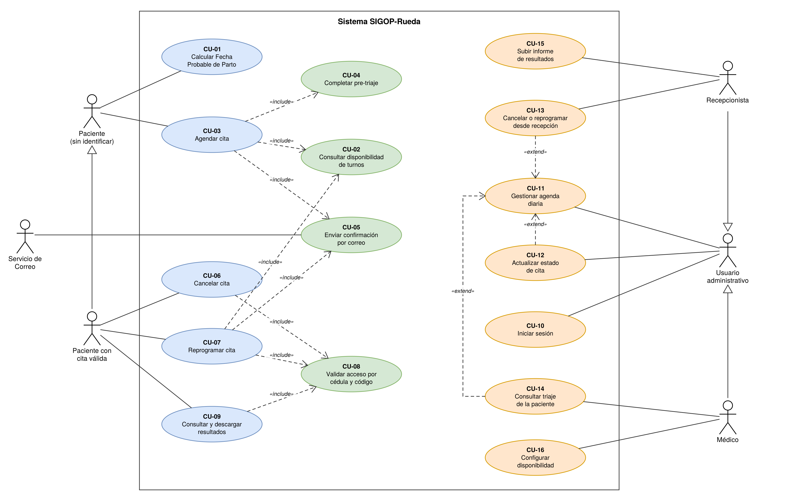
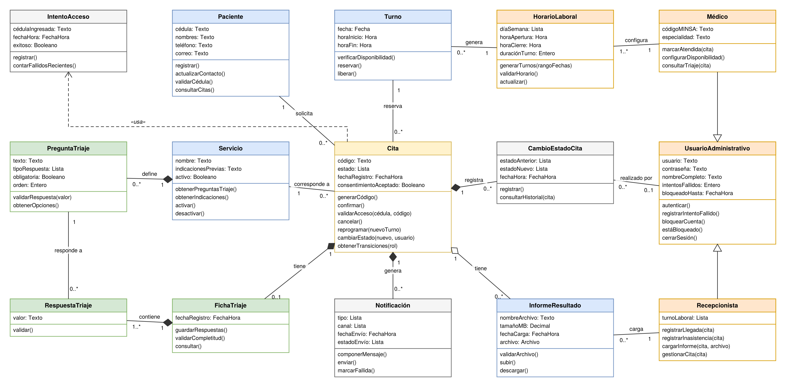
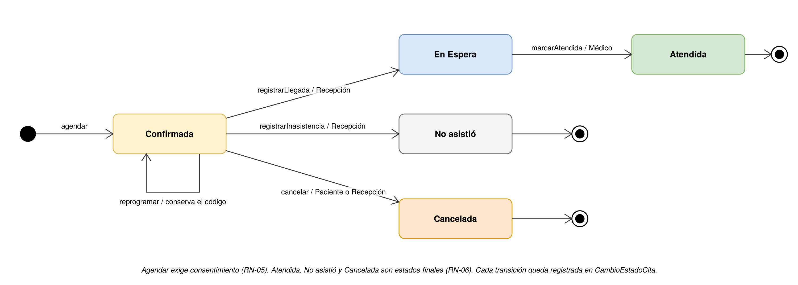
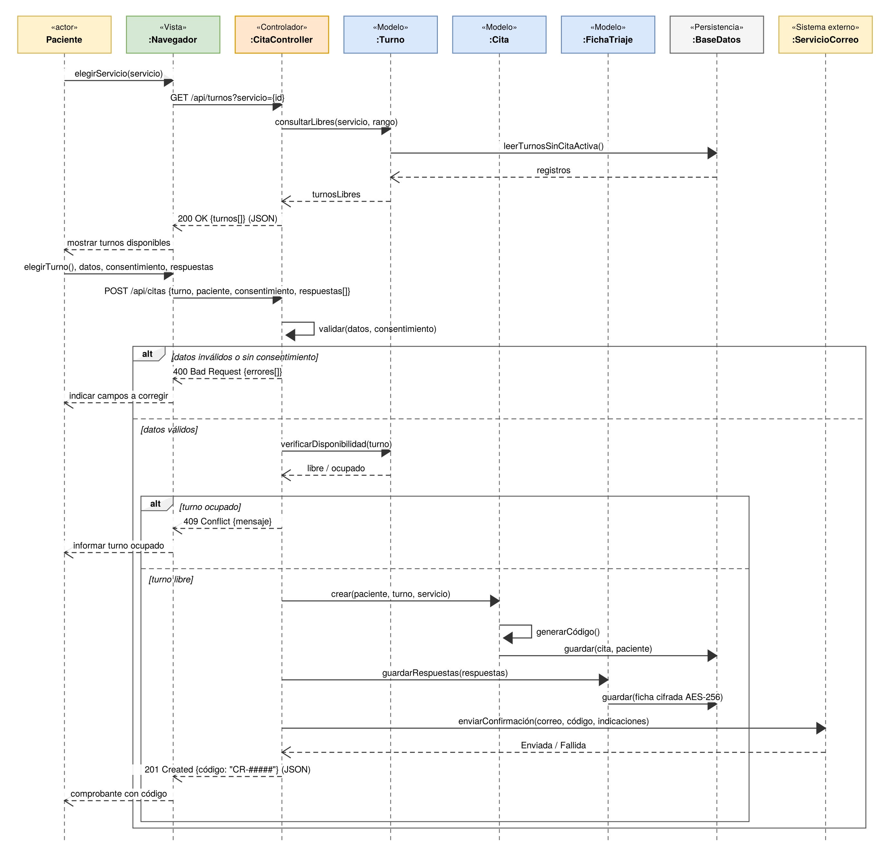
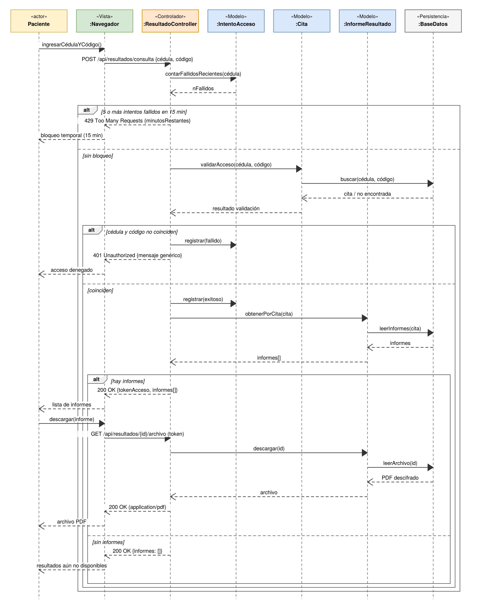
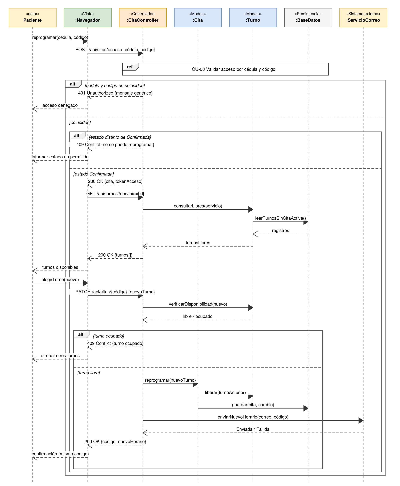
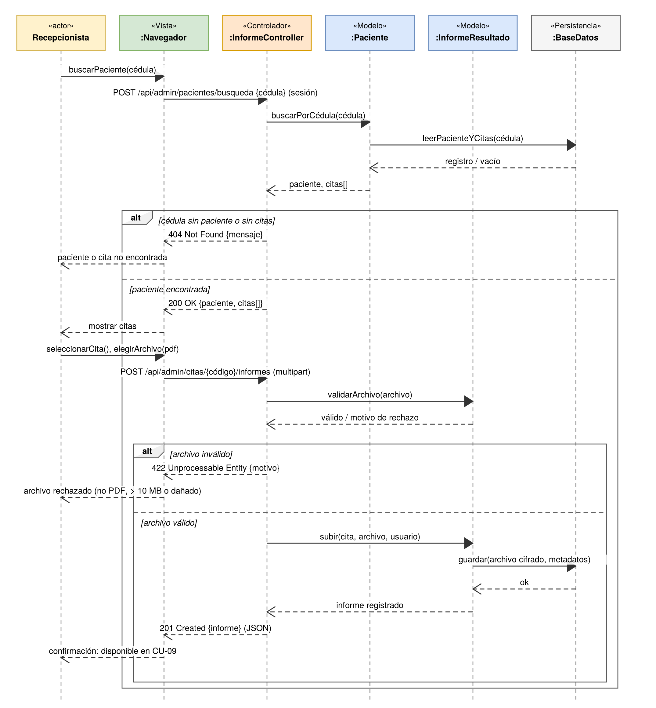
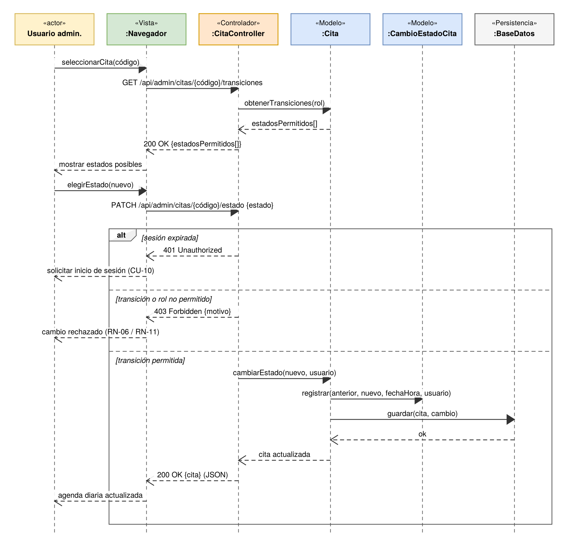

# Fase 2 – 1. Introducción y trazabilidad con la Fase 1

## 1.1 Objetivo del documento

Este documento corresponde a la Fase 2 (Artefactos de Análisis) del sistema SIGOP-Rueda: Sistema de Información Gineco-Obstétrica y Pre-triaje Clínica Rueda. Su objetivo es responder a la pregunta "¿cómo es el problema en detalle?": una vez aprobada la idea de negocio en la Fase 1, aquí se modela la lógica del problema (actores, procesos, datos y reglas de negocio) y se quitan las ambigüedades del backlog.

De acuerdo con la guía del docente, este informe no contiene diseño de interfaz (pantallas), código fuente ni diseño físico de la base de datos relacional: describe qué debe hacer el sistema y qué reglas y datos maneja. Como lo exige la misma guía, los diagramas de secuencia se modelan con el **patrón arquitectónico MVC** e indican las peticiones HTTP y las respuestas JSON que intercambian el navegador y el servidor. Esto describe el comportamiento lógico de una aplicación web por capas, no su implementación. Los artefactos de análisis (casos de uso, narrativas, clases, estados, secuencias y diccionario de datos) se consolidan en el SRS de la sección 7.

## 1.2 Trazabilidad Fase 1 → Fase 2

Cada elemento aprobado en la Fase 1 se descompone en un artefacto de análisis, con los mismos identificadores:

**Tabla 24:** *Trazabilidad entre la Fase 1 y la Fase 2.*

| **Fase 1 (Entrega 1)**                                           | **Fase 2 (esta entrega)**                                                                                       | **Sección** |
|------------------------------------------------------------------|-----------------------------------------------------------------------------------------------------------------|-------------|
| Historias de usuario HU-01 a HU-12 y sus criterios de aceptación | Casos de uso CU-01 a CU-16 y sus 16 narrativas                                                                  | 2 y 3       |
| Requerimientos funcionales RF-01 a RF-17                         | Cinco diagramas de secuencia MVC y RF detallados del SRS                                                        | 5 y 7.4     |
| Entidades del negocio                                            | 15 clases de análisis con atributos, métodos y relaciones; diagrama de estados de la cita; diccionario de datos | 4 y 6       |
| Requerimientos no funcionales RNF-01 a RNF-10 (FURPS+)           | Sección de RNF del SRS                                                                                          | 7.5         |
| Product Backlog PB-01 a PB-14 (MoSCoW)                           | SRS detallado con la prioridad conservada                                                                       | 7           |
| Objetivos SMART (OG y OE-01 a OE-05)                             | Matriz consolidada Objetivo → HU → RF → CU → RN → criterio de aceptación                                        | 7.8         |

## 1.3 Convenciones

- Los identificadores de la Fase 1 se conservan: HU-xx, RF-xx, RNF-xx y PB-xx. Los nuevos identificadores de esta fase son CU-xx (casos de uso) y RN-xx (reglas de negocio).

- La prioridad usa MoSCoW (Must, Should, Could), igual que en la Fase 1.

- Los valores que la Fase 1 no definió y que fue necesario proponer para completar el análisis se marcan como "(propuesto)" y se reúnen en la sección 7.7 para validarlos con la clienta.

- Los tipos de dato son lógicos (Texto, Entero, Decimal, Fecha, Hora, FechaHora, Booleano, Lista, Archivo); no corresponden a ningún lenguaje de programación ni motor de base de datos.

- Figuras y tablas se numeran de forma consecutiva. Cada figura lleva un pie con su número, título, fuente y el nombre de su archivo editable de Draw.io (Anexo C).

# Fase 2 – 2. Diagrama de Casos de Uso

## 2.1 Actores

**Tabla 25:** *Actores del sistema.*

| **Actor**                      | **Tipo**                                                | **Descripción**                                                                                                                                                                                                                    |
|--------------------------------|---------------------------------------------------------|------------------------------------------------------------------------------------------------------------------------------------------------------------------------------------------------------------------------------------|
| Paciente (sin identificar)     | Principal, no autenticado                               | Cualquier persona que usa el portal público. No tiene cuenta ni se identifica: calcula su FPP, consulta turnos y agenda una cita (persona "María").                                                                                |
| Paciente con cita válida       | Principal (especialización de Paciente sin identificar) | Paciente que ya tiene una cita y se identifica con su cédula y el código de la cita (CU-08), sin cuenta ni contraseña. Hereda lo que puede hacer la paciente sin identificar y, además, cancela, reprograma y consulta resultados. |
| Recepcionista                  | Principal, autenticado                                  | Personal de recepción (persona "Ing. Jose Lira"). Gestiona la agenda diaria, registra asistencia y carga los informes de resultados.                                                                                               |
| Médico                         | Principal, autenticado                                  | Especialista única de la clínica (persona "Dra. Rueda"). Consulta el triaje, marca citas atendidas y configura su disponibilidad.                                                                                                  |
| Usuario administrativo         | Principal (generalización abstracta)                    | Agrupa lo que comparten Recepcionista y Médico una vez que inician sesión (CU-10).                                                                                                                                                 |
| Servicio de Correo Electrónico | Secundario (sistema externo)                            | Entrega al correo de la paciente los mensajes que genera SIGOP-Rueda.                                                                                                                                                              |

La Tabla siguiente diferencia explícitamente los tres niveles de acceso del sistema web: usuario no autenticado, usuario identificado por un token de cita y usuario autenticado con sesión.

**Tabla 26:** *Diferenciación entre usuarios no autenticados y autenticados.*

| **Nivel de acceso**      | **Actor**                                      | **Cómo se identifica**                                                                  | **Casos de uso que inicia**                     |
|--------------------------|------------------------------------------------|-----------------------------------------------------------------------------------------|-------------------------------------------------|
| Público (no autenticado) | Paciente (sin identificar)                     | No se identifica.                                                                       | CU-01, CU-03 (que incluye CU-02, CU-04 y CU-05) |
| Identificado por cita    | Paciente con cita válida                       | Cédula + código de cita (CU-08). Recibe un token de acceso temporal; no usa contraseña. | CU-06, CU-07, CU-09                             |
| Autenticado con sesión   | Usuario administrativo (Recepcionista, Médico) | Usuario + contraseña (CU-10). La sesión expira por inactividad.                         | CU-11 a CU-16                                   |

## 2.2 Catálogo de casos de uso

Cada historia de usuario de la Fase 1 queda reflejada en al menos un caso de uso. Los casos de uso del panel administrativo (CU-11 a CU-16) tienen como precondición la sesión iniciada (CU-10).

**Tabla 27:** *Catálogo de casos de uso.*

| **CU** | **Nombre**                                  | **Actor(es)**                  | **HU**       | **RF**       | **Relaciones**                     |
|--------|---------------------------------------------|--------------------------------|--------------|--------------|------------------------------------|
| CU-01  | Calcular Fecha Probable de Parto            | Paciente (sin identificar)     | HU-01        | RF-01, RF-02 | —                                  |
| CU-02  | Consultar disponibilidad de turnos          | Paciente (sin identificar)     | HU-02        | RF-03        | Incluido por CU-03 y CU-07         |
| CU-03  | Agendar cita                                | Paciente (sin identificar)     | HU-03        | RF-04, RF-05 | «include» CU-02, CU-04, CU-05      |
| CU-04  | Completar pre-triaje                        | Paciente (sin identificar)     | HU-04        | RF-06        | Incluido por CU-03                 |
| CU-05  | Enviar confirmación por correo              | Servicio de Correo Electrónico | HU-05        | RF-07        | Incluido por CU-03 y CU-07         |
| CU-06  | Cancelar cita                               | Paciente con cita válida       | HU-12        | RF-14        | «include» CU-08                    |
| CU-07  | Reprogramar cita                            | Paciente con cita válida       | HU-12        | RF-15        | «include» CU-02, CU-05, CU-08      |
| CU-08  | Validar acceso por cédula y código          | — (caso incluido)              | HU-06, HU-12 | RF-08        | Incluido por CU-06, CU-07 y CU-09  |
| CU-09  | Consultar y descargar resultados            | Paciente con cita válida       | HU-06        | RF-08        | «include» CU-08                    |
| CU-10  | Iniciar sesión                              | Usuario administrativo         | HU-07        | RF-09        | —                                  |
| CU-11  | Gestionar agenda diaria                     | Usuario administrativo         | HU-08        | RF-10        | Extendido por CU-12, CU-13 y CU-14 |
| CU-12  | Actualizar estado de cita                   | Usuario administrativo         | HU-08        | RF-17        | «extend» CU-11                     |
| CU-13  | Cancelar o reprogramar cita desde recepción | Recepcionista                  | HU-08        | RF-16        | «extend» CU-11                     |
| CU-14  | Consultar triaje de la paciente             | Médico                         | HU-09        | RF-11        | «extend» CU-11                     |
| CU-15  | Subir informe de resultados                 | Recepcionista                  | HU-10        | RF-12        | —                                  |
| CU-16  | Configurar disponibilidad                   | Médico                         | HU-11        | RF-13        | —                                  |

Nota: al reprogramar desde recepción (CU-13) se reutiliza la consulta de disponibilidad de CU-02 para elegir el nuevo turno.

## 2.3 Diagrama de casos de uso

**Figura 1:** *Diagrama de casos de uso de SIGOP-Rueda. Fuente: elaboración propia (Draw.io). Archivo editable: CU_SIGOP-Rueda.drawio*

# Fase 2 – 3. Especificación narrativa de los casos de uso

Se especifican los 16 casos de uso del sistema (cobertura del 100 %). Cada narrativa incluye precondiciones, flujo principal paso a paso, flujos alternos (caminos válidos distintos), flujos de excepción (errores o condiciones que impiden el objetivo) y postcondiciones. Los pasos describen la lógica del proceso, sin hacer referencia a pantallas ni a tecnología.

## 3.1 CU-01 – Calcular Fecha Probable de Parto

<table>
<colgroup>
<col style="width: 22%" />
<col style="width: 77%" />
</colgroup>
<tbody>
<tr class="odd">
<td><strong>ID</strong></td>
<td>CU-01</td>
</tr>
<tr class="even">
<td><strong>Nombre</strong></td>
<td>Calcular Fecha Probable de Parto</td>
</tr>
<tr class="odd">
<td><strong>Actores</strong></td>
<td>Paciente (sin identificar)</td>
</tr>
<tr class="even">
<td><strong>Descripción</strong></td>
<td>Permite a la paciente conocer su Fecha Probable de Parto (FPP), su semana de gestación y los estudios sugeridos para su trimestre, sin necesidad de agendar una cita.</td>
</tr>
<tr class="odd">
<td><strong>Prioridad / trazabilidad</strong></td>
<td>Must · HU-01 · RF-01, RF-02 · PB-01</td>
</tr>
<tr class="even">
<td><strong>Precondiciones</strong></td>
<td>Ninguna: es una función pública y no requiere registro ni cédula.</td>
</tr>
<tr class="odd">
<td><strong>Flujo principal</strong></td>
<td>
1. La paciente indica que desea calcular su FPP.

2. El sistema solicita la fecha de la última menstruación (FUM).

3. La paciente ingresa la FUM.

4. El sistema valida que la FUM sea una fecha válida, no futura y no anterior a 294 días respecto a hoy (propuesto).

5. El sistema calcula la FPP con la Regla de Naegele: FUM + 7 días − 3 meses + 1 año (RN-13).

6. El sistema calcula las semanas y días de gestación a la fecha actual y determina el trimestre.

7. El sistema muestra la FPP, las semanas y días de gestación, el trimestre y los estudios sugeridos para ese trimestre.

8. El sistema ofrece a la paciente agendar una cita (CU-03).
</td>
</tr>
<tr class="even">
<td><strong>Flujos alternos</strong></td>
<td>
A1. En el paso 7 la paciente corrige la FUM: el flujo vuelve al paso 3 y recalcula.

A2. En el paso 8 la paciente decide agendar: continúa en CU-03.

A3. La paciente termina la consulta sin agendar: el caso de uso finaliza.
</td>
</tr>
<tr class="odd">
<td><strong>Flujos de excepción</strong></td>
<td>
E1. La FUM está vacía, tiene un formato inválido o es una fecha futura: el sistema no calcula, indica el error y solicita una nueva fecha (paso 3).

E2. La FUM supera el límite de 294 días: el sistema informa que la fecha excede la duración de un embarazo y sugiere verificarla o consultar en la clínica.
</td>
</tr>
<tr class="even">
<td><strong>Postcondiciones</strong></td>
<td>La paciente conoce su FPP, semana de gestación y estudios sugeridos. El cálculo no se asocia a ningún dato personal ni se guarda.</td>
</tr>
</tbody>
</table>

## 3.2 CU-02 – Consultar disponibilidad de turnos

<table>
<colgroup>
<col style="width: 22%" />
<col style="width: 77%" />
</colgroup>
<tbody>
<tr class="odd">
<td><strong>ID</strong></td>
<td>CU-02</td>
</tr>
<tr class="even">
<td><strong>Nombre</strong></td>
<td>Consultar disponibilidad de turnos</td>
</tr>
<tr class="odd">
<td><strong>Actores</strong></td>
<td>Paciente (sin identificar); reutilizado por CU-03, CU-07 y CU-13</td>
</tr>
<tr class="even">
<td><strong>Descripción</strong></td>
<td>Obtiene los turnos libres de un servicio dentro de un rango de fechas, según el horario laboral configurado por la médica.</td>
</tr>
<tr class="odd">
<td><strong>Prioridad / trazabilidad</strong></td>
<td>Must · HU-02 · RF-03 · PB-02</td>
</tr>
<tr class="even">
<td><strong>Precondiciones</strong></td>
<td>
El médico tiene configurado al menos un horario laboral (CU-16).

El servicio está activo.
</td>
</tr>
<tr class="odd">
<td><strong>Flujo principal</strong></td>
<td>
1. El actor (o el caso de uso que lo incluye) indica el servicio y el rango de fechas a consultar.

2. El sistema valida que el servicio esté activo.

3. El sistema genera los turnos del rango a partir de los horarios laborales y la duración de turno (RN-10).

4. El sistema descarta los turnos en fechas u horas pasadas y los que tienen una cita activa (RN-01).

5. El sistema presenta los turnos libres ordenados por fecha y hora.
</td>
</tr>
<tr class="even">
<td><strong>Flujos alternos</strong></td>
<td>
A1. El actor cambia el rango de fechas: el flujo vuelve al paso 3.

A2. El actor cambia de servicio: el flujo vuelve al paso 2.
</td>
</tr>
<tr class="odd">
<td><strong>Flujos de excepción</strong></td>
<td>
E1. No hay turnos libres en el rango: el sistema lo informa y sugiere otro rango.

E2. El servicio está inactivo: el sistema no muestra turnos e informa que no se ofrece.

E3. El rango solo contiene días no laborales: no se generan turnos y se informa.
</td>
</tr>
<tr class="even">
<td><strong>Postcondiciones</strong></td>
<td>El actor conoce los turnos libres. No se modifica ningún dato.</td>
</tr>
</tbody>
</table>

## 3.3 CU-03 – Agendar cita

<table>
<colgroup>
<col style="width: 22%" />
<col style="width: 77%" />
</colgroup>
<tbody>
<tr class="odd">
<td><strong>ID</strong></td>
<td>CU-03</td>
</tr>
<tr class="even">
<td><strong>Nombre</strong></td>
<td>Agendar cita</td>
</tr>
<tr class="odd">
<td><strong>Actores</strong></td>
<td>Paciente (sin identificar) (principal); Servicio de Correo Electrónico (secundario, vía CU-05)</td>
</tr>
<tr class="even">
<td><strong>Descripción</strong></td>
<td>Permite a la paciente reservar un turno, completar su pre-triaje y recibir un código único de cita con las indicaciones previas, sin llamar por teléfono.</td>
</tr>
<tr class="odd">
<td><strong>Prioridad / trazabilidad</strong></td>
<td>Must · HU-03, HU-04, HU-05 · RF-04, RF-05, RF-06, RF-07 · PB-03</td>
</tr>
<tr class="even">
<td><strong>Precondiciones</strong></td>
<td>
El médico tiene configurada su disponibilidad (CU-16) y existen turnos libres.

La paciente cuenta con un correo electrónico.
</td>
</tr>
<tr class="odd">
<td><strong>Flujo principal</strong></td>
<td>
1. La paciente selecciona el servicio que necesita (Papanicolaou, Ecografía Pélvica, Control Prenatal u otro).

2. El sistema muestra los turnos disponibles del servicio (incluye CU-02).

3. La paciente elige un turno.

4. El sistema solicita cédula, nombres, teléfono y correo, y presenta la política de privacidad con la aceptación del consentimiento informado.

5. La paciente ingresa sus datos y acepta el consentimiento.

6. El sistema presenta las preguntas de pre-triaje del servicio elegido (incluye CU-04).

7. La paciente responde el cuestionario.

8. El sistema valida los datos obligatorios y sus formatos, el consentimiento y que el turno siga libre.

9. El sistema registra a la paciente (identificada por su cédula), crea la cita en estado Confirmada, genera el código único CR-##### y guarda la ficha de triaje.

10. El sistema envía por correo el comprobante con el código y las indicaciones previas del servicio (incluye CU-05).

11. El sistema muestra a la paciente el comprobante con su código de cita.
</td>
</tr>
<tr class="even">
<td><strong>Flujos alternos</strong></td>
<td>
A1. Antes de confirmar, la paciente decide cambiar de turno: el flujo vuelve al paso 2.

A2. La paciente ya existe en el sistema (misma cédula): se reutilizan sus datos y se actualizan su teléfono y correo.

A3. La paciente abandona el proceso antes del paso 9: no se crea la cita ni se guarda ningún dato.
</td>
</tr>
<tr class="odd">
<td><strong>Flujos de excepción</strong></td>
<td>
E1. Hay campos obligatorios vacíos o con formato inválido: el sistema no envía el formulario e indica cuáles corregir.

E2. La paciente no acepta el consentimiento informado: el sistema no guarda ningún dato ni crea la cita.

E3. El turno fue ocupado por otra paciente entre la selección y la confirmación: el sistema informa y vuelve al paso 2 conservando los datos ingresados.

E4. Falla el envío del correo: la cita queda registrada, el comprobante se muestra igualmente y la notificación queda marcada como Fallida para que la recepción comunique el código por otro medio.
</td>
</tr>
<tr class="even">
<td><strong>Postcondiciones</strong></td>
<td>Existe una cita Confirmada con código único; el turno queda ocupado; la ficha de triaje queda guardada y el consentimiento registrado; se envió (o se registró como fallido) el correo de confirmación.</td>
</tr>
</tbody>
</table>

## 3.4 CU-04 – Completar pre-triaje

<table>
<colgroup>
<col style="width: 22%" />
<col style="width: 77%" />
</colgroup>
<tbody>
<tr class="odd">
<td><strong>ID</strong></td>
<td>CU-04</td>
</tr>
<tr class="even">
<td><strong>Nombre</strong></td>
<td>Completar pre-triaje</td>
</tr>
<tr class="odd">
<td><strong>Actores</strong></td>
<td>Paciente (sin identificar) (incluido por CU-03)</td>
</tr>
<tr class="even">
<td><strong>Descripción</strong></td>
<td>Presenta y recoge el cuestionario clínico propio del servicio elegido.</td>
</tr>
<tr class="odd">
<td><strong>Prioridad / trazabilidad</strong></td>
<td>Must · HU-04 · RF-06 · PB-04</td>
</tr>
<tr class="even">
<td><strong>Precondiciones</strong></td>
<td>
Se está ejecutando CU-03 con un servicio elegido.

La paciente aceptó el consentimiento informado.
</td>
</tr>
<tr class="odd">
<td><strong>Flujo principal</strong></td>
<td>
1. El sistema obtiene las preguntas del servicio en su orden (RN-08).

2. El sistema presenta cada pregunta según su tipo de respuesta (texto, sí/no, número, fecha o selección).

3. La paciente responde.

4. El sistema valida que las preguntas obligatorias tengan respuesta y que cada valor corresponda a su tipo.

5. El sistema conserva las respuestas para guardarlas como ficha de triaje cuando se confirme la cita (CU-03, paso 9).
</td>
</tr>
<tr class="even">
<td><strong>Flujos alternos</strong></td>
<td>
A1. La paciente corrige una respuesta antes de confirmar: el sistema vuelve a validar (paso 4).

A2. El servicio no tiene preguntas configuradas: el caso termina sin ficha y CU-03 continúa.
</td>
</tr>
<tr class="odd">
<td><strong>Flujos de excepción</strong></td>
<td>
E1. Falta una respuesta obligatoria o un valor no corresponde a su tipo: el sistema indica cuál corregir y no avanza.

E2. La paciente abandona el agendamiento: no se guarda ninguna respuesta (CU-03, A3).
</td>
</tr>
<tr class="even">
<td><strong>Postcondiciones</strong></td>
<td>Las respuestas validadas quedan listas para guardarse cifradas y asociadas a la cita (RNF-10, RN-14).</td>
</tr>
</tbody>
</table>

## 3.5 CU-05 – Enviar confirmación por correo

<table>
<colgroup>
<col style="width: 22%" />
<col style="width: 77%" />
</colgroup>
<tbody>
<tr class="odd">
<td><strong>ID</strong></td>
<td>CU-05</td>
</tr>
<tr class="even">
<td><strong>Nombre</strong></td>
<td>Enviar confirmación por correo</td>
</tr>
<tr class="odd">
<td><strong>Actores</strong></td>
<td>Servicio de Correo Electrónico (secundario); incluido por CU-03 y CU-07</td>
</tr>
<tr class="even">
<td><strong>Descripción</strong></td>
<td>Compone y envía a la paciente el comprobante de la cita con su código, horario e indicaciones previas, y registra el resultado del envío.</td>
</tr>
<tr class="odd">
<td><strong>Prioridad / trazabilidad</strong></td>
<td>Must · HU-05 · RF-07 · PB-05 (PB-13 opcional)</td>
</tr>
<tr class="even">
<td><strong>Precondiciones</strong></td>
<td>
Existe una cita Confirmada con código único.

La paciente registró un correo electrónico.
</td>
</tr>
<tr class="odd">
<td><strong>Flujo principal</strong></td>
<td>
1. El sistema recibe la cita confirmada o reprogramada.

2. El sistema determina el tipo de notificación (Confirmación o Reprogramación).

3. El sistema compone el mensaje con código, servicio, fecha, hora e indicaciones previas del servicio.

4. El sistema solicita el envío al Servicio de Correo Electrónico.

5. El Servicio de Correo responde si aceptó el mensaje.

6. El sistema registra la notificación con su fecha de envío y estado Enviada.
</td>
</tr>
<tr class="even">
<td><strong>Flujos alternos</strong></td>
<td>A1. Si se implementa PB-13, el sistema envía además el mensaje por WhatsApp y registra una notificación por cada canal.</td>
</tr>
<tr class="odd">
<td><strong>Flujos de excepción</strong></td>
<td>
E1. El servicio de correo rechaza el mensaje o no responde: la notificación queda Fallida; la cita no se anula y el código se muestra en pantalla (CU-03, E4).

E2. El correo registrado no es válido: no se envía y se registra como Fallida para que recepción contacte a la paciente.
</td>
</tr>
<tr class="even">
<td><strong>Postcondiciones</strong></td>
<td>Existe un registro de Notificación con su estado; la paciente recibió el comprobante o la recepción sabe que debe comunicarlo por otro medio.</td>
</tr>
</tbody>
</table>

## 3.6 CU-06 – Cancelar cita

<table>
<colgroup>
<col style="width: 22%" />
<col style="width: 77%" />
</colgroup>
<tbody>
<tr class="odd">
<td><strong>ID</strong></td>
<td>CU-06</td>
</tr>
<tr class="even">
<td><strong>Nombre</strong></td>
<td>Cancelar cita</td>
</tr>
<tr class="odd">
<td><strong>Actores</strong></td>
<td>Paciente con cita válida</td>
</tr>
<tr class="even">
<td><strong>Descripción</strong></td>
<td>Permite a la paciente cancelar su cita y liberar el turno para otras pacientes.</td>
</tr>
<tr class="odd">
<td><strong>Prioridad / trazabilidad</strong></td>
<td>Must · HU-12 · RF-14 · PB-14</td>
</tr>
<tr class="even">
<td><strong>Precondiciones</strong></td>
<td>
La cita existe y está en estado Confirmada.

La paciente conoce su cédula y el código de su cita.
</td>
</tr>
<tr class="odd">
<td><strong>Flujo principal</strong></td>
<td>
1. La paciente indica que desea cancelar su cita.

2. El sistema solicita la cédula y el código y valida el acceso (incluye CU-08).

3. El sistema muestra el servicio, la fecha y la hora de la cita y pide confirmar la cancelación.

4. La paciente confirma.

5. El sistema cambia la cita a Cancelada y registra el cambio de estado (RN-06).

6. El sistema libera el turno (RN-07).

7. El sistema confirma la cancelación a la paciente.
</td>
</tr>
<tr class="even">
<td><strong>Flujos alternos</strong></td>
<td>
A1. En el paso 4 la paciente prefiere reprogramar: continúa en CU-07.

A2. La paciente desiste: la cita no cambia.
</td>
</tr>
<tr class="odd">
<td><strong>Flujos de excepción</strong></td>
<td>
E1. La cédula y el código no coinciden o el acceso está bloqueado: se aplica CU-08 (mensaje genérico y bloqueo tras 5 intentos).

E2. La cita no está Confirmada: el sistema informa que no puede cancelarse.
</td>
</tr>
<tr class="even">
<td><strong>Postcondiciones</strong></td>
<td>La cita queda Cancelada (estado final); el turno queda disponible; el cambio queda registrado en CambioEstadoCita.</td>
</tr>
</tbody>
</table>

## 3.7 CU-07 – Reprogramar cita

<table>
<colgroup>
<col style="width: 22%" />
<col style="width: 77%" />
</colgroup>
<tbody>
<tr class="odd">
<td><strong>ID</strong></td>
<td>CU-07</td>
</tr>
<tr class="even">
<td><strong>Nombre</strong></td>
<td>Reprogramar cita</td>
</tr>
<tr class="odd">
<td><strong>Actores</strong></td>
<td>Paciente con cita válida (principal); Servicio de Correo Electrónico (secundario, vía CU-05)</td>
</tr>
<tr class="even">
<td><strong>Descripción</strong></td>
<td>Permite a la paciente cambiar su cita a otro turno disponible, conservando su código y liberando el turno anterior.</td>
</tr>
<tr class="odd">
<td><strong>Prioridad / trazabilidad</strong></td>
<td>Must · HU-12 · RF-15 · PB-14</td>
</tr>
<tr class="even">
<td><strong>Precondiciones</strong></td>
<td>
La cita existe y está en estado Confirmada.

La paciente conoce su cédula y el código de su cita.
</td>
</tr>
<tr class="odd">
<td><strong>Flujo principal</strong></td>
<td>
1. La paciente indica que desea reprogramar su cita.

2. El sistema solicita la cédula y el código de cita y verifica que correspondan a una misma cita (incluye CU-08).

3. El sistema verifica que la cita esté en estado Confirmada y muestra su servicio, fecha y hora actuales.

4. El sistema muestra los turnos disponibles del servicio (incluye CU-02).

5. La paciente elige el nuevo turno.

6. El sistema verifica que el nuevo turno siga libre.

7. El sistema asigna el nuevo turno a la cita conservando su código, libera el turno anterior y registra el cambio.

8. El sistema envía por correo el nuevo horario (incluye CU-05).

9. El sistema muestra la confirmación con el nuevo horario y el mismo código de cita.
</td>
</tr>
<tr class="even">
<td><strong>Flujos alternos</strong></td>
<td>
A1. En el paso 5 la paciente decide cancelar en lugar de reprogramar: continúa en CU-06.

A2. La paciente desiste antes del paso 7: la cita se mantiene sin cambios.
</td>
</tr>
<tr class="odd">
<td><strong>Flujos de excepción</strong></td>
<td>
E1. La cédula y el código no coinciden: el sistema deniega el acceso con un mensaje genérico, sin indicar cuál dato falló, y cuenta el intento fallido; al llegar a 5 bloquea temporalmente el acceso (RN-15).

E2. La cita no está en estado Confirmada (Cancelada, En Espera, Atendida o No asistió): el sistema informa que no puede reprogramarse.

E3. No hay turnos disponibles: el sistema informa y sugiere contactar a la clínica.

E4. El turno elegido fue ocupado por otra persona: el sistema informa y vuelve al paso 4.
</td>
</tr>
<tr class="even">
<td><strong>Postcondiciones</strong></td>
<td>La cita sigue Confirmada, con el mismo código, en el nuevo turno; el turno anterior queda libre; el cambio queda registrado y la paciente recibió el nuevo horario por correo.</td>
</tr>
</tbody>
</table>

## 3.8 CU-08 – Validar acceso por cédula y código

<table>
<colgroup>
<col style="width: 22%" />
<col style="width: 77%" />
</colgroup>
<tbody>
<tr class="odd">
<td><strong>ID</strong></td>
<td>CU-08</td>
</tr>
<tr class="even">
<td><strong>Nombre</strong></td>
<td>Validar acceso por cédula y código</td>
</tr>
<tr class="odd">
<td><strong>Actores</strong></td>
<td>— (caso incluido por CU-06, CU-07 y CU-09)</td>
</tr>
<tr class="even">
<td><strong>Descripción</strong></td>
<td>Comprueba que la cédula y el código de cita correspondan a la misma cita y protege el acceso público contra intentos repetidos (fuerza bruta).</td>
</tr>
<tr class="odd">
<td><strong>Prioridad / trazabilidad</strong></td>
<td>Must · HU-06, HU-12 · RF-08 · PB-06</td>
</tr>
<tr class="even">
<td><strong>Precondiciones</strong></td>
<td>El caso de uso base solicitó la cédula y el código a la paciente.</td>
</tr>
<tr class="odd">
<td><strong>Flujo principal</strong></td>
<td>
1. El sistema recibe la cédula y el código de cita.

2. El sistema valida el formato de ambos datos (cédula ###-######-####A; código CR-#####).

3. El sistema cuenta los intentos fallidos recientes realizados con esa cédula (IntentoAcceso).

4. Si hay menos de 5 intentos fallidos en los últimos 15 minutos, el sistema busca una cita en la que ambos datos coincidan (RN-04).

5. El sistema registra el intento como exitoso.

6. El sistema entrega la cita al caso de uso base y habilita un acceso temporal (token) para continuar.
</td>
</tr>
<tr class="even">
<td><strong>Flujos alternos</strong></td>
<td>— (no tiene)</td>
</tr>
<tr class="odd">
<td><strong>Flujos de excepción</strong></td>
<td>
E1. Algún dato tiene formato inválido: el sistema lo rechaza sin buscar la cita e indica el formato esperado.

E2. No hay coincidencia: el sistema registra un intento fallido y responde con un mensaje genérico, sin indicar cuál dato falló.

E3. Hay 5 o más intentos fallidos en 15 minutos con esa cédula: el sistema bloquea temporalmente el acceso e informa el tiempo de espera (RN-15; tiempo propuesto).
</td>
</tr>
<tr class="even">
<td><strong>Postcondiciones</strong></td>
<td>El caso base conoce la cita validada, o el acceso queda denegado y el intento registrado.</td>
</tr>
</tbody>
</table>

## 3.9 CU-09 – Consultar y descargar resultados

<table>
<colgroup>
<col style="width: 22%" />
<col style="width: 77%" />
</colgroup>
<tbody>
<tr class="odd">
<td><strong>ID</strong></td>
<td>CU-09</td>
</tr>
<tr class="even">
<td><strong>Nombre</strong></td>
<td>Consultar y descargar resultados</td>
</tr>
<tr class="odd">
<td><strong>Actores</strong></td>
<td>Paciente con cita válida</td>
</tr>
<tr class="even">
<td><strong>Descripción</strong></td>
<td>Permite a la paciente consultar y descargar sus informes de resultados en PDF sin necesidad de recogerlos en persona.</td>
</tr>
<tr class="odd">
<td><strong>Prioridad / trazabilidad</strong></td>
<td>Must · HU-06 · RF-08 · PB-06</td>
</tr>
<tr class="even">
<td><strong>Precondiciones</strong></td>
<td>
Existe al menos un informe cargado para la cita (CU-15).

La paciente conoce su cédula y el código de su cita.
</td>
</tr>
<tr class="odd">
<td><strong>Flujo principal</strong></td>
<td>
1. La paciente indica que desea consultar sus resultados.

2. El sistema solicita la cédula y el código de cita y verifica que correspondan a una misma cita (incluye CU-08).

3. El sistema muestra la lista de informes vinculados a esa cita (nombre y fecha de carga).

4. La paciente selecciona un informe.

5. El sistema entrega el archivo PDF para su descarga.
</td>
</tr>
<tr class="even">
<td><strong>Flujos alternos</strong></td>
<td>
A1. La paciente descarga más de un informe: se repiten los pasos 4 y 5.

A2. La paciente finaliza sin descargar: el caso de uso termina.
</td>
</tr>
<tr class="odd">
<td><strong>Flujos de excepción</strong></td>
<td>
E1. La cédula y el código no coinciden: el sistema deniega el acceso con un mensaje genérico, sin indicar cuál dato falló (CU-08).

E2. Se superan los 5 intentos fallidos consecutivos: el sistema bloquea temporalmente el acceso (15 minutos, propuesto) e informa el tiempo de espera.

E3. La cita no tiene informes: el sistema informa que los resultados aún no están disponibles.

E4. El archivo no puede entregarse: el sistema informa el problema y sugiere contactar a la clínica.
</td>
</tr>
<tr class="even">
<td><strong>Postcondiciones</strong></td>
<td>La paciente obtuvo su informe en PDF. Los datos del informe permanecen protegidos (RNF-04 y RNF-10).</td>
</tr>
</tbody>
</table>

## 3.10 CU-10 – Iniciar sesión

<table>
<colgroup>
<col style="width: 22%" />
<col style="width: 77%" />
</colgroup>
<tbody>
<tr class="odd">
<td><strong>ID</strong></td>
<td>CU-10</td>
</tr>
<tr class="even">
<td><strong>Nombre</strong></td>
<td>Iniciar sesión</td>
</tr>
<tr class="odd">
<td><strong>Actores</strong></td>
<td>Usuario administrativo (Recepcionista o Médico)</td>
</tr>
<tr class="even">
<td><strong>Descripción</strong></td>
<td>Autentica al personal de la clínica y abre una sesión con su rol.</td>
</tr>
<tr class="odd">
<td><strong>Prioridad / trazabilidad</strong></td>
<td>Must · HU-07 · RF-09 · PB-07</td>
</tr>
<tr class="even">
<td><strong>Precondiciones</strong></td>
<td>El usuario tiene una cuenta creada en el sistema.</td>
</tr>
<tr class="odd">
<td><strong>Flujo principal</strong></td>
<td>
1. El usuario indica que desea ingresar al panel administrativo.

2. El sistema solicita usuario y contraseña.

3. El usuario ingresa sus credenciales.

4. El sistema verifica que la cuenta no esté bloqueada.

5. El sistema compara la contraseña con la almacenada cifrada (RNF-03).

6. El sistema reinicia el contador de intentos fallidos.

7. El sistema abre la sesión con el rol del usuario (Médico o Recepcionista) y muestra la agenda del día (CU-11).
</td>
</tr>
<tr class="even">
<td><strong>Flujos alternos</strong></td>
<td>
A1. El usuario cierra sesión: la sesión termina y se requiere un nuevo ingreso.

A2. La sesión expira por inactividad (30 minutos, propuesto): el sistema solicita ingresar de nuevo.
</td>
</tr>
<tr class="odd">
<td><strong>Flujos de excepción</strong></td>
<td>
E1. Credenciales inválidas: mensaje genérico; el sistema suma un intento fallido.

E2. Al 5.º intento fallido consecutivo la cuenta se bloquea 15 minutos (RN-12; tiempo propuesto).

E3. La cuenta está bloqueada: el sistema informa el tiempo restante sin validar la contraseña.
</td>
</tr>
<tr class="even">
<td><strong>Postcondiciones</strong></td>
<td>Existe una sesión abierta con el rol del usuario, o el intento fallido quedó registrado.</td>
</tr>
</tbody>
</table>

## 3.11 CU-11 – Gestionar agenda diaria

<table>
<colgroup>
<col style="width: 22%" />
<col style="width: 77%" />
</colgroup>
<tbody>
<tr class="odd">
<td><strong>ID</strong></td>
<td>CU-11</td>
</tr>
<tr class="even">
<td><strong>Nombre</strong></td>
<td>Gestionar agenda diaria</td>
</tr>
<tr class="odd">
<td><strong>Actores</strong></td>
<td>Usuario administrativo (Recepcionista o Médico)</td>
</tr>
<tr class="even">
<td><strong>Descripción</strong></td>
<td>Muestra las citas de una fecha con su estado y es el punto de partida para actualizar estados, cancelar o reprogramar y consultar el triaje.</td>
</tr>
<tr class="odd">
<td><strong>Prioridad / trazabilidad</strong></td>
<td>Must · HU-08 · RF-10 · PB-08</td>
</tr>
<tr class="even">
<td><strong>Precondiciones</strong></td>
<td>Sesión iniciada (CU-10).</td>
</tr>
<tr class="odd">
<td><strong>Flujo principal</strong></td>
<td>
1. El usuario abre la agenda.

2. El sistema obtiene las citas de la fecha (por defecto, hoy) ordenadas por hora.

3. El sistema muestra hora, paciente, servicio, código y estado de cada cita.

4. El usuario selecciona una cita.

5. El sistema ofrece las acciones disponibles según el rol y el estado: actualizar estado (CU-12), cancelar o reprogramar (CU-13, solo recepción) y consultar triaje (CU-14, solo médico).
</td>
</tr>
<tr class="even">
<td><strong>Flujos alternos</strong></td>
<td>
A1. El usuario elige otra fecha: el flujo vuelve al paso 2.

A2. El usuario filtra por estado: se muestran solo las citas de ese estado.
</td>
</tr>
<tr class="odd">
<td><strong>Flujos de excepción</strong></td>
<td>
E1. No hay citas en la fecha: el sistema lo informa.

E2. La sesión expiró: el sistema solicita iniciar sesión nuevamente (CU-10).
</td>
</tr>
<tr class="even">
<td><strong>Postcondiciones</strong></td>
<td>El usuario conoce la agenda. Este caso no modifica datos; los cambios ocurren en los casos que lo extienden.</td>
</tr>
</tbody>
</table>

## 3.12 CU-12 – Actualizar estado de cita

<table>
<colgroup>
<col style="width: 22%" />
<col style="width: 77%" />
</colgroup>
<tbody>
<tr class="odd">
<td><strong>ID</strong></td>
<td>CU-12</td>
</tr>
<tr class="even">
<td><strong>Nombre</strong></td>
<td>Actualizar estado de cita</td>
</tr>
<tr class="odd">
<td><strong>Actores</strong></td>
<td>Usuario administrativo (Recepcionista o Médico)</td>
</tr>
<tr class="even">
<td><strong>Descripción</strong></td>
<td>Permite registrar la situación de cada cita de la agenda diaria: llegada, atención o inasistencia. Extiende a CU-11.</td>
</tr>
<tr class="odd">
<td><strong>Prioridad / trazabilidad</strong></td>
<td>Must · HU-08 · RF-17 · PB-08</td>
</tr>
<tr class="even">
<td><strong>Precondiciones</strong></td>
<td>
Sesión iniciada (CU-10).

La cita aparece en la agenda diaria (CU-11).
</td>
</tr>
<tr class="odd">
<td><strong>Flujo principal</strong></td>
<td>
1. El usuario selecciona una cita de la agenda diaria.

2. El sistema muestra los estados a los que puede pasar según el estado actual y el rol del usuario (RN-06 y RN-11).

3. El usuario selecciona el nuevo estado.

4. El sistema valida que la transición y el rol estén permitidos.

5. El sistema actualiza el estado y registra el cambio con fecha, hora y usuario.

6. El sistema refleja el nuevo estado en la agenda diaria.
</td>
</tr>
<tr class="even">
<td><strong>Flujos alternos</strong></td>
<td>
A1. Llegada: la recepcionista cambia la cita de Confirmada a En Espera.

A2. Atención: el médico cambia la cita de En Espera a Atendida.

A3. Inasistencia: la recepcionista cambia la cita de Confirmada a No asistió cuando la paciente no se presentó.

A4. A pedido de la paciente, la recepcionista cancela o reprograma la cita: continúa en CU-13.
</td>
</tr>
<tr class="odd">
<td><strong>Flujos de excepción</strong></td>
<td>
E1. La transición no está permitida (por ejemplo, de Cancelada a En Espera): el sistema la rechaza e informa el motivo.

E2. El rol no está autorizado para ese estado (por ejemplo, la recepcionista intenta marcar Atendida): el sistema deniega el cambio.

E3. La sesión expiró: el sistema solicita iniciar sesión nuevamente (CU-10).
</td>
</tr>
<tr class="even">
<td><strong>Postcondiciones</strong></td>
<td>La cita queda con su nuevo estado y el cambio queda registrado con fecha, hora y usuario.</td>
</tr>
</tbody>
</table>

## 3.13 CU-13 – Cancelar o reprogramar cita desde recepción

<table>
<colgroup>
<col style="width: 22%" />
<col style="width: 77%" />
</colgroup>
<tbody>
<tr class="odd">
<td><strong>ID</strong></td>
<td>CU-13</td>
</tr>
<tr class="even">
<td><strong>Nombre</strong></td>
<td>Cancelar o reprogramar cita desde recepción</td>
</tr>
<tr class="odd">
<td><strong>Actores</strong></td>
<td>Recepcionista</td>
</tr>
<tr class="even">
<td><strong>Descripción</strong></td>
<td>Permite a recepción cancelar o reprogramar una cita a pedido de la paciente (por teléfono o en persona), sin pedir cédula y código, porque el usuario ya está autenticado. Extiende a CU-11.</td>
</tr>
<tr class="odd">
<td><strong>Prioridad / trazabilidad</strong></td>
<td>Must · HU-08 · RF-16 · PB-14</td>
</tr>
<tr class="even">
<td><strong>Precondiciones</strong></td>
<td>
Sesión iniciada con rol Recepcionista.

La cita está en estado Confirmada.
</td>
</tr>
<tr class="odd">
<td><strong>Flujo principal</strong></td>
<td>
1. La recepcionista selecciona la cita en la agenda (CU-11).

2. La recepcionista elige cancelar o reprogramar.

3. Si cancela, el sistema pide confirmación, cambia el estado a Cancelada y libera el turno (RN-06, RN-07).

4. Si reprograma, el sistema muestra los turnos libres del servicio (CU-02); la recepcionista elige uno; el sistema verifica que siga libre, lo asigna conservando el código y libera el anterior.

5. El sistema registra el cambio con fecha, hora y usuario.

6. Si se reprogramó, el sistema envía el nuevo horario por correo (CU-05).

7. La agenda y el calendario público se actualizan de inmediato.
</td>
</tr>
<tr class="even">
<td><strong>Flujos alternos</strong></td>
<td>A1. La recepcionista desiste antes de confirmar: la cita no cambia.</td>
</tr>
<tr class="odd">
<td><strong>Flujos de excepción</strong></td>
<td>
E1. La cita no está Confirmada: la acción no se ofrece o se rechaza.

E2. El turno elegido fue ocupado: el sistema informa y vuelve a mostrar la disponibilidad.

E3. No hay turnos libres: el sistema lo informa.

E4. La sesión expiró: CU-10.
</td>
</tr>
<tr class="even">
<td><strong>Postcondiciones</strong></td>
<td>La cita queda Cancelada, o Confirmada en el nuevo turno con el mismo código; el turno anterior queda libre y el cambio registrado.</td>
</tr>
</tbody>
</table>

## 3.14 CU-14 – Consultar triaje de la paciente

<table>
<colgroup>
<col style="width: 22%" />
<col style="width: 77%" />
</colgroup>
<tbody>
<tr class="odd">
<td><strong>ID</strong></td>
<td>CU-14</td>
</tr>
<tr class="even">
<td><strong>Nombre</strong></td>
<td>Consultar triaje de la paciente</td>
</tr>
<tr class="odd">
<td><strong>Actores</strong></td>
<td>Médico</td>
</tr>
<tr class="even">
<td><strong>Descripción</strong></td>
<td>Permite a la médica ver las respuestas del pre-triaje de una cita antes de atender a la paciente. Extiende a CU-11.</td>
</tr>
<tr class="odd">
<td><strong>Prioridad / trazabilidad</strong></td>
<td>Should · HU-09 · RF-11 · PB-09</td>
</tr>
<tr class="even">
<td><strong>Precondiciones</strong></td>
<td>
Sesión iniciada con rol Médico.

La cita aparece en la agenda diaria.
</td>
</tr>
<tr class="odd">
<td><strong>Flujo principal</strong></td>
<td>
1. La médica selecciona una cita en la agenda.

2. La médica elige ver el triaje.

3. El sistema recupera la ficha de triaje de la cita y descifra las respuestas para el usuario autenticado.

4. El sistema muestra cada pregunta con su respuesta, en el orden del cuestionario, junto con el servicio y la fecha de registro.

5. La médica cierra la ficha y vuelve a la agenda.
</td>
</tr>
<tr class="even">
<td><strong>Flujos alternos</strong></td>
<td>A1. Desde la ficha, la médica marca la cita como Atendida: continúa en CU-12.</td>
</tr>
<tr class="odd">
<td><strong>Flujos de excepción</strong></td>
<td>
E1. La cita no tiene ficha de triaje: el sistema lo informa.

E2. Un usuario sin rol de Médico intenta ver la ficha: acceso denegado (RN-16).

E3. La sesión expiró: CU-10.
</td>
</tr>
<tr class="even">
<td><strong>Postcondiciones</strong></td>
<td>La médica conoce los antecedentes de la paciente. La ficha no se modifica.</td>
</tr>
</tbody>
</table>

## 3.15 CU-15 – Subir informe de resultados

<table>
<colgroup>
<col style="width: 22%" />
<col style="width: 77%" />
</colgroup>
<tbody>
<tr class="odd">
<td><strong>ID</strong></td>
<td>CU-15</td>
</tr>
<tr class="even">
<td><strong>Nombre</strong></td>
<td>Subir informe de resultados</td>
</tr>
<tr class="odd">
<td><strong>Actores</strong></td>
<td>Recepcionista</td>
</tr>
<tr class="even">
<td><strong>Descripción</strong></td>
<td>Permite a la recepcionista cargar el informe en PDF de una paciente para que quede disponible en la consulta de resultados.</td>
</tr>
<tr class="odd">
<td><strong>Prioridad / trazabilidad</strong></td>
<td>Must · HU-10 · RF-12 · PB-10</td>
</tr>
<tr class="even">
<td><strong>Precondiciones</strong></td>
<td>
Sesión iniciada (CU-10).

La paciente y la cita correspondiente existen en el sistema.
</td>
</tr>
<tr class="odd">
<td><strong>Flujo principal</strong></td>
<td>
1. La recepcionista busca a la paciente por su cédula.

2. El sistema muestra los datos de la paciente y sus citas.

3. La recepcionista selecciona la cita y el archivo PDF del informe.

4. El sistema valida que el archivo sea PDF y no supere 10 MB.

5. El sistema guarda el informe cifrado, vinculado a la paciente (por su cédula) y a la cita, y registra la fecha de carga y la recepcionista que lo cargó.

6. El sistema confirma la carga: el informe queda disponible en la consulta de resultados (CU-09).
</td>
</tr>
<tr class="even">
<td><strong>Flujos alternos</strong></td>
<td>
A1. La recepcionista carga varios informes para la misma cita: se repiten los pasos 3 a 6.

A2. La recepcionista cancela antes de confirmar: no se guarda el archivo.
</td>
</tr>
<tr class="odd">
<td><strong>Flujos de excepción</strong></td>
<td>
E1. El archivo no es PDF: el sistema lo rechaza e indica que solo se aceptan archivos .pdf.

E2. El archivo supera 10 MB: el sistema lo rechaza e indica el límite.

E3. La cédula no existe o la paciente no tiene citas: el sistema informa que no se encontró la paciente o la cita.

E4. El archivo está dañado o no se puede leer: el sistema lo rechaza.
</td>
</tr>
<tr class="even">
<td><strong>Postcondiciones</strong></td>
<td>El informe queda guardado y disponible para la paciente; su contenido permanece protegido (RNF-10).</td>
</tr>
</tbody>
</table>

## 3.16 CU-16 – Configurar disponibilidad

<table>
<colgroup>
<col style="width: 22%" />
<col style="width: 77%" />
</colgroup>
<tbody>
<tr class="odd">
<td><strong>ID</strong></td>
<td>CU-16</td>
</tr>
<tr class="even">
<td><strong>Nombre</strong></td>
<td>Configurar disponibilidad</td>
</tr>
<tr class="odd">
<td><strong>Actores</strong></td>
<td>Médico</td>
</tr>
<tr class="even">
<td><strong>Descripción</strong></td>
<td>Permite a la médica definir sus días laborales, el horario de atención y la duración estándar de los turnos.</td>
</tr>
<tr class="odd">
<td><strong>Prioridad / trazabilidad</strong></td>
<td>Should · HU-11 · RF-13 · PB-11</td>
</tr>
<tr class="even">
<td><strong>Precondiciones</strong></td>
<td>Sesión iniciada con rol Médico.</td>
</tr>
<tr class="odd">
<td><strong>Flujo principal</strong></td>
<td>
1. La médica abre la configuración de disponibilidad.

2. El sistema muestra los horarios vigentes por día de la semana.

3. La médica agrega, modifica o elimina días, horas de apertura y cierre y la duración de turno.

4. El sistema valida que la hora de cierre sea mayor que la de apertura y que la duración esté entre 30 y 45 minutos (RN-10).

5. El sistema verifica si alguna cita activa quedaría fuera del nuevo horario.

6. El sistema guarda los horarios y regenera los turnos futuros.

7. El calendario público refleja los cambios de inmediato.
</td>
</tr>
<tr class="even">
<td><strong>Flujos alternos</strong></td>
<td>A1. La médica cancela sin guardar: no hay cambios.</td>
</tr>
<tr class="odd">
<td><strong>Flujos de excepción</strong></td>
<td>
E1. Valores inválidos: el sistema los rechaza e indica el motivo.

E2. Hay citas activas que quedarían fuera del horario: el sistema advierte, conserva esas citas y muestra la lista para que recepción las gestione (CU-13).

E3. La sesión expiró: CU-10.
</td>
</tr>
<tr class="even">
<td><strong>Postcondiciones</strong></td>
<td>El horario laboral queda actualizado y los turnos futuros regenerados; las citas existentes no se alteran.</td>
</tr>
</tbody>
</table>

# Fase 2 – 4. Diagrama de Clases de Análisis

El modelo conceptual muestra las entidades del dominio con sus **atributos clave**, sus **métodos lógicos** (responsabilidades del negocio, no código) y sus relaciones con multiplicidades. Los atributos usan tipos lógicos (Texto, Entero, Decimal, Fecha, Hora, FechaHora, Booleano, Lista, Archivo). Por ser un modelo de análisis no incluye visibilidad, tipos de un lenguaje de programación ni tipos de un motor de base de datos.

## 4.1 Clases de análisis: atributos y métodos lógicos

**Tabla 28:** *Clases de análisis con atributos y métodos lógicos.*

<table>
<colgroup>
<col style="width: 15%" />
<col style="width: 21%" />
<col style="width: 21%" />
<col style="width: 40%" />
</colgroup>
<thead>
<tr class="header">
<th><strong>Clase</strong></th>
<th><strong>Descripción</strong></th>
<th><strong>Atributos (tipo lógico)</strong></th>
<th><strong>Métodos lógicos (responsabilidad)</strong></th>
</tr>
</thead>
<tbody>
<tr class="odd">
<td>Paciente</td>
<td>Persona que solicita citas; se identifica por su cédula.</td>
<td>
cédula: Texto

nombres: Texto

teléfono: Texto

correo: Texto
</td>
<td>
registrar(): crea a la paciente al confirmar su primera cita.

actualizarContacto(): actualiza teléfono y correo (CU-03, A2).

validarCédula(): verifica el formato ###-######-####A.

consultarCitas(): lista sus citas (CU-15).
</td>
</tr>
<tr class="even">
<td>Cita</td>
<td>Reserva de un turno para un servicio. Su código CR-##### es la llave de negocio y su estado indica su situación.</td>
<td>
código: Texto

estado: Lista

fechaRegistro: FechaHora

consentimientoAceptado: Booleano
</td>
<td>
generarCódigo(): crea un código único que no se reutiliza (RN-02).

confirmar(): crea la cita en estado Confirmada (RN-05).

validarAcceso(cédula, código): comprueba RN-04.

cancelar(): pasa a Cancelada y libera el turno.

reprogramar(nuevoTurno): cambia el turno y conserva el código.

cambiarEstado(nuevo, usuario): aplica RN-06 y RN-11.

obtenerTransiciones(rol): estados permitidos.
</td>
</tr>
<tr class="odd">
<td>Turno</td>
<td>Bloque de tiempo atendible por la médica, generado a partir del horario laboral.</td>
<td>
fecha: Fecha

horaInicio: Hora

horaFin: Hora
</td>
<td>
verificarDisponibilidad(): indica si tiene una cita activa (RN-01).

reservar(): lo marca ocupado.

liberar(): lo vuelve disponible (RN-07).
</td>
</tr>
<tr class="even">
<td>HorarioLaboral</td>
<td>Día de la semana con su hora de apertura, cierre y duración de turno; lo configura la médica.</td>
<td>
díaSemana: Lista

horaApertura: Hora

horaCierre: Hora

duraciónTurno: Entero
</td>
<td>
generarTurnos(rangoFechas): crea los turnos del rango (RN-10).

validarHorario(): cierre &gt; apertura; 30–45 min.

actualizar(): guarda cambios sin alterar citas.
</td>
</tr>
<tr class="odd">
<td>Servicio</td>
<td>Estudio o consulta que ofrece la clínica, con sus indicaciones previas.</td>
<td>
nombre: Texto

indicacionesPrevias: Texto

activo: Booleano
</td>
<td>
obtenerPreguntasTriaje(): cuestionario ordenado (RN-08).

obtenerIndicaciones(): texto para el correo.

activar() / desactivar(): controla si se puede agendar.
</td>
</tr>
<tr class="even">
<td>PreguntaTriaje</td>
<td>Pregunta del cuestionario de pre-triaje propio de cada servicio.</td>
<td>
texto: Texto

tipoRespuesta: Lista

obligatoria: Booleano

orden: Entero
</td>
<td>
validarRespuesta(valor): verifica obligatoriedad y tipo.

obtenerOpciones(): opciones si el tipo es selección.
</td>
</tr>
<tr class="odd">
<td>FichaTriaje</td>
<td>Conjunto de respuestas de pre-triaje que la paciente entrega al agendar una cita.</td>
<td>fechaRegistro: FechaHora</td>
<td>
guardarRespuestas(): almacena las respuestas cifradas (RN-14).

validarCompletitud(): todas las obligatorias respondidas.

consultar(): devuelve la ficha al médico (RN-16).
</td>
</tr>
<tr class="even">
<td>RespuestaTriaje</td>
<td>Respuesta de la paciente a una pregunta del cuestionario.</td>
<td>valor: Texto</td>
<td>validar(): delega en PreguntaTriaje.validarRespuesta().</td>
</tr>
<tr class="odd">
<td>InformeResultado</td>
<td>Archivo PDF de resultados vinculado a una cita (y, por ella, a la paciente).</td>
<td>
nombreArchivo: Texto

tamañoMB: Decimal

fechaCarga: FechaHora

archivo: Archivo
</td>
<td>
validarArchivo(): PDF legible de hasta 10 MB (RN-09).

subir(): guarda el archivo cifrado.

descargar(): entrega el PDF a la paciente validada.
</td>
</tr>
<tr class="even">
<td>Notificación</td>
<td>Mensaje enviado a la paciente y su resultado de envío.</td>
<td>
tipo: Lista

canal: Lista

fechaEnvío: FechaHora

estadoEnvío: Lista
</td>
<td>
componerMensaje(): arma código, horario e indicaciones.

enviar(): solicita el envío al servicio de correo.

marcarFallida(): registra el fallo (CU-05, E1).
</td>
</tr>
<tr class="odd">
<td>CambioEstadoCita</td>
<td>Registro histórico de cada cambio de estado de una cita.</td>
<td>
estadoAnterior: Lista

estadoNuevo: Lista

fechaHora: FechaHora
</td>
<td>
registrar(): guarda el cambio con su usuario.

consultarHistorial(cita): lista los cambios de una cita.
</td>
</tr>
<tr class="even">
<td>IntentoAcceso</td>
<td>Registro de cada intento de acceso público con cédula y código; sustenta el bloqueo anti-fuerza-bruta.</td>
<td>
cédulaIngresada: Texto

fechaHora: FechaHora

exitoso: Booleano
</td>
<td>
registrar(): guarda el intento.

contarFallidosRecientes(): fallidos en los últimos 15 min (RN-15).
</td>
</tr>
<tr class="odd">
<td>UsuarioAdministrativo</td>
<td>Persona con acceso al panel (clase abstracta); generaliza a Médico y Recepcionista.</td>
<td>
usuario: Texto

contraseña: Texto

nombreCompleto: Texto

intentosFallidos: Entero

bloqueadoHasta: FechaHora
</td>
<td>
autenticar(): valida la contraseña cifrada (RNF-03).

registrarIntentoFallido(): suma un fallo.

bloquearCuenta(): bloqueo temporal al 5.º fallo (RN-12).

estáBloqueado(): indica si sigue bloqueada.

cerrarSesión(): termina la sesión.
</td>
</tr>
<tr class="even">
<td>Médico</td>
<td>Usuario administrativo que atiende, marca citas Atendidas y configura la disponibilidad.</td>
<td>
códigoMINSA: Texto

especialidad: Texto
</td>
<td>
marcarAtendida(cita): única transición a Atendida (RN-11).

configurarDisponibilidad(): mantiene HorarioLaboral.

consultarTriaje(cita): ve la ficha (RN-16).
</td>
</tr>
<tr class="odd">
<td>Recepcionista</td>
<td>Usuario administrativo que gestiona la agenda, registra asistencia y carga informes.</td>
<td>turnoLaboral: Lista</td>
<td>
registrarLlegada(cita): Confirmada → En Espera.

registrarInasistencia(cita): Confirmada → No asistió.

cargarInforme(cita, archivo): CU-15.

gestionarCita(cita): cancela o reprograma (CU-13).
</td>
</tr>
</tbody>
</table>

## 4.2 Diagrama de clases de análisis

**Figura 2:** *Diagrama de clases de análisis. Cada clase muestra nombre, atributos con tipo lógico y métodos lógicos; el atributo estado de Cita toma los valores Confirmada, En Espera, Atendida, No asistió y Cancelada. Fuente: elaboración propia (Draw.io). Archivo editable: Clases_SIGOP-Rueda.drawio*

## 4.3 Relaciones entre clases

La tabla formaliza cada relación del diagrama con su tipo UML y su multiplicidad. Se usa **composición** cuando la parte no tiene sentido sin el todo y se elimina con él; **agregación** cuando la parte tiene existencia propia; **asociación** para vínculos entre entidades independientes; **herencia** para la generalización de usuarios; y **dependencia** cuando una clase solo usa a otra en una operación.

**Tabla 29:** *Relaciones UML entre clases de análisis.*

| **\#** | **Clase origen** | **Clase destino**     | **Tipo UML**              | **Multiplicidad (origen : destino)** | **Descripción**                                                                                      |
|--------|------------------|-----------------------|---------------------------|--------------------------------------|------------------------------------------------------------------------------------------------------|
| R-01   | Paciente         | Cita                  | Asociación                | 1 : 0..\*                            | Una paciente solicita cero o más citas; cada cita pertenece a una sola paciente (RN-03).             |
| R-02   | Turno            | Cita                  | Asociación                | 1 : 0..\*                            | Un turno puede tener varias citas en su historial, pero solo una activa a la vez (RN-01).            |
| R-03   | Servicio         | Cita                  | Asociación                | 1 : 0..\*                            | Cada cita corresponde a un solo servicio.                                                            |
| R-04   | HorarioLaboral   | Turno                 | Asociación                | 1 : 0..\*                            | Cada horario laboral genera los turnos de su día (RN-10).                                            |
| R-05   | Médico           | HorarioLaboral        | Asociación                | 1 : 1..\*                            | La médica configura uno o más horarios laborales.                                                    |
| R-06   | Servicio         | PreguntaTriaje        | Composición               | 1 : 0..\*                            | Las preguntas pertenecen a un servicio y no existen sin él; un servicio puede no tener cuestionario. |
| R-07   | Cita             | FichaTriaje           | Composición               | 1 : 0..1                             | La ficha de triaje existe solo como parte de su cita.                                                |
| R-08   | FichaTriaje      | RespuestaTriaje       | Composición               | 1 : 1..\*                            | Una ficha contiene una o más respuestas (RN-08).                                                     |
| R-09   | PreguntaTriaje   | RespuestaTriaje       | Asociación                | 1 : 0..\*                            | Cada respuesta responde a una sola pregunta.                                                         |
| R-10   | Cita             | Notificación          | Composición               | 1 : 0..\*                            | Las notificaciones forman el historial de envíos de la cita.                                         |
| R-11   | Cita             | InformeResultado      | Agregación                | 1 : 0..\*                            | El informe es un documento clínico con valor propio que se vincula a una cita (RN-09).               |
| R-12   | Cita             | CambioEstadoCita      | Composición               | 1 : 0..\*                            | El historial de estados es parte de la cita.                                                         |
| R-13   | CambioEstadoCita | UsuarioAdministrativo | Asociación                | 0..\* : 0..1                         | Un cambio lo realiza un usuario administrativo, o la paciente (en ese caso no hay usuario).          |
| R-14   | Recepcionista    | InformeResultado      | Asociación                | 1 : 0..\*                            | La recepcionista que carga cada informe queda registrada.                                            |
| R-15   | Médico           | UsuarioAdministrativo | Herencia (generalización) | —                                    | Médico es un tipo de usuario administrativo.                                                         |
| R-16   | Recepcionista    | UsuarioAdministrativo | Herencia (generalización) | —                                    | Recepcionista es un tipo de usuario administrativo.                                                  |
| R-17   | Cita             | IntentoAcceso         | Dependencia «usa»         | —                                    | Cita.validarAcceso() consulta y registra intentos de acceso (RN-15).                                 |

## 4.4 Diagrama de estados de la Cita

El ciclo de vida de la clase Cita concentra varias reglas de negocio (RN-05, RN-06, RN-07 y RN-11). El diagrama de estados las resume y es la base del diagrama de secuencia de CU-12 (sección 5.6).

**Figura 3:** *Diagrama de estados de la clase Cita. Fuente: elaboración propia (Draw.io). Archivo editable: Estados_Cita.drawio*

## 4.5 Reglas de negocio

**Tabla 30:** *Reglas de negocio.*

| **ID** | **Regla de negocio**                                                                                                                                                                                                     | **Clases involucradas**                                | **Origen**          |
|--------|--------------------------------------------------------------------------------------------------------------------------------------------------------------------------------------------------------------------------|--------------------------------------------------------|---------------------|
| RN-01  | Un turno no puede tener más de una cita activa (no Cancelada) a la vez; no se permiten dobles reservas.                                                                                                                  | Turno, Cita                                            | RF-03, RF-04        |
| RN-02  | Cada cita tiene un código único con formato CR-##### que no se repite ni se reutiliza.                                                                                                                                   | Cita                                                   | RF-05, RNF-09       |
| RN-03  | Una cita pertenece a una sola paciente, a un solo turno y a un solo servicio.                                                                                                                                            | Cita, Paciente, Turno, Servicio                        | RF-04               |
| RN-04  | Para consultar resultados, cancelar o reprogramar, la cédula y el código deben corresponder a la misma cita.                                                                                                             | Cita, Paciente                                         | RF-08, RF-14, RF-15 |
| RN-05  | No se puede crear una cita ni guardar datos de la paciente sin consentimiento informado aceptado.                                                                                                                        | Cita                                                   | RNF-06              |
| RN-06  | Transiciones de estado permitidas: Confirmada → En Espera → Atendida; Confirmada → No asistió; Confirmada → Cancelada. Atendida, No asistió y Cancelada son estados finales. Reprogramar mantiene la cita en Confirmada. | Cita, CambioEstadoCita                                 | RF-10, RF-17        |
| RN-07  | Al cancelar o reprogramar una cita, el turno anterior queda disponible.                                                                                                                                                  | Cita, Turno                                            | RF-14, RF-15        |
| RN-08  | Cada servicio tiene su propio cuestionario de pre-triaje; la ficha de una cita tiene una respuesta por cada pregunta respondida del servicio elegido.                                                                    | Servicio, PreguntaTriaje, FichaTriaje, RespuestaTriaje | RF-06               |
| RN-09  | Un informe es un archivo PDF de hasta 10 MB y se vincula a una cita (y, por ella, a la cédula de la paciente).                                                                                                           | InformeResultado, Cita                                 | RF-12               |
| RN-10  | Los turnos solo existen dentro de los días y horas laborales configurados, en bloques de 30 a 45 minutos.                                                                                                                | HorarioLaboral, Turno                                  | RF-03, RF-13        |
| RN-11  | Solo el médico puede marcar una cita como Atendida; la recepción registra En Espera, No asistió y Cancelada.                                                                                                             | UsuarioAdministrativo, Cita                            | RF-17               |
| RN-12  | Una cuenta administrativa se bloquea temporalmente tras 5 intentos fallidos consecutivos.                                                                                                                                | UsuarioAdministrativo                                  | RF-09               |
| RN-13  | La FPP se calcula con la Regla de Naegele: FUM + 7 días − 3 meses + 1 año.                                                                                                                                               | — (cálculo)                                            | RF-01               |
| RN-14  | Las respuestas de triaje y los informes son datos sensibles de salud y deben protegerse (Ley 787).                                                                                                                       | FichaTriaje, RespuestaTriaje, InformeResultado         | RNF-06, RNF-10      |
| RN-15  | El acceso público con cédula y código se bloquea temporalmente (15 minutos, propuesto) tras 5 intentos fallidos consecutivos con la misma cédula.                                                                        | IntentoAcceso, Cita                                    | RF-08               |
| RN-16  | Solo el médico puede consultar la ficha de triaje; la recepción ve la agenda pero no las respuestas clínicas (minimización de datos).                                                                                    | FichaTriaje, Médico                                    | RF-11, RNF-06       |

# Fase 2 – 5. Diagramas de Secuencia (patrón MVC)

## 5.1 Arquitectura MVC aplicada a los diagramas

SIGOP-Rueda es una aplicación web, por lo que sus interacciones se modelan con el patrón **Modelo–Vista–Controlador (MVC)**. El flujo de cada caso de uso es: **Navegador (Vista) → petición HTTP → Controlador (backend) → Modelo → Persistencia**, y el controlador devuelve al navegador una **respuesta HTTP** con un código de estado y un cuerpo **JSON** (o el archivo PDF, en la descarga de resultados). La tabla siguiente muestra cómo se mapea cada participante de los diagramas a su capa.

**Tabla 31:** *Mapeo de los participantes a las capas MVC.*

| **Capa MVC**    | **Participante en los diagramas**                                                            | **Responsabilidad**                                                                                    | **Ejemplo**                                            |
|-----------------|----------------------------------------------------------------------------------------------|--------------------------------------------------------------------------------------------------------|--------------------------------------------------------|
| Actor           | Paciente, Recepcionista, Usuario administrativo                                              | Inicia la interacción.                                                                                 | La paciente elige un servicio.                         |
| Vista           | :Navegador                                                                                   | Presenta la información, captura los datos y envía las peticiones HTTP; no contiene reglas de negocio. | Envía POST /api/citas con los datos en JSON.           |
| Controlador     | :CitaController, :ResultadoController, :InformeController                                    | Recibe la petición, valida la sesión o el token, coordina a los modelos y construye la respuesta HTTP. | Responde 201 Created {código} o 409 Conflict.          |
| Modelo          | :Cita, :Turno, :FichaTriaje, :InformeResultado, :IntentoAcceso, :Paciente, :CambioEstadoCita | Aplica las reglas de negocio (RN-xx) mediante los métodos lógicos de la sección 4.1.                   | Cita.generarCódigo(), Turno.verificarDisponibilidad(). |
| Persistencia    | :BaseDatos                                                                                   | Lee y guarda los datos de forma permanente; cifra los datos sensibles.                                 | guardar(ficha cifrada AES-256).                        |
| Sistema externo | :ServicioCorreo                                                                              | Entrega los correos a la paciente.                                                                     | enviarConfirmación(correo, código, indicaciones).      |

**Notación:** flecha continua con punta llena = mensaje síncrono; flecha discontinua con punta abierta = respuesta; el fragmento **alt** representa los flujos alternos y de excepción de las narrativas de la sección 3; el fragmento **ref** remite a otro caso de uso ya modelado. La Tabla siguiente resume las peticiones HTTP del sistema; ningún dato personal (como la cédula) viaja en la dirección URL, sino en el cuerpo cifrado de la petición.

**Tabla 32:** *Peticiones HTTP del sistema.*

| **Método y recurso**                                                         | **Caso de uso**      | **Respuesta exitosa**              | **Respuestas de error**                                     |
|------------------------------------------------------------------------------|----------------------|------------------------------------|-------------------------------------------------------------|
| GET /api/turnos?servicio={id}                                                | CU-02                | 200 OK {turnos\[\]}                | 400 rango inválido; 404 servicio inactivo                   |
| POST /api/citas                                                              | CU-03                | 201 Created {código}               | 400 datos inválidos o sin consentimiento; 409 turno ocupado |
| POST /api/citas/acceso                                                       | CU-08 (CU-06, CU-07) | 200 OK {cita, tokenAcceso}         | 401 no coinciden; 409 estado no permitido; 429 bloqueo      |
| POST /api/citas/{código}/cancelacion                                         | CU-06                | 200 OK {cita}                      | 401 token inválido; 409 estado no permitido                 |
| PATCH /api/citas/{código}                                                    | CU-07                | 200 OK {código, nuevoHorario}      | 401; 409 turno ocupado                                      |
| POST /api/resultados/consulta                                                | CU-08, CU-09         | 200 OK {tokenAcceso, informes\[\]} | 401 no coinciden; 429 bloqueo                               |
| GET /api/resultados/{id}/archivo                                             | CU-09                | 200 OK (application/pdf)           | 401 token inválido; 404 no existe                           |
| POST /api/admin/sesion                                                       | CU-10                | 200 OK {rol} + sesión              | 401 credenciales; 423 cuenta bloqueada                      |
| GET /api/admin/agenda?fecha=                                                 | CU-11                | 200 OK {citas\[\]}                 | 401 sesión expirada                                         |
| GET /api/admin/citas/{código}/transiciones                                   | CU-12                | 200 OK {estadosPermitidos\[\]}     | 401                                                         |
| PATCH /api/admin/citas/{código}/estado                                       | CU-12                | 200 OK {cita}                      | 401; 403 transición o rol no permitido                      |
| POST /api/admin/citas/{código}/cancelacion · PATCH /api/admin/citas/{código} | CU-13                | 200 OK {cita}                      | 401; 409                                                    |
| GET /api/admin/citas/{código}/triaje                                         | CU-14                | 200 OK {ficha}                     | 401; 403 rol no autorizado; 404 sin ficha                   |
| POST /api/admin/pacientes/busqueda                                           | CU-15                | 200 OK {paciente, citas\[\]}       | 401; 404 no encontrada                                      |
| POST /api/admin/citas/{código}/informes                                      | CU-15                | 201 Created {informe}              | 401; 422 archivo inválido                                   |
| PUT /api/admin/disponibilidad                                                | CU-16                | 200 OK {horarios\[\]}              | 400 valores inválidos; 401; 403                             |

## 5.2 Agendar cita (CU-03)

**Figura 4:** *Secuencia MVC de CU-03 Agendar cita. Fuente: elaboración propia (Draw.io). Archivo editable: Secuencia_Agendar_Cita.drawio*

## 5.3 Consultar y descargar resultados (CU-09)

**Figura 5:** *Secuencia MVC de CU-09 Consultar y descargar resultados (incluye la validación de CU-08). Fuente: elaboración propia (Draw.io). Archivo editable: Secuencia_Consultar_Resultados.drawio*

## 5.4 Reprogramar cita (CU-07)

**Figura 6:** *Secuencia MVC de CU-07 Reprogramar cita. Fuente: elaboración propia (Draw.io). Archivo editable: Secuencia_Reprogramar_Cita.drawio*

## 5.5 Subir informe de resultados (CU-15)

**Figura 7:** *Secuencia MVC de CU-15 Subir informe de resultados (flujo administrativo). Fuente: elaboración propia (Draw.io). Archivo editable: Secuencia_Subir_Informe.drawio*

## 5.6 Actualizar estado de cita (CU-12)

**Figura 8:** *Secuencia MVC de CU-12 Actualizar estado de cita (aplica la máquina de estados de la Figura 3). Fuente: elaboración propia (Draw.io). Archivo editable: Secuencia_Actualizar_Estado.drawio*

# Fase 2 – 6. Diccionario de Datos

## 6.1 Atributos por entidad

Detalle de cada campo de las clases de análisis. Los tipos son lógicos y las restricciones remiten a las reglas de negocio (RN) y requerimientos (RF/RNF). Las expresiones regulares de validación se reúnen en la sección 6.2.

**Tabla 33:** *Diccionario de datos.*

| **Nombre**             | **Entidad**           | **Tipo de dato** | **Tamaño / formato**                                   | **Descripción**                                                                  | **Restricciones y validaciones**                                            |
|------------------------|-----------------------|------------------|--------------------------------------------------------|----------------------------------------------------------------------------------|-----------------------------------------------------------------------------|
| cédula                 | Paciente              | Texto            | 16 caracteres; \###-######-####A                       | Número de cédula de identidad; identifica a la paciente.                         | Obligatorio; único por paciente; formato ER-01.                             |
| nombres                | Paciente              | Texto            | 3 a 80 caracteres                                      | Nombres y apellidos de la paciente.                                              | Obligatorio; solo letras, espacios y acentos (ER-02).                       |
| teléfono               | Paciente              | Texto            | 8 dígitos                                              | Teléfono de contacto.                                                            | Obligatorio; solo dígitos (ER-03).                                          |
| correo                 | Paciente              | Texto            | Hasta 100 caracteres; nombre@dominio                   | Correo donde recibe confirmaciones e indicaciones.                               | Obligatorio; formato de correo válido (ER-04).                              |
| código                 | Cita                  | Texto            | 8 caracteres; CR-#####                                 | Código único de la cita; llave de negocio.                                       | Generado por el sistema; único; no se reutiliza ni se edita (RN-02, ER-05). |
| estado                 | Cita                  | Lista cerrada    | Confirmada, En Espera, Atendida, No asistió, Cancelada | Situación actual de la cita.                                                     | Inicia en Confirmada; solo transiciones de RN-06.                           |
| fechaRegistro          | Cita                  | FechaHora        | AAAA-MM-DD HH:MM                                       | Momento en que se creó la cita.                                                  | Automático; no editable.                                                    |
| consentimientoAceptado | Cita                  | Booleano         | Sí / No                                                | Aceptación del consentimiento informado (Ley 787).                               | Debe ser Sí para crear la cita (RN-05).                                     |
| fecha                  | Turno                 | Fecha            | AAAA-MM-DD                                             | Día del turno.                                                                   | Día laboral configurado; no anterior a hoy (ER-09).                         |
| horaInicio             | Turno                 | Hora             | HH:MM (24 h)                                           | Hora de inicio del turno.                                                        | Dentro del horario laboral (ER-10).                                         |
| horaFin                | Turno                 | Hora             | HH:MM (24 h)                                           | Hora de fin del turno.                                                           | Mayor que horaInicio; duración de 30 a 45 min (RN-10).                      |
| díaSemana              | HorarioLaboral        | Lista cerrada    | Lunes a domingo                                        | Día de la semana en que la médica atiende.                                       | Un horario por día.                                                         |
| horaApertura           | HorarioLaboral        | Hora             | HH:MM (24 h)                                           | Inicio de la jornada.                                                            | Menor que horaCierre.                                                       |
| horaCierre             | HorarioLaboral        | Hora             | HH:MM (24 h)                                           | Fin de la jornada.                                                               | Mayor que horaApertura.                                                     |
| duraciónTurno          | HorarioLaboral        | Entero           | Minutos; 30 a 45                                       | Duración estándar de los turnos.                                                 | Entre 30 y 45 (RF-03).                                                      |
| nombre                 | Servicio              | Texto            | 3 a 60 caracteres                                      | Nombre del estudio o consulta.                                                   | Obligatorio; único.                                                         |
| indicacionesPrevias    | Servicio              | Texto            | Hasta 1000 caracteres                                  | Preparación que la paciente debe cumplir antes del estudio; se envía por correo. | Obligatorio en servicios con preparación.                                   |
| activo                 | Servicio              | Booleano         | Sí / No                                                | Indica si el servicio se ofrece actualmente.                                     | Solo los servicios activos se pueden agendar.                               |
| texto                  | PreguntaTriaje        | Texto            | Hasta 200 caracteres                                   | Enunciado de la pregunta.                                                        | Obligatorio.                                                                |
| tipoRespuesta          | PreguntaTriaje        | Lista cerrada    | Texto libre, sí/no, número, fecha, selección           | Forma en que se responde.                                                        | Obligatorio.                                                                |
| obligatoria            | PreguntaTriaje        | Booleano         | Sí / No                                                | Indica si debe responderse.                                                      | —                                                                           |
| orden                  | PreguntaTriaje        | Entero           | 1 o más                                                | Posición dentro del cuestionario del servicio.                                   | Único dentro del servicio.                                                  |
| fechaRegistro          | FichaTriaje           | FechaHora        | AAAA-MM-DD HH:MM                                       | Momento en que se completó el triaje.                                            | Automático; dato sensible (RN-14).                                          |
| valor                  | RespuestaTriaje       | Texto            | Hasta 500 caracteres                                   | Respuesta de la paciente a una pregunta.                                         | Obligatorio si la pregunta lo es; acorde al tipoRespuesta; cifrado (RN-14). |
| nombreArchivo          | InformeResultado      | Texto            | Hasta 100 caracteres; termina en .pdf                  | Nombre del archivo del informe.                                                  | Obligatorio; extensión .pdf (RN-09, ER-08).                                 |
| tamañoMB               | InformeResultado      | Decimal          | Hasta 10                                               | Tamaño del archivo en megabytes.                                                 | No mayor a 10 MB (RF-12).                                                   |
| fechaCarga             | InformeResultado      | FechaHora        | AAAA-MM-DD HH:MM                                       | Momento en que se subió el informe.                                              | Automático.                                                                 |
| archivo                | InformeResultado      | Archivo          | PDF; hasta 10 MB                                       | Contenido del informe de resultados.                                             | Solo PDF; cifrado en reposo (RN-14).                                        |
| tipo                   | Notificación          | Lista cerrada    | Confirmación, Reprogramación                           | Motivo del mensaje enviado.                                                      | Obligatorio.                                                                |
| canal                  | Notificación          | Lista cerrada    | Correo; WhatsApp (opcional)                            | Medio de envío.                                                                  | WhatsApp solo si se implementa PB-13.                                       |
| fechaEnvío             | Notificación          | FechaHora        | AAAA-MM-DD HH:MM                                       | Momento del envío.                                                               | Automático.                                                                 |
| estadoEnvío            | Notificación          | Lista cerrada    | Enviada, Fallida                                       | Resultado del envío.                                                             | Obligatorio.                                                                |
| estadoAnterior         | CambioEstadoCita      | Lista cerrada    | Valores de estado de Cita                              | Estado antes del cambio.                                                         | Obligatorio.                                                                |
| estadoNuevo            | CambioEstadoCita      | Lista cerrada    | Valores de estado de Cita                              | Estado después del cambio.                                                       | Obligatorio; transición válida (RN-06).                                     |
| fechaHora              | CambioEstadoCita      | FechaHora        | AAAA-MM-DD HH:MM                                       | Momento del cambio.                                                              | Automático; no editable.                                                    |
| cédulaIngresada        | IntentoAcceso         | Texto            | 16 caracteres                                          | Cédula usada en el intento de acceso público.                                    | Se registra aunque no exista una paciente con esa cédula.                   |
| fechaHora              | IntentoAcceso         | FechaHora        | AAAA-MM-DD HH:MM:SS                                    | Momento del intento.                                                             | Automático.                                                                 |
| exitoso                | IntentoAcceso         | Booleano         | Sí / No                                                | Indica si cédula y código coincidieron.                                          | 5 fallidos en 15 min activan el bloqueo (RN-15).                            |
| usuario                | UsuarioAdministrativo | Texto            | 4 a 30 caracteres                                      | Nombre de acceso al panel.                                                       | Obligatorio; único (ER-06).                                                 |
| contraseña             | UsuarioAdministrativo | Texto secreto    | 8 a 64 caracteres                                      | Clave de acceso al panel.                                                        | Política ER-07; nunca visible ni almacenada en texto plano (RNF-03).        |
| nombreCompleto         | UsuarioAdministrativo | Texto            | 3 a 80 caracteres                                      | Nombre de la persona usuaria.                                                    | Obligatorio.                                                                |
| intentosFallidos       | UsuarioAdministrativo | Entero           | 0 a 5                                                  | Intentos de acceso fallidos consecutivos.                                        | Se reinicia al ingresar bien; al llegar a 5 bloquea la cuenta (RN-12).      |
| bloqueadoHasta         | UsuarioAdministrativo | FechaHora        | AAAA-MM-DD HH:MM                                       | Fin del bloqueo temporal de la cuenta.                                           | Vacío si la cuenta no está bloqueada.                                       |
| códigoMINSA            | Médico                | Texto            | Hasta 20 caracteres                                    | Código de registro profesional de la médica ante el Ministerio de Salud.         | Obligatorio; único.                                                         |
| especialidad           | Médico                | Texto            | Hasta 60 caracteres                                    | Especialidad médica.                                                             | Valor por defecto: Ginecología y Obstetricia.                               |
| turnoLaboral           | Recepcionista         | Lista cerrada    | Matutino, Vespertino, Completo                         | Jornada en que la recepcionista atiende.                                         | Obligatorio.                                                                |

Nota: Médico y Recepcionista heredan todos los atributos de UsuarioAdministrativo y agregan los propios indicados arriba; el rol de cada usuario queda determinado por su subclase. La relación de un cambio de estado con su usuario es opcional porque la paciente también puede cancelar o reprogramar.

## 6.2 Expresiones regulares de validación

Las reglas de formato del diccionario se formalizan con las siguientes expresiones regulares (ER). Todas se evalúan sobre el valor completo (de inicio ^ a fin \$).

**Tabla 34:** *Expresiones regulares de validación.*

| **ID** | **Campo**                                     | **Expresión regular**                                       | **Ejemplo válido**       | **Observación**                                                                                                           |
|--------|-----------------------------------------------|-------------------------------------------------------------|--------------------------|---------------------------------------------------------------------------------------------------------------------------|
| ER-01  | cédula (Paciente, IntentoAcceso)              | ^\d{3}-\d{6}-\d{4}\[A-Z\]\$                                 | 001-150390-0012K         | Cédula nicaragüense: 3 dígitos del municipio, 6 de la fecha de nacimiento (DDMMAA), 4 consecutivos y una letra mayúscula. |
| ER-02  | nombres, nombreCompleto                       | ^\[A-Za-zÁÉÍÓÚÜÑáéíóúüñ \]{3,80}\$                          | María José López         | Solo letras (con acentos y ñ) y espacios.                                                                                 |
| ER-03  | teléfono                                      | ^\[2578\]\d{7}\$                                            | 88123456                 | 8 dígitos; inicia con 2 (fijo) o 5, 7, 8 (móvil).                                                                         |
| ER-04  | correo                                        | ^\[A-Za-z0-9.\_%+-\]+@\[A-Za-z0-9.-\]+\\\[A-Za-z\]{2,}\$    | maria.lopez@gmail.com    | Además, máximo 100 caracteres.                                                                                            |
| ER-05  | código (Cita)                                 | ^CR-\d{5}\$                                                 | CR-04821                 | 8 caracteres en total (RNF-09).                                                                                           |
| ER-06  | usuario                                       | ^\[a-z0-9.\_\]{4,30}\$                                      | recepcion.lira           | Minúsculas, dígitos, punto y guion bajo.                                                                                  |
| ER-07  | contraseña                                    | ^(?=.\*\[a-z\])(?=.\*\[A-Z\])(?=.\*\d).{8,64}\$             | Clinica2026              | Al menos una minúscula, una mayúscula y un dígito.                                                                        |
| ER-08  | nombreArchivo                                 | ^\[\w\\. \]{1,96}\\\[pP\]\[dD\]\[fF\]\$                     | eco_pelvica_CR-04821.pdf | Debe terminar en .pdf; se valida además el contenido real del archivo.                                                    |
| ER-09  | fecha                                         | ^\d{4}-(0\[1-9\]\|1\[0-2\])-(0\[1-9\]\|\[12\]\d\|3\[01\])\$ | 2026-11-20               | Formato AAAA-MM-DD; la validez del día se comprueba aparte.                                                               |
| ER-10  | horaInicio, horaFin, horaApertura, horaCierre | ^(\[01\]\d\|2\[0-3\]):\[0-5\]\d\$                           | 14:30                    | Formato de 24 horas.                                                                                                      |

# Fase 2 – 7. Especificación de Requerimientos de Software (SRS)

Documento que consolida los artefactos de análisis y detalla cada requerimiento: entrada, procesamiento, salida y excepciones. Su estructura sigue el estándar IEEE 830 adaptado a una aplicación web.

## 7.1 Identificación del documento

**Tabla 35:** *Identificación del SRS.*

| **Campo**                | **Valor**                                                                                                                                          |
|--------------------------|----------------------------------------------------------------------------------------------------------------------------------------------------|
| **Código del documento** | SRS-SIGOP-01                                                                                                                                       |
| **Versión**              | 1.1                                                                                                                                                |
| **Fecha**                | 3 de noviembre de 2026                                                                                                                             |
| **Proyecto**             | SIGOP-Rueda: Sistema de Información Gineco-Obstétrica y Pre-triaje Clínica Rueda                                                                   |
| **Cliente**              | Clínica Rueda — Dra. Rueda                                                                                                                         |
| **Autores**              | Br. Francisco Javier Bárcenas Montoya (2024-1522U), Br. Marien Tatiana Gómez Moreno (2024-1542U), Br. Sergio Sacarías Rueda Hernández (2024-1544U) |
| **Revisor**              | MSc. Walter José Quintero Acevedo (docente)                                                                                                        |
| **Estado**               | Para revisión del docente y validación de la clienta (sección 7.7)                                                                                 |

**Tabla 36:** *Historial de versiones.*

| **Versión** | **Fecha**  | **Autor**          | **Descripción del cambio**                                                                                                                                                                                                                                                                                           |
|-------------|------------|--------------------|----------------------------------------------------------------------------------------------------------------------------------------------------------------------------------------------------------------------------------------------------------------------------------------------------------------------|
| 1.0         | 14/10/2026 | Equipo SIGOP-Rueda | Versión inicial entregada con la Fase 2.                                                                                                                                                                                                                                                                             |
| 1.1         | 03/11/2026 | Equipo SIGOP-Rueda | Ajustes según la evaluación del docente: clases con atributos y métodos, tabla de relaciones, diagrama de estados, secuencias MVC con HTTP/JSON (5 diagramas), 16 narrativas de casos de uso, expresiones regulares, identificación del SRS, criterios de aceptación de los puntos por validar y matriz consolidada. |

## 7.2 Introducción

### 7.2.1 Propósito

Especificar de forma completa y verificable lo que debe hacer SIGOP-Rueda para que la Clínica Rueda, un consultorio uniprofesional de Ginecología y Obstetricia, automatice el agendamiento de citas, el pre-triaje clínico y la entrega segura de resultados. Está dirigido a la clienta, al equipo de desarrollo y al docente.

### 7.2.2 Alcance

El sistema es una plataforma web con un portal público (calculadora obstétrica, agendamiento, cancelación y reprogramación, pre-triaje y consulta de resultados) y un panel administrativo (autenticación, agenda diaria, triaje, carga de informes y disponibilidad). Excluye la gestión de varios médicos o especialidades, la historia clínica electrónica completa, la facturación o cobros en línea y la telemedicina, como se aprobó en la Fase 1.

### 7.2.3 Definiciones, siglas y abreviaturas

**Tabla 37:** *Definiciones, siglas y abreviaturas.*

| **Término**     | **Definición**                                                                                                                  |
|-----------------|---------------------------------------------------------------------------------------------------------------------------------|
| FUM             | Fecha de la última menstruación.                                                                                                |
| FPP             | Fecha Probable de Parto, calculada con la Regla de Naegele (FUM + 7 días − 3 meses + 1 año).                                    |
| Turno           | Bloque de tiempo atendible por la médica.                                                                                       |
| Cita            | Reserva de un turno para un servicio, identificada por un código único CR-#####.                                                |
| Pre-triaje      | Cuestionario clínico que la paciente responde antes de la consulta, según el servicio elegido.                                  |
| Token de acceso | Credencial temporal que el sistema entrega a la paciente después de validar su cédula y código (CU-08).                         |
| HU / CU         | Historia de usuario (Fase 1) / Caso de uso (Fase 2).                                                                            |
| RF / RNF / RN   | Requerimiento funcional / Requerimiento no funcional / Regla de negocio.                                                        |
| MVC             | Modelo–Vista–Controlador: patrón que separa la presentación, la coordinación y las reglas de negocio de una aplicación.         |
| HTTP / JSON     | Protocolo de comunicación entre navegador y servidor / formato de texto para intercambiar datos estructurados.                  |
| API             | Conjunto de peticiones que el servidor expone al navegador (sección 5.1).                                                       |
| FURPS+          | Clasificación de requerimientos: Funcionalidad, Usabilidad, Confiabilidad, Rendimiento, Soporte, más restricciones adicionales. |
| MoSCoW          | Priorización: Must (imprescindible), Should (importante), Could (deseable).                                                     |
| PF / COCOMO     | Puntos de Función / Constructive Cost Model: métodos de estimación de tamaño y esfuerzo (Fase 1, sección 3.2).                  |
| Ley 787         | Ley de Protección de Datos Personales de Nicaragua.                                                                             |
| ARCO            | Derechos de Acceso, Rectificación, Cancelación y Oposición sobre los datos personales.                                          |

### 7.2.4 Referencias

- Informe de la Fase 1: SIGOP-Rueda – Estudio Preliminar y Requerimientos (versión 2.0, corregida).

- Plan de Ejecución del Proyecto de Curso – Ingeniería de Software I (MSc. Walter José Quintero Acevedo).

- Resultados de la Evaluación del Proyecto de Curso, Fases 1 y 2 (octubre de 2026).

- IEEE Std 830-1998, IEEE Recommended Practice for Software Requirements Specifications.

- Ley N.º 787, Ley de Protección de Datos Personales de Nicaragua.

## 7.3 Descripción general

### 7.3.1 Perspectiva del producto

SIGOP-Rueda es un sistema independiente que reemplaza la agenda telefónica y el cuaderno físico de la clínica. No se integra con historia clínica ni con facturación. Se relaciona únicamente con un servicio de correo electrónico para enviar mensajes a las pacientes.

### 7.3.2 Funciones del producto

- Portal público: calculadora obstétrica (CU-01).

- Agendamiento: disponibilidad, reserva con código único, confirmación por correo, cancelación y reprogramación (CU-02 a CU-08).

- Triaje clínico: cuestionario por servicio y consulta del triaje por la médica (CU-04, CU-14).

- Resultados: carga de informes por recepción y consulta segura por la paciente (CU-09, CU-15).

- Administración y seguridad: acceso al panel, agenda diaria con estados, configuración de disponibilidad y cumplimiento de la Ley 787 (CU-10 a CU-13, CU-16).

### 7.3.3 Características de los usuarios

Las pacientes usan el portal desde su teléfono, sin cuenta y con uso habitual de correo y WhatsApp. La recepcionista y la médica tienen alfabetización digital básica y necesitan un panel simple, sin curva de aprendizaje. Las personas, sus frustraciones y su frecuencia de uso están en la Fase 1 (sección 4); los niveles de acceso, en la sección 2.1 de este documento.

### 7.3.4 Restricciones

- El sistema debe ser una aplicación web.

- Debe cumplir la Ley N.º 787 por tratar datos de salud.

- Debe desarrollarse dentro del calendario oficial de la asignatura.

- El modelo es uniprofesional (una única médica) y el presupuesto de la clínica es limitado.

### 7.3.5 Supuestos y dependencias

- La clínica cuenta con conexión a internet estable y una única especialista activa.

- Las pacientes otorgan consentimiento informado explícito antes de registrar sus datos y cuentan con un correo electrónico.

- El servicio de correo electrónico está disponible para entregar los mensajes del sistema.

### 7.3.6 Entorno operativo

Cliente: navegador web actualizado (las 2 últimas versiones de Chrome, Firefox y Safari) en teléfonos desde 360 px de ancho y en computadoras (RNF-07). Servidor: servidor web en la nube accesible por HTTPS (Fase 1, sección 3.1). No se requiere instalar software en los equipos de la clínica ni en los teléfonos de las pacientes.

### 7.3.7 Interfaces externas

- **Interfaz de usuario:** portal público adaptable al teléfono y panel administrativo con agenda; ambos en español. El diseño de pantallas corresponde a la Fase 3.

- **Interfaces de hardware:** ninguna específica; basta un dispositivo con navegador.

- **Interfaces de software:** servicio de correo electrónico (SMTP) para las notificaciones; opcionalmente, servicio de mensajería WhatsApp (PB-13).

- **Interfaces de comunicación:** HTTPS con TLS 1.2 o superior (RNF-04); peticiones y respuestas en JSON, salvo la descarga de informes en PDF (sección 5.1).

## 7.4 Requerimientos funcionales detallados

Para cada requerimiento se indica su caso de uso, prioridad, entrada, procesamiento, salida y excepciones. Los criterios de verificación se conservan de la Fase 1 (sección 7.1).

**Tabla 38:** *Requerimientos funcionales detallados.*

<table>
<colgroup>
<col style="width: 18%" />
<col style="width: 16%" />
<col style="width: 27%" />
<col style="width: 17%" />
<col style="width: 20%" />
</colgroup>
<thead>
<tr class="header">
<th><strong>Requerimiento</strong></th>
<th><strong>Entrada</strong></th>
<th><strong>Procesamiento</strong></th>
<th><strong>Salida</strong></th>
<th><strong>Excepciones</strong></th>
</tr>
</thead>
<tbody>
<tr class="odd">
<td>
RF-01 Calcular la FPP

CU-01 · Must
</td>
<td>FUM (fecha).</td>
<td>Valida la fecha y aplica FUM + 7 días − 3 meses + 1 año (RN-13).</td>
<td>FPP (fecha).</td>
<td>FUM vacía, inválida, futura o anterior a 294 días (propuesto): se rechaza con mensaje y no se calcula.</td>
</tr>
<tr class="even">
<td>
RF-02 Mostrar semanas, días y estudios sugeridos

CU-01 · Must
</td>
<td>FUM; fecha actual.</td>
<td>Días transcurridos = hoy − FUM; semanas = días ÷ 7 (parte entera) y días restantes; trimestre: 1.º hasta la semana 13+6, 2.º de 14+0 a 27+6, 3.º desde 28+0; recupera los estudios configurados para ese trimestre.</td>
<td>Semanas y días de gestación, trimestre y lista de estudios.</td>
<td>Gestación superior a 42 semanas: mensaje de verificación. Trimestre sin estudios configurados: se sugiere consultar a la clínica.</td>
</tr>
<tr class="odd">
<td>
RF-03 Mostrar horarios disponibles

CU-02 · Must
</td>
<td>Servicio; rango de fechas.</td>
<td>Genera turnos según el horario laboral y la duración (30 a 45 min); excluye fechas pasadas y turnos con cita activa (RN-01).</td>
<td>Lista de turnos libres (fecha y hora).</td>
<td>Sin turnos libres: mensaje informativo. Día no laboral: no genera turnos.</td>
</tr>
<tr class="even">
<td>
RF-04 Reservar un turno

CU-03 · Must
</td>
<td>Turno; servicio; cédula, nombres, teléfono, correo; consentimiento.</td>
<td>Valida obligatorios, formatos (ER-01 a ER-04) y consentimiento; verifica que el turno esté libre; crea o actualiza a la paciente por su cédula; crea la cita en estado Confirmada.</td>
<td>Cita registrada (continúa en RF-05).</td>
<td>Campo vacío o inválido: no se envía. Sin consentimiento: no se guarda nada. Turno ocupado: se rechaza y se ofrecen otros.</td>
</tr>
<tr class="odd">
<td>
RF-05 Generar el código único de cita

CU-03 · Must
</td>
<td>Cita confirmada.</td>
<td>Genera CR- seguido de 5 dígitos; verifica que no exista y reintenta si hay colisión (RN-02).</td>
<td>Código de cita CR-#####.</td>
<td>No se logra un código único tras varios reintentos: no se confirma la cita y se informa el error.</td>
</tr>
<tr class="even">
<td>
RF-06 Presentar el pre-triaje dinámico

CU-04 · Must
</td>
<td>Servicio; respuestas de la paciente.</td>
<td>Obtiene en orden las preguntas del servicio; valida obligatorias y tipo de respuesta; guarda la ficha cifrada asociada a la cita.</td>
<td>Ficha de triaje guardada.</td>
<td>Pregunta obligatoria sin respuesta: no avanza. Servicio sin preguntas configuradas: se agenda sin ficha.</td>
</tr>
<tr class="odd">
<td>
RF-07 Enviar comprobante e indicaciones por correo

CU-05 · Must
</td>
<td>Cita; correo; indicaciones del servicio.</td>
<td>Compone el mensaje con código, fecha, hora, servicio e indicaciones previas; solicita el envío y registra la notificación.</td>
<td>Correo en la bandeja en menos de 2 minutos; notificación registrada.</td>
<td>Correo inválido o falla de envío: notificación Fallida; el código se muestra igualmente en el comprobante.</td>
</tr>
<tr class="even">
<td>
RF-08 Consultar y descargar resultados

CU-08, CU-09 · Must
</td>
<td>Cédula; código de cita; informe elegido.</td>
<td>Cuenta los intentos fallidos recientes (RN-15); busca la cita donde ambos datos coinciden (RN-04); registra el intento; lista sus informes; entrega el PDF elegido con un token temporal.</td>
<td>Lista de informes y archivo PDF.</td>
<td>No coinciden: acceso denegado sin indicar cuál dato falló. 5 fallidos: bloqueo de 15 min (propuesto). Sin informes: mensaje informativo.</td>
</tr>
<tr class="odd">
<td>
RF-09 Autenticar usuarios administrativos

CU-10 · Must
</td>
<td>Usuario; contraseña.</td>
<td>Verifica la credencial; cuenta fallos consecutivos; al 5.º bloquea la cuenta 15 min (propuesto); reinicia el contador al ingresar bien (RN-12).</td>
<td>Sesión con el rol del usuario.</td>
<td>Credenciales inválidas: mensaje genérico. Cuenta bloqueada: se informa el tiempo restante.</td>
</tr>
<tr class="even">
<td>
RF-10 Mostrar la agenda diaria con estados

CU-11 · Must
</td>
<td>Fecha (por defecto, hoy).</td>
<td>Obtiene las citas de la fecha ordenadas por hora, con su estado (Confirmada, En Espera, Atendida, No asistió, Cancelada).</td>
<td>Lista de citas: hora, paciente, servicio, código y estado.</td>
<td>Sin citas: mensaje informativo. Sin sesión: acceso denegado.</td>
</tr>
<tr class="odd">
<td>
RF-11 Ver el triaje de una paciente

CU-14 · Should
</td>
<td>Cita seleccionada.</td>
<td>Verifica que el usuario tenga rol Médico (RN-16); recupera y descifra la ficha de triaje de la cita.</td>
<td>Respuestas de triaje (carga en menos de 3 s).</td>
<td>Cita sin ficha: se informa. Rol no autorizado o sin sesión: acceso denegado.</td>
</tr>
<tr class="even">
<td>
RF-12 Subir informes PDF

CU-15 · Must
</td>
<td>Cédula; cita; archivo.</td>
<td>Valida extensión .pdf (ER-08), tamaño de hasta 10 MB y contenido legible; vincula el informe a la paciente y a la cita; registra fecha de carga y recepcionista (RN-09).</td>
<td>Confirmación de carga; informe disponible en CU-09.</td>
<td>No es PDF, supera 10 MB, está dañado, o la paciente o cita no existe: se rechaza con mensaje.</td>
</tr>
<tr class="odd">
<td>
RF-13 Configurar la disponibilidad

CU-16 · Should
</td>
<td>Días laborales; hora de apertura y cierre; duración de turno.</td>
<td>Valida cierre &gt; apertura y duración de 30 a 45 min; actualiza los horarios y los turnos futuros sin alterar citas existentes (RN-10).</td>
<td>Horarios actualizados y reflejados de inmediato en el calendario público.</td>
<td>Valores inválidos: se rechazan. Un cambio que dejaría citas activas fuera de horario: se advierte y esas citas se conservan.</td>
</tr>
<tr class="even">
<td>
RF-14 Cancelar una cita (paciente)

CU-06 · Must
</td>
<td>Cédula; código de cita.</td>
<td>Valida que coincidan (RN-04) y que la cita esté Confirmada; la pasa a Cancelada; libera el turno (RN-07); registra el cambio.</td>
<td>Confirmación de cancelación.</td>
<td>No coinciden: acceso denegado. Estado distinto de Confirmada: no se puede cancelar.</td>
</tr>
<tr class="odd">
<td>
RF-15 Reprogramar una cita (paciente)

CU-07 · Must
</td>
<td>Cédula; código; nuevo turno.</td>
<td>Valida datos y estado Confirmada; verifica que el nuevo turno esté libre; lo asigna conservando el código; libera el anterior; registra el cambio; envía el nuevo horario por correo.</td>
<td>Cita con nuevo horario y mismo código.</td>
<td>No coinciden; estado no permitido; sin turnos libres; nuevo turno ocupado.</td>
</tr>
<tr class="even">
<td>
RF-16 Cancelar o reprogramar desde recepción

CU-13 · Must
</td>
<td>Cita elegida en la agenda; acción; nuevo turno si reprograma.</td>
<td>Aplica las mismas reglas que RF-14 y RF-15 sin pedir cédula y código, porque el usuario ya está autenticado.</td>
<td>Agenda y calendario público actualizados.</td>
<td>Estado no permitido; nuevo turno ocupado.</td>
</tr>
<tr class="odd">
<td>
RF-17 Actualizar el estado de una cita

CU-12 · Must
</td>
<td>Cita; estado nuevo.</td>
<td>Valida el rol y la transición (RN-06, RN-11); actualiza el estado y registra fecha, hora y usuario.</td>
<td>Estado actualizado en la agenda.</td>
<td>Transición no permitida o rol no autorizado: se rechaza con mensaje.</td>
</tr>
</tbody>
</table>

## 7.5 Requerimientos no funcionales

Clasificados con FURPS+ y medibles, tal como se aprobaron en la Fase 1.

**Tabla 39:** *Requerimientos no funcionales del SRS.*

| **ID** | **Tipo (FURPS+)** | **Descripción**                                                                                                           | **Criterio de verificación**                                                                 | **Afecta a**                                   |
|--------|-------------------|---------------------------------------------------------------------------------------------------------------------------|----------------------------------------------------------------------------------------------|------------------------------------------------|
| RNF-01 | Rendimiento       | El cálculo de la FPP debe mostrarse en menos de 2 segundos tras enviar el formulario.                                     | Prueba de carga: 20 solicitudes concurrentes, tiempo de respuesta promedio \< 2 s.           | CU-01, RF-01                                   |
| RNF-02 | Usabilidad        | El agendamiento debe completarse en máximo 4 pasos y 3 minutos para un usuario sin experiencia previa.                    | Prueba con 5 usuarios reales; se registra el tiempo promedio.                                | CU-03                                          |
| RNF-03 | Seguridad         | Las contraseñas del panel administrativo deben cifrarse con bcrypt (factor de costo ≥ 10).                                | Revisión de base de datos: ninguna contraseña en texto plano.                                | CU-10, RF-09                                   |
| RNF-04 | Seguridad         | Todo el tráfico entre cliente y servidor debe viajar cifrado bajo HTTPS/TLS 1.2 o superior.                               | Certificado SSL válido; calificación mínima A en un análisis tipo SSL Labs.                  | Todo el sistema                                |
| RNF-05 | Disponibilidad    | El sistema debe estar disponible el 99 % del tiempo mensual (máx. 7.3 h de caída al mes).                                 | Monitoreo de uptime durante 30 días consecutivos.                                            | Todo el sistema                                |
| RNF-06 | Soporte / Legal   | Cumplir la Ley 787, incluyendo consentimiento informado explícito antes de capturar datos de salud.                       | Checklist legal firmado: casilla de consentimiento presente antes de guardar cualquier dato. | CU-03, RN-05                                   |
| RNF-07 | Compatibilidad    | El portal público debe verse correctamente en las 2 últimas versiones de Chrome, Firefox y Safari, desde 360 px de ancho. | Pruebas manuales en 3 navegadores y al menos 2 tamaños de pantalla.                          | CU-01, CU-02, CU-03                            |
| RNF-08 | Escalabilidad     | La base de datos debe soportar al menos 500 citas mensuales sin degradación perceptible.                                  | Prueba de carga con 500 registros simulados; tiempos estables.                               | Clase Cita                                     |
| RNF-09 | Usabilidad        | El código de cita debe ser breve y fácil de comunicar verbalmente (máximo 8 caracteres alfanuméricos).                    | Verificación de formato: CR-##### (8 caracteres en total, ER-05).                            | RF-05, RN-02                                   |
| RNF-10 | Seguridad         | Los datos sensibles de salud (respuestas de triaje e informes) deben almacenarse cifrados en reposo con AES-256.          | Verificación técnica: los campos se almacenan cifrados (AES-256), nunca en texto plano.      | FichaTriaje, RespuestaTriaje, InformeResultado |

## 7.6 Reglas de negocio

Las reglas de negocio RN-01 a RN-16 que gobiernan los requerimientos están en la sección 4.5 de este documento y forman parte de esta especificación.

## 7.7 Puntos por validar con la clienta

Valores que la Fase 1 no definió y que se propusieron para completar el análisis. Deben confirmarse con la Dra. Rueda antes de la construcción (Fase 4); cada uno incluye el criterio con que se verificará una vez aprobado.

**Tabla 40:** *Puntos por validar con la clienta.*

| **\#** | **Punto**                                                                                                     | **Valor propuesto**                                                                                                     | **Dónde se usa**                      | **Criterio de aceptación**                                                                                                                                        |
|--------|---------------------------------------------------------------------------------------------------------------|-------------------------------------------------------------------------------------------------------------------------|---------------------------------------|-------------------------------------------------------------------------------------------------------------------------------------------------------------------|
| 1      | Tiempo de bloqueo tras 5 intentos fallidos (panel y consulta de resultados)                                   | 15 minutos                                                                                                              | RF-08, RF-09, RN-12, RN-15            | Con 5 intentos fallidos el acceso queda bloqueado; al 6.º intento correcto antes de 15 min se rechaza; pasados 15 min se permite.                                 |
| 2      | Límite hacia atrás de la FUM                                                                                  | 294 días (42 semanas)                                                                                                   | RF-01, RF-02                          | Una FUM de hace 294 días se acepta; una de 295 días se rechaza con mensaje.                                                                                       |
| 3      | Anticipación mínima para cancelar o reprogramar                                                               | Sin mínimo (por definir)                                                                                                | RF-14, RF-15                          | Si se fija un mínimo de N horas, un intento dentro de esas N horas se rechaza e indica contactar a la clínica.                                                    |
| 4      | Número máximo de reprogramaciones por cita                                                                    | Sin límite (por definir)                                                                                                | RF-15                                 | Si se fija un máximo M, la reprogramación M+1 se rechaza.                                                                                                         |
| 5      | Identificación de pacientes sin cédula nicaragüense                                                           | Solo cédula \###-######-####A (por definir)                                                                             | RF-04                                 | Si se aceptan pasaportes, se define su formato y se prueba un registro con cada tipo de documento.                                                                |
| 6      | Consentimiento de pacientes menores de edad o con capacidad limitada                                          | Por definir con la clienta                                                                                              | RNF-06                                | El flujo definido exige el consentimiento de la persona responsable y se verifica en una prueba con una paciente menor de 18 años.                                |
| 7      | Vínculo del informe a la cita además de la cédula                                                             | El informe se carga sobre una cita concreta                                                                             | RF-12, RN-09                          | Un informe cargado en la cita A no aparece al consultar con el código de la cita B de la misma paciente.                                                          |
| 8      | Expiración de la sesión administrativa por inactividad                                                        | 30 minutos                                                                                                              | CU-10, CU-12                          | Tras 30 minutos sin actividad, la siguiente acción devuelve 401 y solicita iniciar sesión.                                                                        |
| 9      | Supuestos del cálculo de ROI (llamadas diarias, citas por mes, reducción de inasistencia, precio de consulta) | Valores de la Fase 1, sección 3.2.4                                                                                     | Viabilidad económica                  | La clienta confirma o corrige los valores y el ROI se recalcula con ellos.                                                                                        |
| 10     | Cuantificación de la línea base de dobles reservas                                                            | Línea base cualitativa (choques recurrentes, sin registro); se cuantifica con los intentos rechazados por turno ocupado | Objetivo general (Fase 1, 2.5); RN-01 | Durante el primer mes de operación se cuentan las respuestas 409 Conflict por turno ocupado; la agenda del sistema muestra 0 dobles reservas en el mismo periodo. |

## 7.8 Matriz consolidada de verificación

La matriz enlaza cada objetivo del Acta de Constitución, con su métrica, hasta las historias, requerimientos, casos de uso, reglas de negocio y el criterio de aceptación que se probará. La columna Resultado de la prueba se completará en la Fase 4 como evidencia para la defensa.

**Tabla 41:** *Matriz consolidada Objetivo → HU → RF → CU → RN → criterio de aceptación.*

| **Objetivo (métrica)**                                      | **HU**              | **RF**                     | **CU**                     | **RN**              | **Criterio de aceptación**                                                                                                 | **Resultado de la prueba** |
|-------------------------------------------------------------|---------------------|----------------------------|----------------------------|---------------------|----------------------------------------------------------------------------------------------------------------------------|----------------------------|
| OG: 0 dobles reservas y entrega de indicaciones en \< 2 min | HU-03, HU-05        | RF-03, RF-04, RF-07        | CU-03, CU-05               | RN-01               | 20 reservas simultáneas sobre el mismo turno generan una sola cita; el correo llega en \< 2 min en 10 de 10 pruebas.       | Pendiente (Fase 4)         |
| OE-01: 100 % de reservas con folio único                    | HU-02, HU-03, HU-05 | RF-03, RF-04, RF-05        | CU-02, CU-03               | RN-01, RN-02, RN-05 | Todas las citas de prueba tienen un código CR-##### distinto; sin consentimiento no se crea la cita.                       | Pendiente (Fase 4)         |
| OE-02: pre-triaje digital por servicio                      | HU-04, HU-09        | RF-06, RF-11               | CU-04, CU-14               | RN-08, RN-14, RN-16 | Cada servicio muestra su cuestionario; la ficha carga en \< 3 s solo para la médica; las respuestas están cifradas.        | Pendiente (Fase 4)         |
| OE-03: entrega segura de resultados                         | HU-06, HU-10        | RF-08, RF-12               | CU-08, CU-09, CU-15        | RN-04, RN-09, RN-15 | Todo informe cargado se descarga con cédula y código correctos; datos erróneos se rechazan; 5 fallos bloquean el acceso.   | Pendiente (Fase 4)         |
| OE-04: calculadora obstétrica pública                       | HU-01               | RF-01, RF-02               | CU-01                      | RN-13               | 20 de 20 casos coinciden con el cálculo manual; respuesta \< 2 s.                                                          | Pendiente (Fase 4)         |
| OE-05: cancelación, reprogramación y asistencia             | HU-08, HU-12        | RF-14, RF-15, RF-16, RF-17 | CU-06, CU-07, CU-12, CU-13 | RN-06, RN-07, RN-11 | El turno se libera al cancelar o reprogramar; las transiciones inválidas se rechazan; cada cambio registra usuario y hora. | Pendiente (Fase 4)         |

## 7.9 Anexos

### Anexo A. Trazabilidad RF ↔ CU

**Tabla 42:** *Trazabilidad RF ↔ CU.*

| **RF** | **Requerimiento**                            | **Caso de uso** | **HU**       | **Backlog**  |
|--------|----------------------------------------------|-----------------|--------------|--------------|
| RF-01  | Calcular la FPP                              | CU-01           | HU-01        | PB-01        |
| RF-02  | Mostrar semanas, días y estudios sugeridos   | CU-01           | HU-01        | PB-01        |
| RF-03  | Mostrar horarios disponibles                 | CU-02           | HU-02        | PB-02        |
| RF-04  | Reservar un turno                            | CU-03           | HU-03        | PB-03        |
| RF-05  | Generar el código único de cita              | CU-03           | HU-03, HU-05 | PB-03        |
| RF-06  | Presentar el pre-triaje dinámico             | CU-04           | HU-04        | PB-04        |
| RF-07  | Enviar comprobante e indicaciones por correo | CU-05           | HU-05        | PB-05, PB-13 |
| RF-08  | Consultar y descargar resultados             | CU-08, CU-09    | HU-06        | PB-06        |
| RF-09  | Autenticar usuarios administrativos          | CU-10           | HU-07        | PB-07        |
| RF-10  | Mostrar la agenda diaria con estados         | CU-11           | HU-08        | PB-08        |
| RF-11  | Ver el triaje de una paciente                | CU-14           | HU-09        | PB-09        |
| RF-12  | Subir informes PDF                           | CU-15           | HU-10        | PB-10        |
| RF-13  | Configurar la disponibilidad                 | CU-16           | HU-11        | PB-11        |
| RF-14  | Cancelar una cita (paciente)                 | CU-06           | HU-12        | PB-14        |
| RF-15  | Reprogramar una cita (paciente)              | CU-07           | HU-12        | PB-14        |
| RF-16  | Cancelar o reprogramar desde recepción       | CU-13           | HU-08        | PB-14        |
| RF-17  | Actualizar el estado de una cita             | CU-12           | HU-08        | PB-08        |

### Anexo B. Trazabilidad HU ↔ CU

**Tabla 43:** *Trazabilidad HU ↔ CU.*

| **HU** | **Casos de uso**    | **Requerimientos**  | **Backlog**  |
|--------|---------------------|---------------------|--------------|
| HU-01  | CU-01               | RF-01, RF-02        | PB-01        |
| HU-02  | CU-02               | RF-03               | PB-02        |
| HU-03  | CU-03               | RF-04, RF-05        | PB-03        |
| HU-04  | CU-04               | RF-06               | PB-04        |
| HU-05  | CU-05               | RF-05, RF-07        | PB-05, PB-13 |
| HU-06  | CU-08, CU-09        | RF-08               | PB-06        |
| HU-07  | CU-10               | RF-09               | PB-07        |
| HU-08  | CU-11, CU-12, CU-13 | RF-10, RF-16, RF-17 | PB-08, PB-14 |
| HU-09  | CU-14               | RF-11               | PB-09        |
| HU-10  | CU-15               | RF-12               | PB-10        |
| HU-11  | CU-16               | RF-13               | PB-11        |
| HU-12  | CU-06, CU-07        | RF-14, RF-15        | PB-14        |

El ítem PB-12 (Ley 787 y cifrado) se cubre con RNF-06 y RNF-10 y con las reglas RN-14, RN-15 y RN-16.

### Anexo C. Diagramas y archivos fuente

**Tabla 44:** *Diagramas y archivos fuente.*

| **Diagrama**                                        | **Sección** | **Archivo editable (Draw.io)**        |
|-----------------------------------------------------|-------------|---------------------------------------|
| Diagrama de casos de uso                            | 2.3         | CU_SIGOP-Rueda.drawio                 |
| Diagrama de clases de análisis                      | 4.2         | Clases_SIGOP-Rueda.drawio             |
| Diagrama de estados de la Cita                      | 4.4         | Estados_Cita.drawio                   |
| Secuencia: Agendar cita (CU-03)                     | 5.2         | Secuencia_Agendar_Cita.drawio         |
| Secuencia: Consultar y descargar resultados (CU-09) | 5.3         | Secuencia_Consultar_Resultados.drawio |
| Secuencia: Reprogramar cita (CU-07)                 | 5.4         | Secuencia_Reprogramar_Cita.drawio     |
| Secuencia: Subir informe de resultados (CU-15)      | 5.5         | Secuencia_Subir_Informe.drawio        |
| Secuencia: Actualizar estado de cita (CU-12)        | 5.6         | Secuencia_Actualizar_Estado.drawio    |

### Anexo D. Herramientas utilizadas

**Tabla 45:** *Herramientas utilizadas.*

| **Herramienta**        | **Uso en el proyecto**                                                                                                                                                                                                                                              | **Rol**                 |
|------------------------|---------------------------------------------------------------------------------------------------------------------------------------------------------------------------------------------------------------------------------------------------------------------|-------------------------|
| Draw.io (diagrams.net) | Modelado UML: casos de uso, clases, estados y secuencias. Los archivos editables se listan en el Anexo C.                                                                                                                                                           | Modelador UML           |
| Microsoft Word         | Redacción, formato y numeración del informe.                                                                                                                                                                                                                        | Procesador de texto     |
| Claude (Anthropic)     | Asistente en la redacción, la estructuración y la corrección del informe; modelado inicial de los artefactos de análisis y generación de los archivos .drawio a partir de las decisiones del equipo; aplicación de las observaciones del docente en la versión 2.0. | Asistente de IA (apoyo) |

Todo el contenido generado con apoyo de herramientas fue revisado por los integrantes del equipo, quienes asumen su autoría.
