# Fase 3 – 1. Introducción y trazabilidad con la Fase 2

La Fase 3 responde a la pregunta "¿cómo lo vamos a construir?". Aquí se toman las decisiones técnicas que la Fase 2 dejó fuera a propósito: arquitectura, tecnologías, base de datos relacional, clases listas para programar, despliegue y pantallas. Este diseño es el plano directo del código de la Fase 4: cada tabla, clase, ruta de la API y pantalla que aparece aquí tiene un equivalente en el repositorio.

Esta versión del diseño se ajustó a tres condiciones del equipo: (1) la base de datos es **SQL Server**, administrada con SQL Server Management Studio 22 (SSMS), que el equipo ya tiene instalado; (2) el sistema debe poder publicarse **sin pagar servidor**, usando capas gratuitas; y (3) la aplicación debe ser **lo más sencilla posible**: un solo programa Node.js con Express, en JavaScript, sin Docker ni ORM, para que cualquier integrante pueda leerla, probarla y modificarla. Cambia la tecnología, no el alcance: se conservan completos los 16 casos de uso, los 17 requerimientos funcionales, los 10 no funcionales, las 16 reglas de negocio y las 18 entidades de las Fases 1 y 2 (la Tabla 46 muestra dónde se cumple cada requerimiento).

**Decisiones que actualizan a la Fase 1 (sección 3.1).** Para la construcción prevalece esta fase:

- **Base de datos:** de PostgreSQL a SQL Server (Express o Developer en el equipo; Azure SQL Database en la nube). El modelo de datos es el mismo; solo cambian los tipos y las restricciones, que se expresan con CHECK e índices únicos filtrados.

- **Servidor:** de NestJS con TypeScript a Express con JavaScript. La Fase 1 ya había elegido un único lenguaje (JavaScript) para todo el sistema; esta versión lo respeta sin pasos de compilación.

- **Despliegue:** de un VPS de pago (≈ \$10/mes) a Render y Azure SQL Database en capa gratuita. El VPS queda como escenario de crecimiento (sección 7).

- **Archivos PDF:** se guardan cifrados dentro de la base de datos, en lugar de un servicio de almacenamiento aparte; así no hay otro servicio que contratar ni administrar.

**Tabla 46:** *Cobertura de los requerimientos de las Fases 1 y 2 en el diseño.*

| **Requerimiento** | **Cómo lo cubre el diseño**                                                                                                          | **Sección** |
|-------------------|--------------------------------------------------------------------------------------------------------------------------------------|-------------|
| RF-01             | Módulo calculadora; POST /calculadora/fpp. La Regla de Naegele se calcula en el servicio, sin consultar la base.                     | 2.3, 5      |
| RF-02             | Semanas, días y trimestre calculados en el servicio; estudios sugeridos leídos de la tabla estudios_sugeridos.                       | 2.3, 3.3    |
| RF-03             | Módulo disponibilidad: tablas horarios_laborales y turnos; GET /turnos solo devuelve turnos libres; procedimiento sp_generar_turnos. | 3.3, 5      |
| RF-04             | POST /citas con cédula, nombres, teléfono y correo; tablas pacientes y citas; validadores ER-01 a ER-04.                             | 5, 6        |
| RF-05             | Función generarCodigoCita; UNIQUE y CHECK sobre citas.codigo (formato CR-#####).                                                     | 3.5         |
| RF-06             | Tablas preguntas_triaje y opciones_pregunta; GET /servicios/:id/preguntas. Los cuestionarios son datos, no código.                   | 3.3, 5      |
| RF-07             | NotificacionesService con Nodemailer; tabla notificaciones con estado y reintentos; el correo sale en la misma petición de agendar.  | 2.3, 3.3    |
| RF-08             | POST /resultados/consulta y GET /resultados/:id/archivo, protegidos por cédula, código y token de cita.                              | 5, 6        |
| RF-09             | Módulo auth: bcrypt, sesión en cookie, tabla sesiones y bloqueo tras 5 intentos fallidos.                                            | 6           |
| RF-10             | GET /admin/citas/agenda; citas.estado con los 5 estados y la máquina de estados.                                                     | 3.3, 4, 5   |
| RF-11             | GET /admin/citas/:codigo/triaje, solo para el rol Médico; la ficha se descifra al leerla.                                            | 5, 6        |
| RF-12             | POST /admin/citas/:codigo/informes; tabla informes_resultado; validación de extensión, firma %PDF y 10 MB.                           | 3.5, 5      |
| RF-13             | GET y PUT /admin/disponibilidad; tabla horarios_laborales; al guardar se regeneran los turnos libres.                                | 5           |
| RF-14             | POST /citas/:codigo/cancelacion; el índice filtrado libera el turno al pasar la cita a CANCELADA.                                    | 3.5, 5      |
| RF-15             | PATCH /citas/:codigo en una transacción; conserva el código, libera el turno anterior y envía correo.                                | 5           |
| RF-16             | Rutas /admin/citas/:codigo/cancelacion y PATCH /admin/citas/:codigo para el rol Recepcionista.                                       | 5           |
| RF-17             | PATCH /admin/citas/:codigo/estado; cada cambio queda en cambios_estado_cita con fecha, hora y usuario.                               | 3.3, 5      |
| RNF-01            | El cálculo de la FPP ocurre en memoria; el monitor de disponibilidad evita el arranque en frío del servicio.                         | 7           |
| RNF-02            | Agendamiento en 4 pasos con indicador de progreso (pantallas P2).                                                                    | 8           |
| RNF-03            | bcryptjs con costo 12; la columna contrasena_hash nunca se devuelve en una respuesta.                                                | 6           |
| RNF-04            | Certificado HTTPS gratuito de Render, redirección de HTTP a HTTPS y cabecera HSTS (Helmet).                                          | 6, 7        |
| RNF-05            | Monitor UptimeRobot sobre /api/v1/salud; se declaran los límites de la capa gratuita y la ruta de crecimiento.                       | 7           |
| RNF-06            | Consentimiento obligatorio (CHECK en citas), minimización de datos y derechos ARCO.                                                  | 6           |
| RNF-07            | Páginas responsivas desde 360 px con Tailwind CSS; revisión manual en Chrome, Firefox y Safari.                                      | 8, 9        |
| RNF-08            | Índices por fecha, cédula y código; 500 citas al mes es una carga pequeña para SQL Server.                                           | 3.3         |
| RNF-09            | Código CR-##### de 8 caracteres (CHAR(8) con CHECK).                                                                                 | 3.5         |
| RNF-10            | AES-256-GCM en respuestas_triaje.valor_cifrado e informes_resultado.archivo_cifrado; clave fuera de la base.                         | 6           |

Los casos de uso CU-01 a CU-16 se asignan a módulos en la Tabla 48 y a rutas en la Tabla 57; las reglas de negocio RN-01 a RN-16 y su mecanismo de cumplimiento están en la Tabla 53; las pantallas, en la Tabla 62.

# Fase 3 – 2. Arquitectura del sistema

## 2.1 Estilo arquitectónico: MVC en capas sobre un monolito modular

SIGOP-Rueda es una **aplicación web cliente-servidor** que aplica el patrón **Modelo–Vista–Controlador** en capas, tal como se modeló en los diagramas de secuencia de la Fase 2. El navegador (Vista) se comunica con el servidor mediante HTTPS y JSON; Express recibe la petición, los middlewares autentican y validan, el controlador la entrega al servicio, el servicio aplica las reglas de negocio y los repositorios ejecutan SQL parametrizado en SQL Server.

El backend es un **monolito modular**: una sola aplicación Node.js que se despliega como una unidad y que además sirve las páginas del frontend desde la carpeta public/. Así hay un único servicio y una única dirección web, lo que simplifica el código QR, el certificado HTTPS y el costo (cero). Por dentro está dividido en módulos por área del negocio (citas, triaje, resultados, etc.); un módulo nuevo se agrega sin tocar los demás.

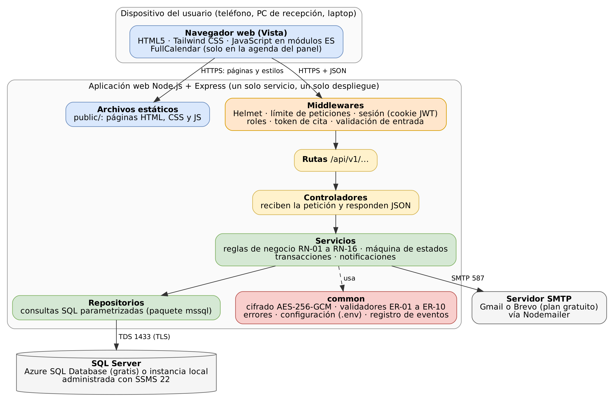

**Figura 9:** *Arquitectura en capas de SIGOP-Rueda. Fuente: elaboración propia (Graphviz). Archivo editable: docs/diagramas/fig9.dot*

## 2.2 Stack tecnológico definitivo

El criterio de selección fue: pocas piezas, todas gratuitas, bien documentadas y fáciles de entender para un equipo de tres personas. La Tabla 47 lista cada capa con su justificación.

**Tabla 47:** *Stack tecnológico definitivo.*

| **Capa**                | **Tecnología**                                                                                                         | **Justificación**                                                                                                                 | **RNF / RN**                         |
|-------------------------|------------------------------------------------------------------------------------------------------------------------|-----------------------------------------------------------------------------------------------------------------------------------|--------------------------------------|
| Vista (frontend)        | HTML5, Tailwind CSS (compilado en un solo archivo), JavaScript en módulos ES y FullCalendar                            | Sin framework ni empaquetador: las páginas se abren y se editan directamente. FullCalendar se usa solo en la agenda del panel.    | RNF-01, RNF-02, RNF-07               |
| Servidor                | Node.js (LTS) y Express, en JavaScript                                                                                 | Un solo lenguaje en todo el sistema (decisión de la Fase 1); estructura simple por módulos; no requiere compilar.                 | RNF-08                               |
| Validación de entrada   | zod y el módulo common/validadores.js                                                                                  | Las expresiones regulares ER-01 a ER-10 se definen en un solo lugar; los campos no declarados se rechazan.                        | RN-02, RN-05                         |
| Acceso a datos          | Paquete mssql, consultas parametrizadas y transacciones; sin ORM                                                       | El SQL queda visible y se puede probar tal cual en SSMS; las transacciones protegen el agendamiento.                              | RN-01                                |
| Base de datos           | SQL Server 2019 o superior (Express o Developer en el equipo; Azure SQL Database en la nube), administrada con SSMS 22 | Índices únicos filtrados impiden dobles reservas; restricciones CHECK validan formatos; sin costo de licencia en estas ediciones. | RN-01, RN-02, RN-10                  |
| Seguridad               | bcryptjs, jsonwebtoken, helmet, express-rate-limit y node:crypto (AES-256-GCM)                                         | Contraseñas con hash, sesión con expiración, límite de intentos, cabeceras seguras y cifrado de datos de salud.                   | RNF-03, RNF-04, RNF-10, RN-12, RN-15 |
| Notificaciones          | Nodemailer con SMTP de Gmail o Brevo; interfaz CanalNotificacion                                                       | El correo es el canal principal y gratuito; WhatsApp se agrega después como otra implementación.                                  | RF-07, PB-13                         |
| Archivos (informes PDF) | Columna VARBINARY(MAX) cifrada; carga con multer en memoria (máximo 10 MB)                                             | No se contrata almacenamiento aparte y las copias de seguridad de la base incluyen los informes.                                  | RF-12, RNF-10                        |
| Pruebas                 | Jest y Supertest; script database/03_pruebas.sql; revisión manual en navegadores                                       | Cada regla de negocio tiene una prueba; las reglas de la base se prueban con SQL.                                                 | Todos                                |
| Control de versiones    | Git, GitHub y GitHub Actions                                                                                           | Historial por integrante, revisión por pull request y pruebas en cada cambio.                                                     | Plan de Ejecución                    |
| Publicación             | Render (servicio web), Azure SQL Database (oferta gratuita) y UptimeRobot                                              | Capas gratuitas con HTTPS incluido; detalle y límites en la sección 7.                                                            | RNF-04, RNF-05                       |

## 2.3 Módulos del backend

Cada módulo agrupa sus rutas, controlador, servicio, repositorio y esquemas de validación en una carpeta. Un módulo solo usa a otro a través de sus servicios, nunca consulta directamente sus tablas. Así, un cambio interno en un módulo no rompe a los demás.

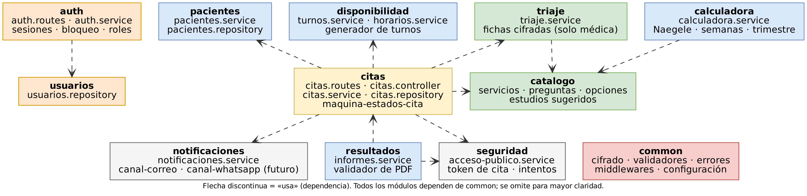

**Figura 10:** *Módulos del backend y sus dependencias. Fuente: elaboración propia (Graphviz). Archivo editable: docs/diagramas/fig10.dot*

**Tabla 48:** *Módulos del backend.*

| **Módulo**      | **Responsabilidad**                                                             | **Casos de uso**                                | **Entidades**                                             | **Rutas (/api/v1)**                        |
|-----------------|---------------------------------------------------------------------------------|-------------------------------------------------|-----------------------------------------------------------|--------------------------------------------|
| calculadora     | Cálculo de FPP, semanas de gestación, trimestre y estudios sugeridos            | CU-01                                           | EstudioSugerido (lectura)                                 | /calculadora                               |
| catalogo        | Servicios, preguntas de triaje, opciones y estudios sugeridos                   | CU-03, CU-04 (apoyo)                            | Servicio, PreguntaTriaje, OpcionPregunta, EstudioSugerido | /servicios                                 |
| disponibilidad  | Horarios laborales, generación y consulta de turnos libres                      | CU-02, CU-16                                    | HorarioLaboral, Turno                                     | /turnos, /admin/disponibilidad             |
| pacientes       | Registro y actualización de pacientes por cédula                                | CU-03, CU-15 (apoyo)                            | Paciente                                                  | /admin/pacientes                           |
| citas           | Agendar, validar acceso, cancelar, reprogramar, agenda diaria y estados         | CU-03, CU-06, CU-07, CU-08, CU-11, CU-12, CU-13 | Cita, CambioEstadoCita                                    | /citas, /admin/citas                       |
| triaje          | Guardar y consultar fichas de triaje cifradas                                   | CU-04, CU-14                                    | FichaTriaje, RespuestaTriaje                              | /admin/citas/:codigo/triaje                |
| resultados      | Carga, consulta y descarga de informes PDF                                      | CU-09, CU-15                                    | InformeResultado                                          | /resultados, /admin/citas/:codigo/informes |
| notificaciones  | Composición y envío de mensajes por canal; registro de envíos                   | CU-05                                           | Notificacion                                              | — (interno)                                |
| seguridad       | Límite de intentos del acceso público y token de cita                           | CU-08                                           | IntentoAcceso                                             | — (interno)                                |
| auth y usuarios | Inicio y cierre de sesión, bloqueo de cuenta, roles                             | CU-10                                           | Usuario, Medico, Recepcionista, Sesion                    | /admin/sesion                              |
| common          | Cifrado, validadores, errores, middlewares, configuración y registro de eventos | Transversal                                     | —                                                         | /salud                                     |

## 2.4 Patrones de diseño aplicados

**Tabla 49:** *Patrones de diseño aplicados.*

| **Patrón**                       | **Dónde se aplica**                                                    | **Problema que resuelve**                                                                                              |
|----------------------------------|------------------------------------------------------------------------|------------------------------------------------------------------------------------------------------------------------|
| MVC en capas                     | Navegador → ruta → controlador → servicio → repositorio                | Separa presentación, coordinación, reglas de negocio y datos; cada capa se prueba por separado.                        |
| Repository (DAO)                 | CitasRepository, PacientesRepository, InformesRepository…              | Todo el SQL queda en un solo lugar; los servicios no escriben consultas.                                               |
| Esquema de entrada (DTO)         | crearCitaSchema, accesoCitaSchema, reprogramarSchema…                  | La API nunca acepta campos no declarados; la validación es declarativa y reutiliza ER-01 a ER-10.                      |
| Presentador (Mapper)             | CitaPresentador, InformePresentador                                    | Convierte filas de la base en respuestas; evita filtrar datos sensibles (hash de contraseña, triaje).                  |
| Inyección de dependencias manual | Funciones fábrica: crearCitasService({ repo, turnos, notificaciones }) | Cada servicio recibe sus colaboradores; en las pruebas se reemplazan por simulados.                                    |
| State (máquina de estados)       | MaquinaEstadosCita                                                     | Las transiciones de RN-06 y los permisos de RN-11 se definen en una tabla única, no dispersos en condiciones.          |
| Strategy                         | CanalNotificacion (correo, WhatsApp)                                   | Agregar un canal es crear una clase nueva, sin modificar las existentes.                                               |
| Unidad de trabajo (transacción)  | CitasService.agendar() y reprogramar()                                 | Paciente, cita, ficha y cambio de estado se guardan todos o ninguno.                                                   |
| Cadena de middlewares            | sesion, requiereRol, tokenCita                                         | La autorización se declara en cada ruta y se evalúa antes del controlador.                                             |
| Manejador central de errores     | manejadorErrores (middleware global)                                   | Todo error llega al usuario como JSON con un mensaje claro; nunca se muestra un error crudo del servidor o de la base. |
| Utilidad de cifrado              | common/cifrado.js                                                      | El cifrado y descifrado de columnas sensibles se hace en un solo lugar.                                                |

## 2.5 Escalabilidad y extensibilidad

La arquitectura está pensada para que las mejoras futuras sean adiciones, no reescrituras. La Tabla 50 muestra cómo se incorporarían algunas mejoras previsibles y qué partes quedan intactas.

**Tabla 50:** *Cómo crece el sistema sin rehacerse.*

| **Mejora futura**                      | **Qué se agrega o cambia**                                                                        | **Qué no se toca**                                                         |
|----------------------------------------|---------------------------------------------------------------------------------------------------|----------------------------------------------------------------------------|
| Recordatorio por WhatsApp (PB-13)      | Clase CanalWhatsApp que implementa CanalNotificacion; variable de entorno para activarla          | Módulo citas y base de datos (el canal ya existe en el CHECK)              |
| Recordatorio automático 24 h antes     | Tarea programada en el módulo notificaciones (requiere un servicio siempre activo)                | Agendamiento y API pública                                                 |
| Una segunda médica o especialidad      | Registrar el nuevo Medico y sus horarios; filtro por médico en la consulta de turnos              | Esquema: horarios_laborales ya tiene medico_id                             |
| Pagos en línea o facturación           | Módulo nuevo pagos con sus tablas y rutas /api/v1/pagos                                           | Módulos existentes; solo citas emite el hecho "cita confirmada"            |
| Nuevo servicio o pregunta de triaje    | Registros en servicios y preguntas_triaje                                                         | Código: los cuestionarios son datos, no programación                       |
| Aplicación móvil nativa                | Cliente nuevo que consume la misma API /api/v1                                                    | Backend completo                                                           |
| Cambio incompatible en la API          | Versión /api/v2 en paralelo a /api/v1                                                             | Clientes actuales                                                          |
| Más carga o disponibilidad garantizada | Subir de plan en Render y pasar Azure SQL a facturación continua, o un VPS con SQL Server Express | Código: la API no guarda estado en memoria (las sesiones están en la base) |

Para que esto funcione, el código sigue cinco reglas: (1) cada funcionalidad nueva vive en su propio módulo o en el de su área; (2) los módulos se comunican por servicios, nunca por tablas ajenas; (3) toda configuración variable (credenciales, límites, tiempos) sale del archivo .env; (4) todo cambio de esquema se hace con un script SQL numerado en database/; y (5) toda regla de negocio tiene una prueba automática que impide romperla por accidente.

## 2.6 Estructura del repositorio

El repositorio es único y contiene el servidor, el frontend, los scripts de la base de datos y la documentación que el asistente de IA usa como contexto:

> sigop-rueda/
>
> ├── CLAUDE.md instrucciones del proyecto para Claude (Antigravity)
>
> ├── README.md cómo instalar y ejecutar
>
> ├── package.json dependencias y comandos (npm start, npm test)
>
> ├── .env.example variables de entorno (sin secretos reales)
>
> ├── docs/ diseño por fases y documentación de la API
>
> ├── database/
>
> │ ├── 01_esquema.sql 18 tablas, índices y procedimiento sp_generar_turnos
>
> │ ├── 02_datos_demo.sql usuarios, servicios, preguntas, horarios y turnos
>
> │ └── 03_pruebas.sql pruebas de las reglas garantizadas por la base
>
> ├── src/
>
> │ ├── server.js arranque del servidor
>
> │ ├── app.js Express: middlewares, rutas y archivos estáticos
>
> │ ├── config/ lectura del .env y conexión a SQL Server
>
> │ ├── common/ cifrado, validadores, errores, middlewares, correo
>
> │ └── modules/
>
> │ ├── citas/ citas.routes.js, citas.controller.js, citas.service.js,
>
> │ │ citas.repository.js, citas.schemas.js,
>
> │ │ maquina-estados-cita.js, citas.service.test.js
>
> │ └── auth/ usuarios/ pacientes/ catalogo/ disponibilidad/ triaje/
>
> │ resultados/ notificaciones/ seguridad/ calculadora/
>
> ├── public/
>
> │ ├── index.html, agendar.html, mi-cita.html, resultados.html
>
> │ ├── admin/ login.html, agenda.html, triaje.html,
>
> │ │ informes.html, disponibilidad.html
>
> │ ├── css/ tailwind.css (fuente) y app.css (generado con npm run css; se versiona para que Render no necesite paso de compilación)
>
> │ └── js/ api.js, páginas y componentes
>
> └── tests/ pruebas de reglas de negocio y de la API

## 2.7 Convenciones de código y de la API

**Tabla 51:** *Convenciones de código y de la API.*

| **Aspecto**        | **Convención**                                                                                                                                                                                          |
|--------------------|---------------------------------------------------------------------------------------------------------------------------------------------------------------------------------------------------------|
| Idioma             | Nombres del dominio en español y sin tildes (cedula, codigoMinsa); términos técnicos del framework en inglés (router, middleware).                                                                      |
| Nombres            | Clases en PascalCase; variables y funciones en camelCase; tablas y columnas en snake_case plural; archivos en kebab-case con el rol al final (citas.service.js).                                        |
| Rutas              | Prefijo /api/v1; recursos en plural; rutas del personal bajo /admin; ningún dato personal en la URL (la cédula viaja en el cuerpo).                                                                     |
| Fechas             | ISO 8601 en la API (2026-11-09, 09:30); zona horaria America/Managua. Las fechas de turnos se guardan como DATE y TIME; las de auditoría, como DATETIME2 en UTC.                                        |
| Llaves             | INT IDENTITY en todas las tablas; solo sesiones usa UNIQUEIDENTIFIER porque su identificador viaja en la cookie y no debe poder adivinarse.                                                             |
| Respuesta de error | JSON uniforme: { "codigo": "TURNO_OCUPADO", "mensaje": "El turno ya fue reservado. Elige otro.", "detalles": \[\] } con el código HTTP correspondiente.                                                 |
| Códigos HTTP       | 200 consulta, 201 creación, 400 datos inválidos, 401 sin sesión o token, 403 sin permiso, 404 no existe, 409 conflicto de negocio, 413 cuerpo demasiado grande, 422 archivo inválido, 423 cuenta bloqueada, 429 demasiados intentos, 500 error interno, 503 base de datos no disponible (tras los reintentos). Catálogo de códigos en docs/api.md. |
| Consultas SQL      | Siempre parametrizadas (request.input); nunca se concatena texto del usuario en una consulta.                                                                                                           |
| Commits            | Convención Conventional Commits en español: feat(citas): agendar con transacción; fix(triaje): validar obligatorias.                                                                                    |

# Fase 3 – 3. Modelo Entidad-Relación final

## 3.1 Del modelo de clases al modelo relacional

El MER se obtuvo transformando las clases de análisis y el diccionario de datos de la Fase 2 con las siguientes reglas. El modelo es el mismo de siempre (18 tablas); solo se expresó con los tipos y mecanismos de SQL Server:

- **Una tabla por clase** con llave primaria sustituta id de tipo INT IDENTITY, fácil de leer y de consultar en SSMS. El código de cita (CR-#####) y la cédula siguen siendo únicos (UNIQUE), pero no son llave primaria porque son datos de negocio visibles para el usuario. La única excepción es sesiones, que usa UNIQUEIDENTIFIER porque su identificador viaja en la cookie.

- **Herencia** UsuarioAdministrativo → Médico / Recepcionista: tabla por subclase. La tabla usuarios guarda lo común y el rol; medicos y recepcionistas guardan lo propio y usan usuario_id como llave primaria y foránea a la vez (PF).

- **Asociaciones 1 a N:** llave foránea en el lado N (por ejemplo, citas.paciente_id). **Composiciones:** llave foránea con ON DELETE CASCADE. **Agregación** Cita–InformeResultado: sin cascada, porque un informe clínico no se borra en cascada.

- **Listas cerradas** del diccionario (estado, rol, tipo de respuesta, canal): SQL Server no tiene tipo ENUM, así que son columnas VARCHAR con una restricción CHECK que lista los valores permitidos.

- **Tipos de datos:** NVARCHAR para texto con tildes y ñ; VARCHAR para códigos y cédulas; BIT para sí/no; DATE y TIME para turnos; DATETIME2 en UTC para auditoría (con valor por defecto SYSUTCDATETIME()); VARBINARY para datos cifrados.

- **Tablas nuevas que exige el diseño:** sesiones (cerrar sesión y expirar por inactividad, CU-10 A2), opciones_pregunta (opciones de las preguntas de selección, 1FN) y estudios_sugeridos (RF-02 indica que los estudios por trimestre son configurables).

- **Turnos materializados:** los turnos se generan como filas a partir del horario laboral con el procedimiento sp_generar_turnos. Esto permite que la base de datos garantice RN-01 con un índice único.

## 3.2 Diagrama Entidad-Relación

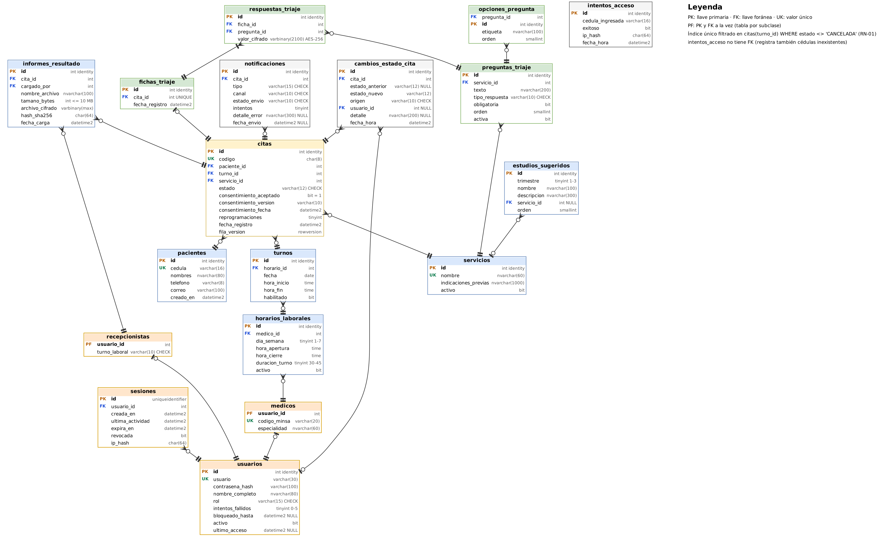

**Figura 11:** *Modelo Entidad-Relación final de SIGOP-Rueda (notación de pata de gallo, tipos de SQL Server). Fuente: elaboración propia (Graphviz). Archivo editable: docs/diagramas/fig11.dot*

## 3.3 Tablas, llaves y cardinalidades

Las 18 tablas del modelo, con sus llaves, restricciones de unicidad e índices. Los scripts completos están en database/01_esquema.sql.

**Tabla 52:** *Tablas, llaves y cardinalidades del modelo relacional.*

| **Tabla**           | **Llave primaria** | **Llaves foráneas**                               | **Únicos e índices**                                                      | **Relación (cardinalidad)**                                                |
|---------------------|--------------------|---------------------------------------------------|---------------------------------------------------------------------------|----------------------------------------------------------------------------|
| pacientes           | id                 | —                                                 | cedula (UK)                                                               | pacientes 1 : 0..N citas                                                   |
| usuarios            | id                 | —                                                 | usuario (UK)                                                              | usuarios 1 : 0..1 medicos / recepcionistas; 1 : 0..N sesiones              |
| medicos             | usuario_id (PF)    | usuario_id → usuarios                             | codigo_minsa (UK)                                                         | medicos 1 : 0..N horarios_laborales                                        |
| recepcionistas      | usuario_id (PF)    | usuario_id → usuarios                             | —                                                                         | recepcionistas 1 : 0..N informes_resultado                                 |
| sesiones            | id (GUID)          | usuario_id → usuarios                             | índice filtrado por usuario (revocada = 0)                                | N : 1 usuarios                                                             |
| servicios           | id                 | —                                                 | nombre (UK)                                                               | servicios 1 : 0..N citas, preguntas_triaje; 0..1 : 0..N estudios_sugeridos |
| preguntas_triaje    | id                 | servicio_id → servicios                           | (servicio_id, orden) UK                                                   | 1 : 0..N opciones_pregunta y respuestas_triaje                             |
| opciones_pregunta   | id                 | pregunta_id → preguntas_triaje                    | (pregunta_id, orden) UK                                                   | N : 1 preguntas_triaje                                                     |
| estudios_sugeridos  | id                 | servicio_id → servicios (opcional)                | (trimestre, nombre) UK                                                    | N : 0..1 servicios                                                         |
| horarios_laborales  | id                 | medico_id → medicos                               | (medico_id, dia_semana) UK                                                | 1 : 0..N turnos                                                            |
| turnos              | id                 | horario_id → horarios_laborales                   | (horario_id, fecha, hora_inicio) UK; índice por fecha                     | 1 : 0..N citas (solo 1 activa)                                             |
| citas               | id                 | paciente_id, turno_id, servicio_id                | codigo (UK); índice único filtrado turno_id WHERE estado \<\> 'CANCELADA' | 1 : 0..N cambios, notificaciones, informes; 1 : 0..1 fichas_triaje         |
| cambios_estado_cita | id                 | cita_id → citas; usuario_id → usuarios (opcional) | índice (cita_id, fecha_hora)                                              | N : 1 citas; N : 0..1 usuarios                                             |
| fichas_triaje       | id                 | cita_id → citas                                   | cita_id (UK)                                                              | 0..1 : 1 citas; 1 : 1..N respuestas_triaje                                 |
| respuestas_triaje   | id                 | ficha_id, pregunta_id                             | (ficha_id, pregunta_id) UK                                                | N : 1 fichas_triaje y preguntas_triaje                                     |
| informes_resultado  | id                 | cita_id → citas; cargado_por → recepcionistas     | índice por cita                                                           | N : 1 citas                                                                |
| notificaciones      | id                 | cita_id → citas                                   | índice filtrado de pendientes                                             | N : 1 citas                                                                |
| intentos_acceso     | id                 | — (registra también cédulas inexistentes)         | índice (cedula_ingresada, fecha_hora)                                     | independiente                                                              |

## 3.4 Justificación de la normalización hasta 3FN

**Primera forma normal (1FN): todos los atributos son atómicos y no hay grupos repetidos.** Las opciones de una pregunta de selección no se guardan como una lista dentro de una columna, sino como filas de opciones_pregunta. Las respuestas del triaje tampoco se guardan en un único documento JSON (la Fase 1 lo había contemplado): cada respuesta es una fila de respuestas_triaje vinculada a su pregunta, lo que permite validarla, cifrarla y consultarla de forma individual. Los nombres de la paciente se guardan en un solo campo porque el negocio nunca los usa por separado.

**Segunda forma normal (2FN): cada atributo no clave depende de toda la llave primaria.** Todas las tablas tienen una llave primaria simple (id), por lo que no pueden existir dependencias parciales. En las tablas con llaves candidatas compuestas, como respuestas_triaje (ficha_id, pregunta_id), el único atributo no clave (valor_cifrado) depende de ambas columnas a la vez: es la respuesta de esa ficha a esa pregunta.

**Tercera forma normal (3FN): no hay dependencias transitivas entre atributos no clave.** Ejemplos de decisiones tomadas para cumplirla:

- citas no repite el nombre, teléfono ni correo de la paciente: los obtiene por paciente_id. Si la paciente actualiza su correo, todas sus citas lo reflejan.

- turnos no guarda medico_id, porque el médico ya se determina por el horario (turno → horario → médico). Guardarlo sería una dependencia transitiva.

- Los datos propios del médico (código MINSA, especialidad) viven en medicos y no en usuarios, porque dependen del rol y no de cualquier usuario.

- No se guardan datos calculables: el tamaño en MB del informe se deriva de tamano_bytes, la semana de gestación se calcula desde la FUM y la duración de un turno se deriva de su hora de inicio y fin.

- Las indicaciones previas pertenecen al servicio, no a la cita ni a la notificación: el correo las toma de servicios al componer el mensaje.

Se aceptó una única desnormalización controlada: citas.reprogramaciones (contador) podría calcularse contando los cambios de estado de tipo reprogramación, pero se guarda para aplicar con eficiencia el límite que la clienta pueda fijar (punto 4 de la sección 7.7 de la Fase 2).

## 3.5 Reglas de negocio garantizadas por la base de datos

Las reglas críticas se protegen en dos niveles: el servicio las valida para dar un mensaje claro, y la base de datos las garantiza aunque haya un error de programación o dos peticiones simultáneas. La Tabla 53 cubre las 16 reglas de negocio de la Fase 2.

**Tabla 53:** *Reglas de negocio y cómo se cumplen en SQL Server y en la aplicación.*

| **Regla**                                           | **Mecanismo en SQL Server**                                                                             | **Validación en la aplicación**                                                                       |
|-----------------------------------------------------|---------------------------------------------------------------------------------------------------------|-------------------------------------------------------------------------------------------------------|
| RN-01 Sin dobles reservas                           | Índice único filtrado uq_cita_turno_activa sobre citas(turno_id) WHERE estado \<\> 'CANCELADA'          | CitasService.agendar() verifica el turno dentro de la transacción; si el índice rechaza, responde 409 |
| RN-02 Código único CR-#####                         | UNIQUE(codigo) y CHECK codigo LIKE 'CR-\[0-9\]\[0-9\]\[0-9\]\[0-9\]\[0-9\]'                             | generarCodigoCita() reintenta si hay colisión                                                         |
| RN-03 Una cita, una paciente, un turno, un servicio | paciente_id, turno_id y servicio_id NOT NULL con llave foránea                                          | El esquema de entrada exige los tres datos                                                            |
| RN-04 Cédula y código de la misma cita              | —                                                                                                       | El servicio busca la cita con código y cédula juntos; si no coinciden, error genérico                 |
| RN-05 Consentimiento obligatorio                    | CHECK (consentimiento_aceptado = 1) y consentimiento_version NOT NULL                                   | crearCitaSchema exige consentimiento verdadero                                                        |
| RN-06 Transiciones de estado                        | CHECK con los 5 estados; historial en cambios_estado_cita                                               | MaquinaEstadosCita.validar()                                                                          |
| RN-07 Turno libre al cancelar o reprogramar         | El índice filtrado excluye CANCELADA: el turno vuelve a quedar libre                                    | Cancelar y reprogramar se hacen en una transacción                                                    |
| RN-08 Cuestionario por servicio                     | preguntas_triaje.servicio_id; UNIQUE(ficha_id, pregunta_id)                                             | TriajeService valida que las preguntas sean del servicio y que estén las obligatorias                 |
| RN-09 Informe PDF de hasta 10 MB                    | CHECK nombre_archivo LIKE '%.pdf' y tamano_bytes BETWEEN 1 AND 10485760; llave foránea a citas          | Validación de la firma %PDF y del tamaño antes de cifrar                                              |
| RN-10 Turnos de 30 a 45 minutos                     | CHECK duracion_turno BETWEEN 30 AND 45, hora_cierre \> hora_apertura y duración del turno entre 30 y 45 | HorariosService.validar() y sp_generar_turnos                                                         |
| RN-11 Quién cambia cada estado                      | CHECK: un cambio del personal exige usuario_id                                                          | MaquinaEstadosCita: solo el rol Médico marca ATENDIDA                                                 |
| RN-12 Bloqueo de cuenta                             | CHECK intentos_fallidos BETWEEN 0 AND 5; columna bloqueado_hasta                                        | Usuario.registrarFallo(); el mensaje no dice si falló el usuario o la contraseña                      |
| RN-13 Regla de Naegele                              | —                                                                                                       | CalculadoraService: FUM + 7 días − 3 meses + 1 año                                                    |
| RN-14 Datos de salud protegidos                     | Columnas valor_cifrado y archivo_cifrado (VARBINARY)                                                    | common/cifrado.js (AES-256-GCM); la clave vive fuera de la base de datos                              |
| RN-15 Bloqueo del acceso público                    | Tabla intentos_acceso con índice (cedula_ingresada, fecha_hora)                                         | AccesoPublicoService: 5 fallos en 15 minutos bloquean la cédula                                       |
| RN-16 Triaje solo para la médica                    | —                                                                                                       | Middleware requiereRol('MEDICO') en las rutas de triaje; la agenda no incluye respuestas              |

## 3.6 Scripts SQL de referencia y verificación

El modelo se entrega como tres scripts para ejecutar en SSMS 22, en este orden, sobre una base vacía llamada SIGOP (en SQL Server local o en Azure SQL Database):

- database/01_esquema.sql: crea las 18 tablas, las restricciones CHECK, los índices (incluidos los filtrados) y el procedimiento sp_generar_turnos.

- database/02_datos_demo.sql: usuarios de prueba, 4 servicios con sus indicaciones, 10 preguntas de triaje, estudios por trimestre, el horario de la médica (lunes a viernes, 08:00 a 16:00, turnos de 40 minutos) y los turnos de los próximos 14 días. Son solo datos de demostración.

- database/03_pruebas.sql: ejecuta dentro de una transacción las comprobaciones de la Tabla 54 e imprime OK o FALLA por cada una; al final revierte todo.

**Tabla 54:** *Comprobaciones del script 03_pruebas.sql.*

| **Prueba**                                                   | **Regla**    | **Resultado esperado**                                                               |
|--------------------------------------------------------------|--------------|--------------------------------------------------------------------------------------|
| Creación de las 18 tablas, índices filtrados y procedimiento | —            | Sin errores                                                                          |
| Carga de datos de demostración                               | —            | 2 usuarios, 4 servicios, 10 preguntas, 6 estudios, 5 horarios y 120 turnos (14 días) |
| Segunda cita activa en el mismo turno                        | RN-01        | Rechazada por uq_cita_turno_activa                                                   |
| Nueva cita en un turno cuya cita fue cancelada               | RN-07        | Aceptada: el turno quedó libre                                                       |
| Cédula con letra minúscula; teléfono que inicia con 9        | ER-01, ER-03 | Rechazados por CHECK                                                                 |
| Código CR-1; código repetido                                 | ER-05, RN-02 | Rechazados por CHECK y por UNIQUE                                                    |
| Cita sin consentimiento                                      | RN-05        | Rechazada por CHECK                                                                  |
| Horario con turnos de 60 minutos                             | RN-10        | Rechazado por CHECK                                                                  |
| Cambio de estado del personal sin usuario                    | RF-17, RN-11 | Rechazado por CHECK                                                                  |
| intentos_fallidos = 6                                        | RN-12        | Rechazado por CHECK                                                                  |
| Archivo .docx y PDF de más de 10 MB                          | RN-09        | Rechazados por CHECK                                                                 |
| Ejecutar sp_generar_turnos dos veces para el mismo día       | RN-10        | No duplica turnos                                                                    |

Estas pruebas se ejecutan en SSMS 22 antes de empezar la Fase 4 y sus resultados se anexan a la entrega.

# Fase 3 – 4. Diagrama de clases de diseño

## 4.1 Del análisis al diseño

El diagrama de clases de diseño es la evolución del de análisis (Fase 2, sección 4). Como el sistema se escribe en JavaScript sin ORM, las clases de dominio son clases pequeñas que guardan las reglas, y los datos llegan desde SQL como filas que se convierten con un método desdeFila(). Los cambios aplicados son:

- **Visibilidad:** + público, − privado (en JavaScript, los campos privados se escriben con \#). Las dependencias inyectadas y los detalles internos son privados; las operaciones que usan otras capas son públicas.

- **Tipos:** JavaScript no declara tipos, así que el diagrama indica el tipo esperado de cada campo (string, number, boolean, Date, arreglos, uniones como 1 \| 2 \| 3) y el código lo documenta con comentarios JSDoc. Los valores de entrada se verifican con los esquemas de validación.

- **Sin anotaciones de framework:** no hay decoradores ni ORM; el mapeo entre tablas y clases lo hacen los repositorios, y las rutas se declaran con Express.

- **Getters y setters:** las propiedades que no deben cambiar se marcan {readOnly}; las que cambian con reglas (estado de la cita, intentos fallidos) se modifican solo mediante métodos de dominio (cambiarEstado(), registrarFallo()), que actúan como setters controlados. Los valores calculados se exponen como getters (get esModificable, get tamanoMB, get estaBloqueado).

- **Nombres de código:** sin tildes ni ñ (cedula, codigoMinsa, tamanoBytes); la herencia de análisis se implementa como relación 1 a 1 con Usuario (tabla por subclase).

- **Clases nuevas de diseño:** controladores, servicios, repositorios, esquemas de validación, presentadores, la máquina de estados y las estrategias de notificación, que no existían en el análisis porque son parte de la solución técnica.

## 4.2 Entidades: agenda y citas

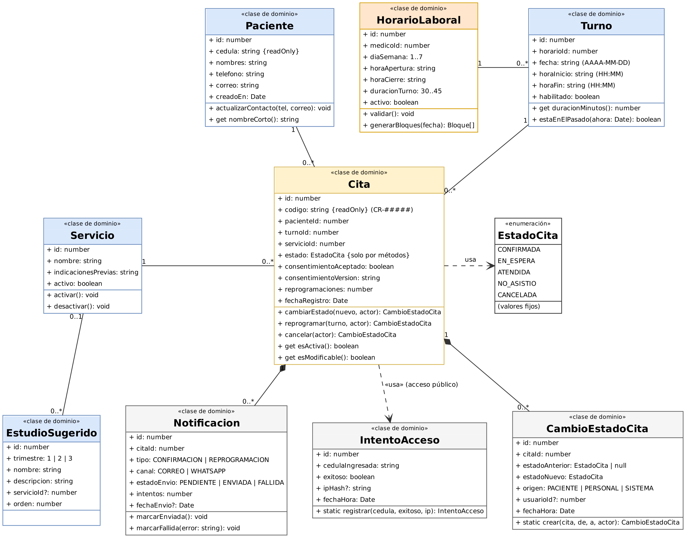

**Figura 12:** *Clases de diseño: entidades de agenda y citas. Fuente: elaboración propia (Graphviz). Archivo editable: docs/diagramas/fig12.dot*

## 4.3 Entidades: usuarios, triaje y resultados

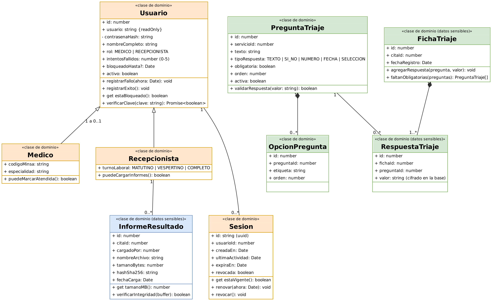

**Figura 13:** *Clases de diseño: entidades de usuarios, triaje y resultados. Fuente: elaboración propia (Graphviz). Archivo editable: docs/diagramas/fig13.dot*

## 4.4 Capas y patrones del módulo Citas

El módulo Citas es el núcleo del sistema y muestra la estructura que siguen todos los módulos: controladores delgados que solo reciben y responden, un servicio que coordina la transacción, un repositorio para la persistencia, esquemas de validación para la entrada, presentadores para la salida y colaboradores de otros módulos que se reciben por su servicio público.

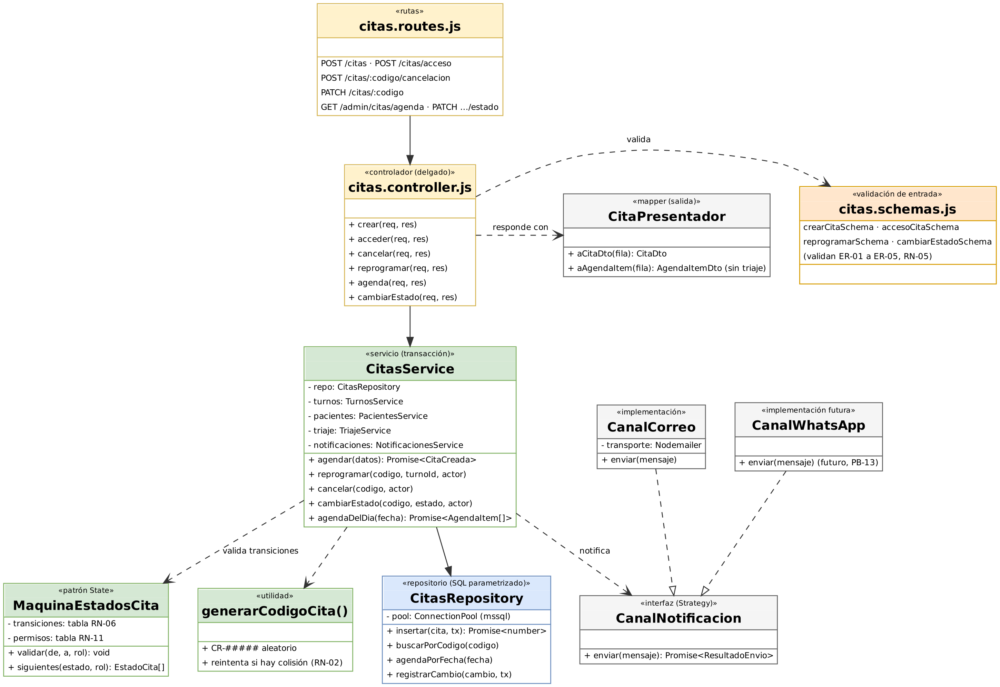

**Figura 14:** *Clases de diseño del módulo Citas: ruta, controlador, servicio, repositorio, validación, State y Strategy. Fuente: elaboración propia (Graphviz). Archivo editable: docs/diagramas/fig14.dot*

**Equivalencia con la terminología del Plan de Ejecución.** El Plan habla de entidades anotadas (@Entity, @Column), getters y setters, DTO y DAO, vocabulario propio de Java y de los ORM. En este diseño el sistema usa Node.js sin ORM, por eso los mismos conceptos se expresan así:

- **Entidad (@Entity) y columna (@Column):** la clase de dominio de las Figuras 12 y 13 y su tabla en SQL Server. Los tipos, las llaves y las restricciones (PK, FK, UNIQUE, CHECK) que una anotación declararía están en el script 01_esquema.sql y en el diccionario de la sección 3.

- **Getters y setters:** cada atributo de la clase se lee y se asigna por propiedad; los cambios con reglas (por ejemplo, cancelar una cita o registrar un fallo de acceso) se hacen con métodos de la clase y no con una asignación directa, de modo que la regla de negocio no se pueda saltar.

- **DTO:** los esquemas de validación (zod) del módulo, que definen la forma de lo que entra, y los presentadores o mapeadores, que definen la forma de lo que sale. Así la API no expone las entidades ni columnas internas.

- **DAO:** el repositorio de cada módulo; es la única clase que escribe consultas SQL parametrizadas y la única que conoce las tablas.

## 4.5 Clases por módulo

Los demás módulos siguen la misma estructura. La tabla lista sus archivos y clases principales para que el código se pueda generar de forma consistente:

**Tabla 55:** *Clases principales por módulo.*

| **Módulo**      | **Rutas y controladores**                  | **Servicios y otros**                                                            | **Repositorios**                         | **Esquemas de entrada**                                                   |
|-----------------|--------------------------------------------|----------------------------------------------------------------------------------|------------------------------------------|---------------------------------------------------------------------------|
| calculadora     | calculadora.routes, calculadora.controller | CalculadoraService (Naegele, semanas, trimestre)                                 | EstudiosRepository                       | fppSchema                                                                 |
| catalogo        | servicios.routes, servicios.controller     | ServiciosService, PreguntasService                                               | ServiciosRepository, PreguntasRepository | —                                                                         |
| disponibilidad  | turnos.routes, disponibilidad-admin.routes | TurnosService, HorariosService (usa sp_generar_turnos)                           | TurnosRepository, HorariosRepository     | consultaTurnosSchema, guardarHorariosSchema                               |
| pacientes       | pacientes-admin.routes                     | PacientesService                                                                 | PacientesRepository                      | buscarPacienteSchema                                                      |
| citas           | citas.routes, citas-admin.routes           | CitasService, MaquinaEstadosCita, generarCodigoCita, CitaPresentador             | CitasRepository, CambiosEstadoRepository | crearCitaSchema, accesoCitaSchema, reprogramarSchema, cambiarEstadoSchema |
| triaje          | triaje-admin.routes                        | TriajeService                                                                    | FichasRepository                         | respuestasSchema                                                          |
| resultados      | resultados.routes, informes-admin.routes   | InformesService, validarPdf                                                      | InformesRepository                       | consultaResultadosSchema                                                  |
| notificaciones  | —                                          | NotificacionesService, CanalCorreo, CanalWhatsApp (futuro), plantillas de correo | NotificacionesRepository                 | —                                                                         |
| seguridad       | —                                          | AccesoPublicoService, middleware tokenCita                                       | IntentosRepository                       | —                                                                         |
| auth / usuarios | auth.routes                                | AuthService, middlewares sesion y requiereRol                                    | UsuariosRepository, SesionesRepository   | iniciarSesionSchema                                                       |

## 4.6 Servicios transversales (common)

**Tabla 56:** *Servicios transversales.*

| **Archivo**    | **Tipo**           | **Responsabilidad**                                                                                                                                                                             |
|----------------|--------------------|-------------------------------------------------------------------------------------------------------------------------------------------------------------------------------------------------|
| cifrado.js     | Utilidad           | Cifra y descifra con AES-256-GCM (IV aleatorio de 12 bytes por valor); la clave de 32 bytes se lee de la variable CLAVE_CIFRADO. Se usa en respuestas de triaje y en los PDF.                   |
| base-datos.js  | Utilidad           | Crea el pool de conexiones de mssql, ofrece el ayudante transaccion(fn) y reintenta la conexión (3 intentos con espera creciente de 2 s y 4 s) para cuando Azure SQL está pausado y tarda en despertar. La conexión se abre en la primera consulta, no al arrancar. Vive en src/config/ (sección 2.6). |
| validadores.js | Utilidad           | Expresiones regulares ER-01 a ER-10 y funciones de validación compartidas por todos los esquemas.                                                                                               |
| errores.js     | Clase y middleware | Clase ErrorNegocio(codigo, mensaje, http) y manejador global que convierte cualquier excepción en la respuesta de error estándar; el detalle técnico va solo al registro, sin datos personales. |
| middlewares/   | Middlewares        | sesion (verifica la cookie y renueva la inactividad), requiereRol (RN-11, RN-16), tokenCita, limitePeticiones (express-rate-limit) y la configuración de Helmet.                                |
| config.js      | Configuración      | Carga y valida las variables de entorno al iniciar; la aplicación no arranca si falta una. Vive en src/config/ (sección 2.6); las variables de SMTP son obligatorias en producción; en desarrollo y pruebas, si SMTP_HOST está vacío, se usa un canal de correo simulado que no envía nada (decisión de la Iteración 1).     |
| registro.js    | Utilidad           | Registro estructurado (JSON) de eventos y errores, con identificador de petición y sin datos personales.                                                                                        |

# Fase 3 – 5. Diseño de la API REST

La API publica las peticiones modeladas en los diagramas de secuencia de la Fase 2 bajo el prefijo **/api/v1**. Hay tres niveles de acceso, los mismos de la Fase 2 (sección 2.1): **Pública**, **Token de cita** (emitido tras validar cédula y código, válido 15 minutos y solo para esa cita) y **Sesión** (personal autenticado, con su rol).

**Tabla 57:** *Rutas de la API REST (prefijo /api/v1).*

| **Método y ruta**                                                  | **Acceso**                   | **Entrada**             | **Respuesta exitosa**                                      | **CU**       |
|--------------------------------------------------------------------|------------------------------|-------------------------|------------------------------------------------------------|--------------|
| POST /calculadora/fpp                                              | Pública                      | { fum }                 | 200 { fpp, semanas, dias, trimestre, estudios\[\] }        | CU-01        |
| GET /servicios                                                     | Pública                      | —                       | 200 \[ { id, nombre, indicaciones } \]                     | CU-03        |
| GET /servicios/:id/preguntas                                       | Pública                      | —                       | 200 \[ { id, texto, tipo, obligatoria, opciones\[\] } \]   | CU-04        |
| GET /turnos?servicioId&desde&hasta                                 | Pública                      | query                   | 200 \[ { id, fecha, horaInicio, horaFin, disponible } \]   | CU-02        |
| POST /citas                                                        | Pública                      | crearCitaSchema         | 201 { codigo, servicio, fecha, horaInicio, horaFin, indicaciones, correoEnviado } | CU-03, CU-05 |
| POST /citas/acceso                                                 | Pública (límite de intentos) | { cedula, codigo }      | 200 { cita, tokenCita }                                    | CU-08        |
| POST /citas/:codigo/cancelacion                                    | Token de cita                | —                       | 200 { cita }                                               | CU-06        |
| PATCH /citas/:codigo                                               | Token de cita                | { turnoId }             | 200 { codigo, servicio, nuevoHorario, indicaciones, correoEnviado } | CU-07        |
| POST /resultados/consulta                                          | Pública (límite de intentos) | { cedula, codigo }      | 200 { tokenCita, informes\[\] }                            | CU-08, CU-09 |
| GET /resultados/:id/archivo                                        | Token de cita                | —                       | 200 application/pdf                                        | CU-09        |
| POST /admin/sesion · DELETE /admin/sesion                          | Pública / Sesión             | { usuario, contrasena } | 200 { nombre, rol } + cookie de sesión                     | CU-10        |
| GET /admin/citas/agenda?fecha                                      | Sesión                       | query                   | 200 \[ AgendaItem \]                                       | CU-11        |
| GET /admin/citas/:codigo/transiciones                              | Sesión                       | —                       | 200 \[ estados \]                                          | CU-12        |
| PATCH /admin/citas/:codigo/estado                                  | Sesión (rol según RN-11)     | { estado }              | 200 { cita }                                               | CU-12        |
| POST /admin/citas/:codigo/cancelacion · PATCH /admin/citas/:codigo | Sesión (Recepcionista)       | — / { turnoId }         | 200 { cita }                                               | CU-13        |
| GET /admin/citas/:codigo/triaje                                    | Sesión (Médico)              | —                       | 200 { preguntas y respuestas }                             | CU-14        |
| POST /admin/pacientes/busqueda                                     | Sesión (Recepcionista)       | { cedula }              | 200 { paciente, citas\[\] }                                | CU-15        |
| POST /admin/citas/:codigo/informes                                 | Sesión (Recepcionista)       | multipart: archivo PDF  | 201 { informe }                                            | CU-15        |
| GET · PUT /admin/disponibilidad                                    | Sesión (Médico)              | guardarHorariosSchema   | 200 { horarios\[\], citasFueraDeHorario\[\] }              | CU-16        |
| GET /salud                                                         | Pública                      | —                       | 200 { estado: "ok" } (no consulta la base de datos)        | RNF-05       |

Respecto de la tabla de la Fase 2 solo cambian dos detalles de nombres: la agenda se agrupa bajo /admin/citas/agenda y la consulta de turnos usa servicioId en lugar de servicio. Las respuestas de error usan el formato de la sección 2.7 y los códigos ya definidos en la Fase 2 (sección 5.1). Las rutas se documentan en docs/api.md, que se mantiene a partir de esta tabla. La ruta /salud no toca la base de datos a propósito: así el monitor de disponibilidad puede consultarla cada 5 minutos sin despertar a Azure SQL.

**Decisiones de la Iteración 1.** (a) GET /turnos devuelve también los turnos ocupados con disponible = false, para mostrarlos tachados como en la Figura 18 (sin datos de quién los reservó); antes de consultar genera con sp_generar_turnos los turnos que falten en el rango, acepta como máximo 31 días por consulta y hasta 90 días en adelante, y omite los turnos que ya empezaron según la hora de Managua. (b) POST /citas devuelve además horaFin e indicaciones para el comprobante (P3). (c) En las preguntas de tipo SELECCION se guarda cifrado el texto de la opción elegida, no su id, para que la ficha siga siendo legible si la opción cambia. (d) La versión del consentimiento (v1.0) corresponde a public/privacidad.html.

**Decisiones de la Iteración 2.** (a) El token de cita es un JWT HS256 (paquete jsonwebtoken) firmado con SECRETO_SESION y con audiencia «cita», de modo que no sirve como sesión del personal. Solo contiene el id y el código de la cita, vale 15 minutos, la página lo guarda en memoria y lo envía en la cabecera Authorization: Bearer. (b) POST /citas/acceso responde 409 CITA_NO_MODIFICABLE, sin token, si la cita no está Confirmada o su hora ya pasó, como en la Fase 2. La consulta de resultados (CU-09) tendrá su propia ruta, POST /resultados/consulta. (c) RN-15: se cuentan los fallidos de la cédula en los últimos 15 minutos posteriores a su último acceso exitoso. El 5.º fallido responde 429 ACCESO_BLOQUEADO con los minutos de espera, y mientras dure el bloqueo no se busca la cita. Un formato inválido (E1) no cuenta como intento. (d) La IP de cada intento se guarda como HMAC-SHA256 con un secreto del servidor, no como SHA-256 simple, porque el espacio de direcciones IPv4 es pequeño y un hash sin secreto se podría revertir. (e) Las rutas con token responden 401 TOKEN_REQUERIDO o TOKEN_INVALIDO, y 403 TOKEN_NO_CORRESPONDE si el token es de otra cita. (f) La paciente no puede cancelar ni reprogramar una cita cuya hora ya empezó. No se fijó anticipación mínima ni máximo de reprogramaciones (parámetros «por definir» de la Fase 2). (g) Reprogramar registra el cambio Confirmada → Confirmada en cambios_estado_cita con el horario anterior y el nuevo, suma 1 a reprogramaciones y envía la notificación REPROGRAMACION. Cancelar no envía correo. (h) PATCH /citas/:codigo devuelve además servicio, indicaciones y correoEnviado para mostrar la confirmación en P4.

# Fase 3 – 6. Diseño de seguridad y cumplimiento de la Ley 787

**Tabla 58:** *Controles de seguridad del diseño.*

| **Control**                         | **Implementación**                                                                                                                                                                                                                                                | **Cubre**       |
|-------------------------------------|-------------------------------------------------------------------------------------------------------------------------------------------------------------------------------------------------------------------------------------------------------------------|-----------------|
| Contraseñas                         | Hash bcrypt (paquete bcryptjs) con costo 12; la columna contrasena_hash nunca se selecciona en las consultas de datos ni se devuelve en una respuesta.                                                                                                            | RNF-03          |
| Sesión del personal                 | Cookie HttpOnly, Secure y SameSite=Strict con un JWT firmado que apunta a una fila de sesiones; expira tras 30 minutos sin actividad y se revoca al cerrar sesión.                                                                                                | CU-10, RNF-04   |
| Bloqueo de cuenta                   | 5 intentos fallidos consecutivos bloquean 15 minutos (bloqueado_hasta); el mensaje no indica si falló el usuario o la contraseña.                                                                                                                                 | RN-12           |
| Acceso público a citas y resultados | Cédula + código; 5 intentos fallidos con la misma cédula en 15 minutos bloquean (intentos_acceso); además, límite de 20 peticiones por minuto por IP (express-rate-limit). Tras validar, token de 15 minutos limitado a esa cita.                                 | RN-04, RN-15    |
| Autorización por rol                | requiereRol('MEDICO') en triaje y disponibilidad; requiereRol('RECEPCIONISTA') en informes y gestión de citas; la máquina de estados valida el rol de cada transición.                                                                                            | RN-11, RN-16    |
| Cifrado en tránsito                 | HTTPS con TLS 1.2 o superior: el certificado gratuito lo entrega Render; la aplicación redirige HTTP a HTTPS y envía la cabecera HSTS. La conexión a SQL Server usa encrypt = true.                                                                               | RNF-04          |
| Cifrado en reposo                   | AES-256-GCM para respuestas de triaje y archivos PDF antes de guardarlos; la clave está en una variable de entorno, fuera de la base y del repositorio; hash SHA-256 para verificar la integridad de cada informe. Azure SQL cifra además los discos por defecto. | RNF-10, RN-14   |
| Validación de entrada               | Esquemas zod que rechazan cualquier campo no declarado; consultas parametrizadas del paquete mssql (sin SQL concatenado).                                                                                                                                         | Seguridad       |
| Cabeceras y navegador               | Helmet (Content-Security-Policy, X-Frame-Options, nosniff). Como el frontend se sirve desde el mismo dominio, no se habilita CORS.                                                                                                                                | Seguridad       |
| Privacidad y minimización           | Ningún dato personal en la URL ni en los registros; las IP se guardan como hash HMAC-SHA256 con secreto del servidor; la recepción no ve las respuestas del triaje.                                                                                                                                    | RNF-06, Ley 787 |
| Consentimiento                      | Casilla obligatoria antes de guardar datos; se registran la versión de la política aceptada y la fecha.                                                                                                                                                           | RN-05, RNF-06   |
| Derechos ARCO                       | Contacto publicado en la política de privacidad; la recepción puede actualizar los datos de contacto de la paciente; las solicitudes de eliminación se atienden manualmente en esta versión.                                                                      | Ley 787         |
| Secretos                            | Variables de entorno (.env) excluidas de Git y cargadas en el panel de Render; .env.example documenta cada variable sin valores reales.                                                                                                                           | Soporte         |
| Acceso a la base de datos           | Usuario de SQL de la aplicación con permisos solo sobre la base SIGOP; reglas de firewall de Azure SQL limitadas a las direcciones necesarias.                                                                                                                    | RNF-06          |
| Respaldos                           | Azure SQL conserva copias de seguridad automáticas; además, una exportación mensual (.bacpac) desde SSMS guardada fuera de la nube. En local, respaldo (.bak) con SSMS.                                                                                           | RNF-05          |

**Datos reales.** Mientras el sistema esté en capa gratuita y en fase de demostración, solo se usan los datos de 02_datos_demo.sql. Los datos reales de pacientes se cargan únicamente después de completar el checklist legal de la Ley 787 (RNF-06) y con la aprobación de la clienta.

# Fase 3 – 7. Arquitectura de despliegue

El objetivo es que la paciente entre desde su teléfono, por un código QR o un enlace, y que la clínica no pague servidor. Para eso se usan servicios en capa gratuita: **Render** aloja la aplicación Node.js y **Azure SQL Database** (oferta gratuita) aloja la base de datos SQL Server. La Fase 1 evaluó un VPS de pago; se conserva como escenario de crecimiento si la clínica necesita disponibilidad garantizada.

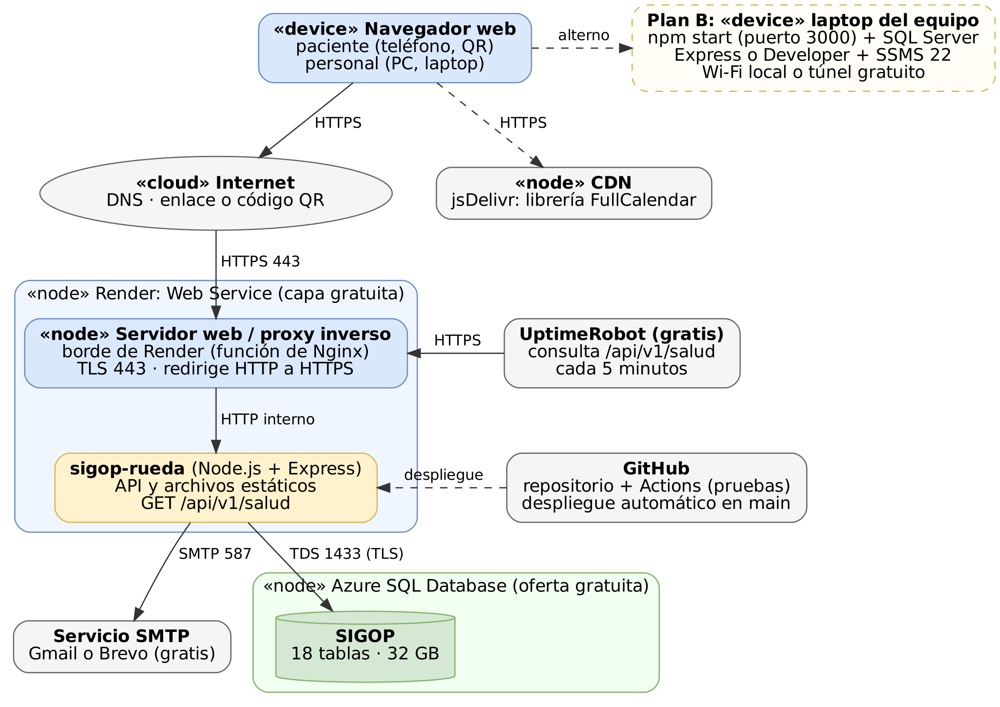

**Figura 15:** *Diagrama de despliegue de SIGOP-Rueda en capa gratuita. Fuente: elaboración propia (Graphviz). Archivo editable: docs/diagramas/fig15.dot*

**Tabla 59:** *Nodos del despliegue y límites de la capa gratuita.*

| **Nodo**                         | **Tipo**  | **Contenido y función**                                                                                                                                                                                       | **Costo y límite gratuito**                                                                           |
|----------------------------------|-----------|---------------------------------------------------------------------------------------------------------------------------------------------------------------------------------------------------------------|-------------------------------------------------------------------------------------------------------|
| Dispositivo del usuario          | «device»  | Navegador del teléfono de la paciente (entra por QR o enlace) o de la PC de recepción.                                                                                                                        | Sin costo                                                                                             |
| Internet                         | «cloud»   | Red pública por la que el teléfono o la PC llegan al sistema mediante el enlace o el código QR; resuelve el nombre del sitio (DNS).                                                                           | Sin costo                                                                                             |
| CDN                              | «node»    | Red de distribución de contenido (jsDelivr) que entrega la librería FullCalendar al navegador; el resto de archivos estáticos los sirve la propia aplicación.                                                 | Gratis                                                                                                |
| Servidor web / proxy inverso     | «node»    | Borde de Render: recibe el tráfico, termina el HTTPS (puerto 443, certificado incluido), redirige HTTP a HTTPS y lo pasa a la aplicación. Cumple la función que tendría Nginx o Apache en un servidor propio. | Incluido en Render                                                                                    |
| Render: servicio web sigop-rueda | «node»    | Node.js + Express; sirve el frontend y la API con HTTPS incluido; sin estado en memoria.                                                                                                                      | 750 horas gratis al mes; se duerme tras 15 minutos sin visitas y tarda cerca de 1 minuto en despertar |
| Azure SQL Database               | «node»    | SQL Server administrado con la base SIGOP (18 tablas); copias automáticas; se administra con SSMS 22.                                                                                                         | Oferta gratuita: 100 000 vCore-segundos y 32 GB al mes; se pausa tras 15 minutos sin uso; sin SLA     |
| Servicio SMTP                    | «service» | Gmail (contraseña de aplicación) o Brevo para confirmaciones y reprogramaciones.                                                                                                                              | Gratis con tope diario; verificar el tope vigente                                                     |
| Monitor de disponibilidad        | «service» | UptimeRobot consulta /api/v1/salud cada 5 minutos: mide RNF-05 y evita que Render se duerma.                                                                                                                  | Plan gratuito                                                                                         |
| GitHub                           | «service» | Repositorio, pull requests y GitHub Actions; Render despliega al actualizar la rama main.                                                                                                                     | Gratis                                                                                                |
| Laptop del equipo (plan B)       | «device»  | npm start con SQL Server Express o Developer y SSMS 22; se accede por Wi-Fi o con un túnel gratuito.                                                                                                          | Sin costo; depende de la laptop y de la red                                                           |

## 7.1 Qué significan los límites gratuitos para este sistema

- **Arranque en frío de Render.** Si nadie visita el sitio durante 15 minutos, el servicio se duerme y la primera visita espera cerca de un minuto. El monitor de disponibilidad lo consulta cada 5 minutos, lo que lo mantiene despierto; un servicio activo todo el mes consume unas 744 de las 750 horas gratuitas.

- **Pausa de Azure SQL.** La base se pausa tras 15 minutos sin consultas y la primera conexión puede tardar o fallar. Por eso la ruta /salud no consulta la base y el servidor reintenta la conexión (sección 4.6). Mientras SSMS tenga una conexión abierta, la base no se pausa y gasta cuota.

- **Presupuesto de Azure SQL.** Los 100 000 vCore-segundos mensuales alcanzan para una demostración o un piloto, pero no para tener la base activa todo el día. Si la base usa el mínimo de 0,5 vCore, equivalen a unas 55 horas de base activa al mes; como cada despertar mantiene la base activa al menos 15 minutos (unos 450 vCore-segundos), alcanzan para unos 220 despertares al mes. Al agotarse, se elige entre pausar la base hasta el mes siguiente (sin cargos) o seguir con cargos por uso. Se recomienda pausar durante las pruebas y la defensa.

- **Sin garantía de servicio.** Ninguna capa gratuita ofrece SLA. La meta de disponibilidad de 99 % (RNF-05) se mide con el monitor, pero no puede prometerse mientras todo sea gratuito. Si la clínica la necesita, se pasa al escenario de crecimiento (Tabla 60).

- **Límites que pueden cambiar.** Las condiciones de las capas gratuitas las define cada proveedor y pueden variar; se verifican en su documentación antes de la defensa.

**Tabla 60:** *Entornos de ejecución.*

| **Entorno**                    | **Dónde**                                                                                                                                             | **Uso**                                                                            |
|--------------------------------|-------------------------------------------------------------------------------------------------------------------------------------------------------|------------------------------------------------------------------------------------|
| Desarrollo                     | Computadora de cada integrante: SQL Server Express o Developer con SSMS 22; npm run dev.                                                              | Programar y probar con los datos de 02_datos_demo.sql.                             |
| Pruebas automáticas (CI)       | GitHub Actions en cada push y pull request.                                                                                                           | Instalar dependencias y ejecutar las pruebas de reglas con repositorios simulados. |
| Demostración (defensa o feria) | Render + Azure SQL Database. Plan B: npm start en la laptop con SQL Server local y un túnel o red propia. Un código QR apunta a la dirección pública. | Demostración en vivo con usuarios de prueba; solo datos de demostración.           |
| Piloto en la clínica           | Los mismos servicios gratuitos, con datos reales solo tras el checklist de la Ley 787.                                                                | Uso real con las limitaciones de la sección 7.1.                                   |
| Producción ampliada (opcional) | Plan de pago de Render y Azure SQL con facturación continua, o un VPS con SQL Server Express (escenario de la Fase 1).                                | Disponibilidad garantizada (RNF-05) si la clínica lo requiere.                     |

## 7.2 Pasos de publicación

- **Base de datos:** crear la base SIGOP en Azure SQL Database con la oferta gratuita y la opción de pausa automática; conectarse desde SSMS 22 y ejecutar 01_esquema.sql y 02_datos_demo.sql.

- **Repositorio:** subir el código a GitHub (sin el archivo .env).

- **Servicio web:** crear en Render un Web Service de Node conectado al repositorio, con instalación npm install e inicio npm start; cargar las variables de entorno (conexión a la base, CLAVE_CIFRADO, secreto de sesión, datos del SMTP).

- **Firewall:** autorizar en Azure SQL las direcciones de salida de Render (se consultan en su panel).

- **Verificación:** abrir /api/v1/salud, agendar una cita de prueba y confirmar que llega el correo.

- **Monitor y QR:** crear el monitor en UptimeRobot y generar el código QR con la dirección pública.

# Fase 3 – 8. Prototipo de interfaz de usuario (UI/UX)

## 8.1 Sistema de diseño

La identidad visual parte del contexto de la clínica: un tono baya, cálido y asociado a la salud de la mujer sin caer en el rosado infantil, acompañado de un verde salvia para las confirmaciones y un amarillo sol que marca "dónde estás" (la semana de embarazo, la cita en curso). La tipografía del texto es **Atkinson Hyperlegible**, diseñada por el Braille Institute para personas con baja visión, porque muchas pacientes leerán desde el teléfono en la sala de espera; los títulos usan **Bricolage Grotesque**, con más carácter. Todas las combinaciones de color superan el contraste mínimo AA de WCAG 2.1 (4.5:1).

**Tabla 61:** *Paleta del sistema de diseño.*

| **Token**        | **Color** | **Uso**                                                    | **Contraste**         |
|------------------|-----------|------------------------------------------------------------|-----------------------|
| Baya             | \#8A2D5C  | Acciones principales, marca, fecha probable de parto       | 8.0:1 sobre blanco    |
| Tinta            | \#2B2233  | Texto principal, barra lateral del panel                   | 13.6:1 sobre Bruma    |
| Tinta secundaria | \#5E5468  | Texto de apoyo y etiquetas                                 | 7.1:1 sobre blanco    |
| Bruma            | \#F5F1F6  | Fondo de las páginas                                       | —                     |
| Salvia           | \#2E6B5E  | Confirmaciones, "Registrar llegada", estado Atendida       | 6.2:1 sobre blanco    |
| Sol              | \#F2C14E  | Marcador de semana actual, cita en curso, foco del teclado | 9.1:1 con texto Tinta |
| Error            | \#B3261E  | Mensajes de error y acciones destructivas                  | 6.5:1 sobre blanco    |

**Componentes y reglas de usabilidad:** botones de al menos 44 px de alto; cada error dice qué pasó y cómo corregirlo junto al campo; los estados de la cita usan color y texto a la vez (nunca solo color); el foco del teclado es visible (contorno Sol); el agendamiento muestra el progreso en 4 pasos (RNF-02); la vista móvil empieza en 360 px de ancho (RNF-07) y en el panel la tabla de la agenda se convierte en tarjetas.

## 8.2 Flujo de navegación

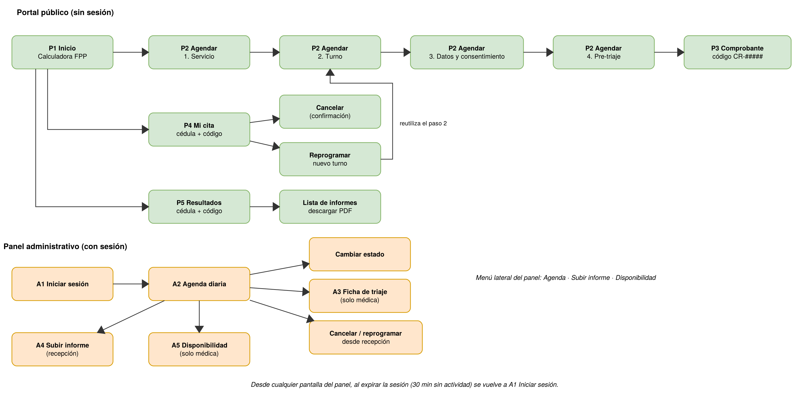

**Figura 16:** *Flujo de navegación del portal público y del panel administrativo. Fuente: elaboración propia (Draw.io). Archivo editable: Flujo_Navegacion.drawio*

**Tabla 62:** *Pantallas y su trazabilidad.*

| **Pantalla**                                        | **Casos de uso**    | **Requerimientos**  |
|-----------------------------------------------------|---------------------|---------------------|
| P1 Inicio y calculadora                             | CU-01               | RF-01, RF-02        |
| P2 Agendar: servicio, día y hora, datos, pre-triaje | CU-02, CU-03, CU-04 | RF-03 a RF-06       |
| P3 Comprobante                                      | CU-03, CU-05        | RF-05, RF-07        |
| P4 Mi cita                                          | CU-06, CU-07, CU-08 | RF-14, RF-15        |
| P5 Resultados                                       | CU-08, CU-09        | RF-08               |
| A1 Iniciar sesión                                   | CU-10               | RF-09               |
| A2 Agenda diaria                                    | CU-11, CU-12, CU-13 | RF-10, RF-16, RF-17 |
| A3 Ficha de triaje                                  | CU-14               | RF-11               |
| A4 Subir informe                                    | CU-15               | RF-12               |
| A5 Disponibilidad                                   | CU-16               | RF-13               |

## 8.3 Pantallas del portal público

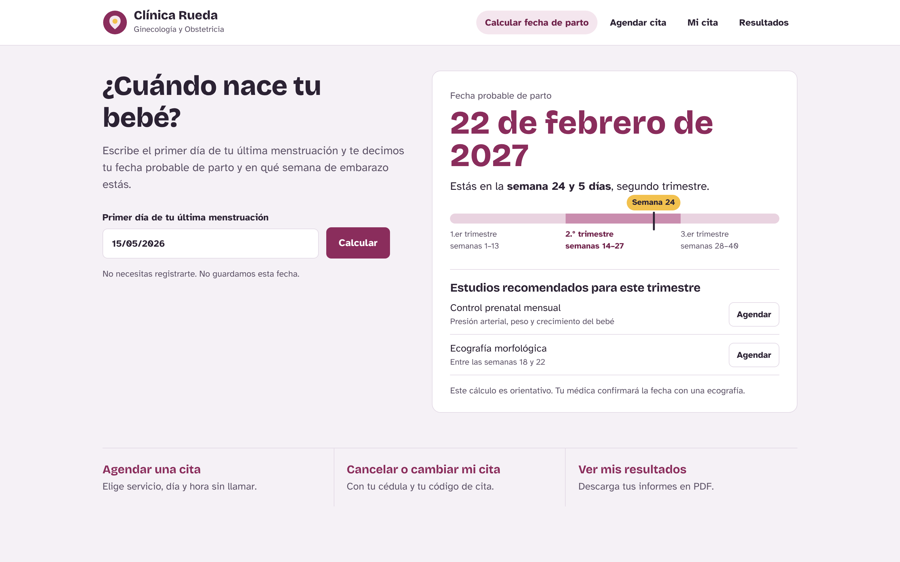

**Figura 17:** *P1 Inicio y calculadora de fecha probable de parto, vista de escritorio. Fuente: elaboración propia (prototipo navegable SIGOP-Rueda).*

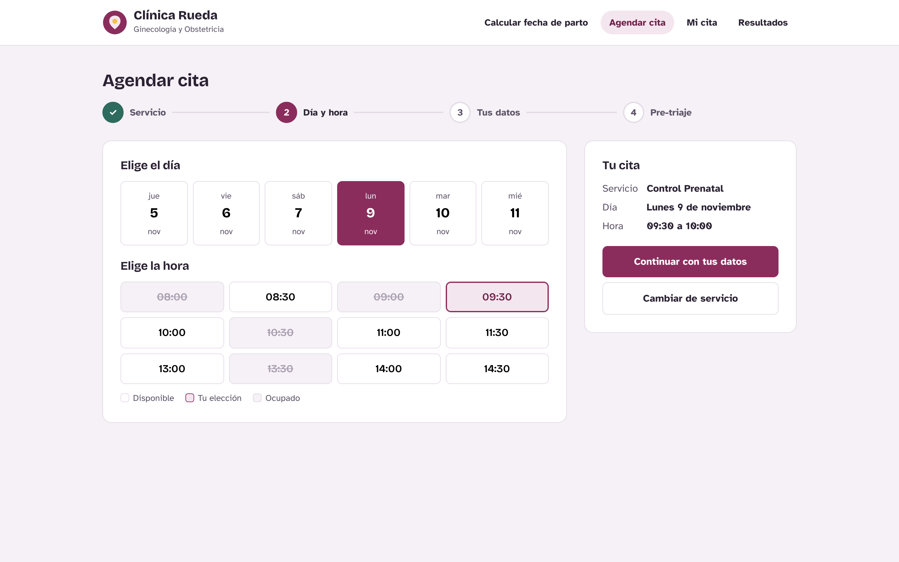

**Figura 18:** *P2 Agendar cita, paso 2: elección de día y hora (los turnos ocupados aparecen tachados), vista de escritorio. Fuente: elaboración propia (prototipo navegable SIGOP-Rueda).*

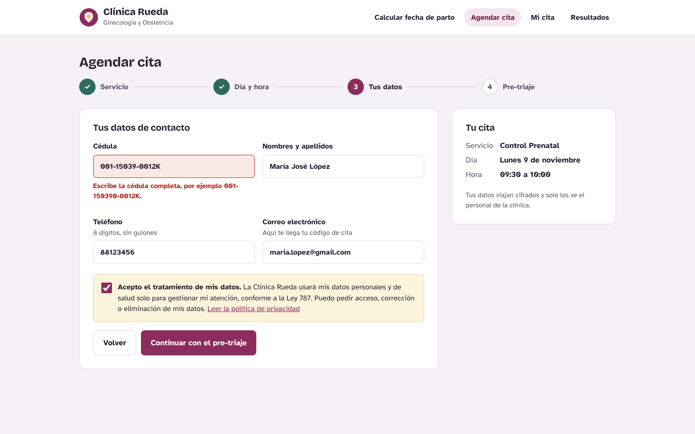

**Figura 19:** *P2 Agendar cita, paso 3: datos de contacto con error de validación de la cédula (ER-01) y consentimiento informado (Ley 787). Fuente: elaboración propia (prototipo navegable SIGOP-Rueda).*

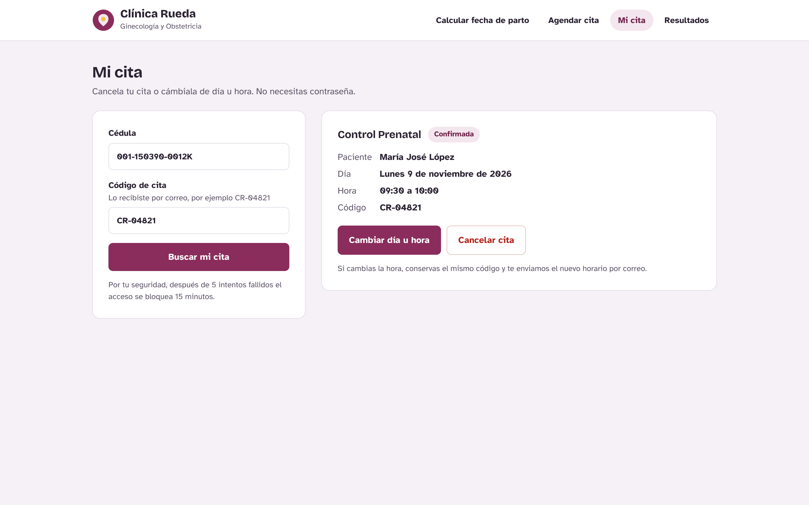

**Figura 20:** *P4 Mi cita: acceso con cédula y código, cancelación y reprogramación. Fuente: elaboración propia (prototipo navegable SIGOP-Rueda).*

## 8.4 Vista móvil (Responsive Design)

Las mismas pantallas se reorganizan en una sola columna en teléfonos desde 360 px de ancho: el menú se contrae en un botón, los días y horas pasan a una cuadrícula de 3 columnas y la agenda del panel se muestra como tarjetas.

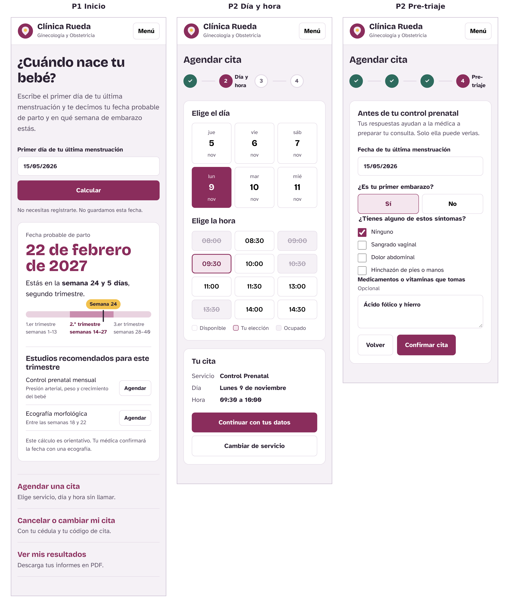

**Figura 21:** *Vista móvil de P1 Inicio, P2 elección de día y hora, y P2 pre-triaje (Control Prenatal). Fuente: elaboración propia (prototipo navegable SIGOP-Rueda).*

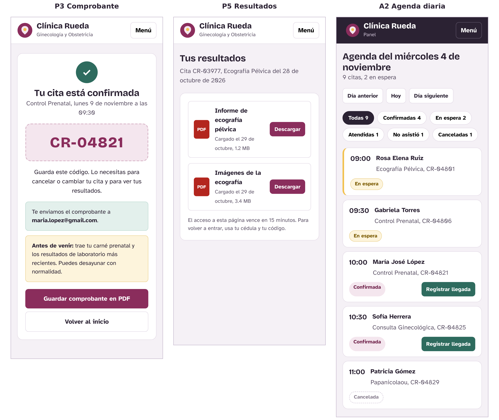

**Figura 22:** *Vista móvil de P3 Comprobante, P5 Resultados y A2 Agenda diaria (la tabla se convierte en tarjetas). Fuente: elaboración propia (prototipo navegable SIGOP-Rueda).*

## 8.5 Pantallas del panel administrativo

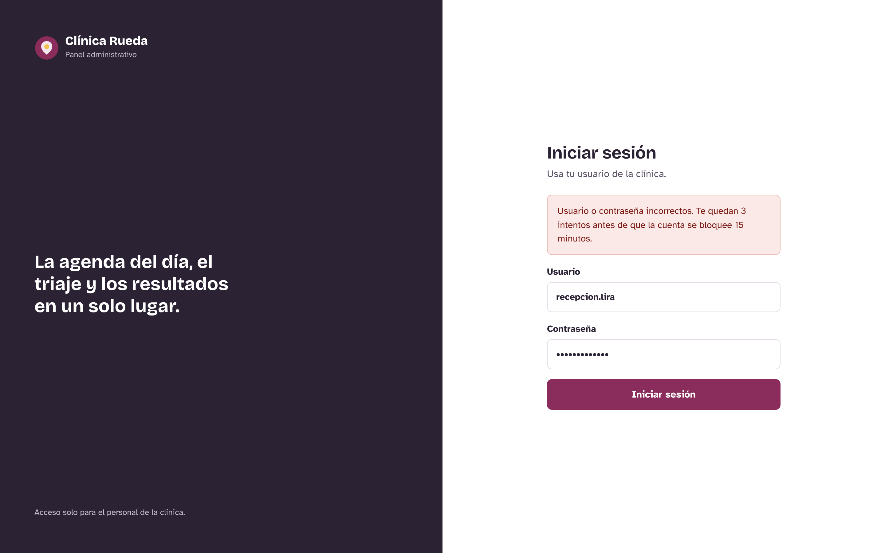

**Figura 23:** *A1 Iniciar sesión, con el aviso de intentos restantes antes del bloqueo (RN-12). Fuente: elaboración propia (prototipo navegable SIGOP-Rueda).*

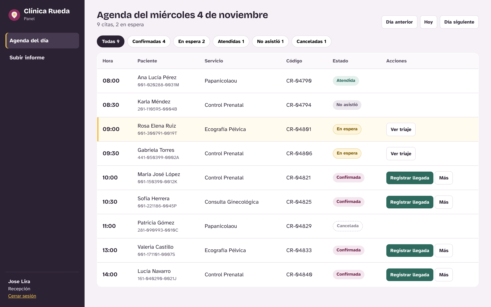

**Figura 24:** *A2 Agenda diaria de la recepción: estados de cita, cita en curso resaltada y acciones por estado. Fuente: elaboración propia (prototipo navegable SIGOP-Rueda).*

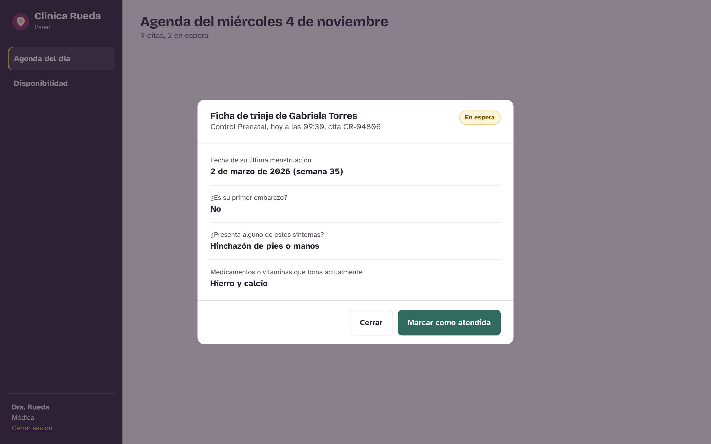

**Figura 25:** *A3 Ficha de triaje, visible solo para la médica (RN-16). Fuente: elaboración propia (prototipo navegable SIGOP-Rueda).*

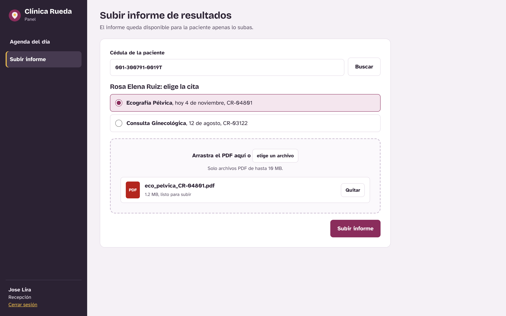

**Figura 26:** *A4 Subir informe de resultados: búsqueda por cédula, elección de la cita y archivo PDF. Fuente: elaboración propia (prototipo navegable SIGOP-Rueda).*

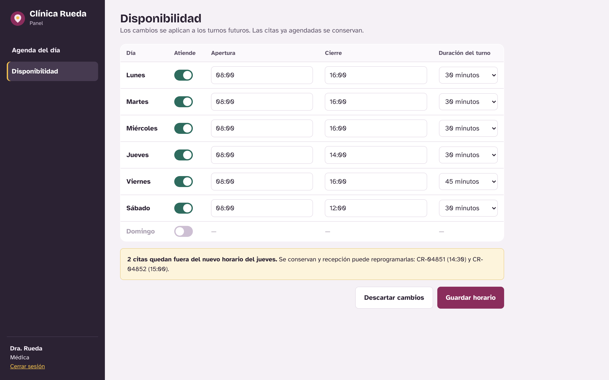

**Figura 27:** *A5 Disponibilidad de la médica, con aviso de citas que quedan fuera del nuevo horario (CU-16 E2). Fuente: elaboración propia (prototipo navegable SIGOP-Rueda).*

## 8.6 Uso de las maquetas en la Fase 4

Las pantallas de esta sección son maquetas de alta fidelidad hechas en HTML y CSS, con los mismos colores y la misma tipografía que usará el sistema. Sirven como modelo visual: en la Fase 4 las páginas reales de public/ se construyen con este sistema de diseño (Tailwind CSS) y se conectan a la API. Cada botón y enlace sigue el flujo de la Figura 16 y las vistas se adaptan a escritorio y móvil. Si el docente lo requiere en Figma, las maquetas se importan con el complemento html.to.design.

# Fase 3 – 9. Plan de construcción (puente a la Fase 4)

## 9.1 Iteraciones

La construcción sigue el orden del Product Backlog: primero las funciones Must que forman el flujo completo de la paciente, después el panel y al final las funciones Should y el endurecimiento. Cada iteración termina con algo que se puede demostrar. Las iteraciones 2 y 3 pueden avanzar en paralelo porque tocan módulos distintos.

**Tabla 63:** *Plan de iteraciones de la Fase 4.*

| **Iteración**                   | **Objetivo**                                                                                                                                 | **Casos de uso**    | **Responsable principal**                 | **Entregable verificable**                                                                 |
|---------------------------------|----------------------------------------------------------------------------------------------------------------------------------------------|---------------------|-------------------------------------------|--------------------------------------------------------------------------------------------|
| 0\. Base del proyecto           | Repositorio, Express, conexión a SQL Server, scripts 01 y 02 ejecutados desde SSMS, manejador de errores, /api/v1/salud, GitHub Actions      | —                   | Francisco Bárcenas                        | npm start levanta la API; /api/v1/salud responde y la base tiene los datos de prueba       |
| 1\. Agendar cita                | Catálogo, disponibilidad, pacientes, citas, triaje, notificación por correo; frontend P1–P3                                                  | CU-01 a CU-05       | Francisco (API) y Marien (frontend)       | Una paciente agenda de punta a punta y recibe el correo con el código                      |
| 2\. Gestión de la paciente      | Validación de acceso, bloqueo por intentos, token de cita, cancelar, reprogramar; frontend P4                                                | CU-06, CU-07, CU-08 | Sergio Rueda                              | Cancelar y reprogramar funcionan con cédula y código; 5 fallos bloquean                    |
| 3\. Panel administrativo        | Sesión, roles, agenda diaria, estados, gestión desde recepción, ficha de triaje; frontend A1–A3                                              | CU-10 a CU-14       | Marien Gómez (frontend) y Francisco (API) | La recepción y la médica operan la agenda del día                                          |
| 4\. Resultados y disponibilidad | Carga y descarga cifrada de PDF, configuración de horarios; frontend P5, A4, A5                                                              | CU-09, CU-15, CU-16 | Sergio Rueda                              | Un informe cargado se descarga desde el portal público                                     |
| 5\. Calidad y despliegue        | Pruebas de las reglas RN, revisión en navegadores y teléfonos, revisión de seguridad, publicación en Render y Azure SQL, monitor y código QR | Todos               | Los tres integrantes                      | Aplicación en línea accesible por QR, pruebas en verde, matriz 7.8 de la Fase 2 completada |

Con las iteraciones 1 a 4 se implementan los 16 casos de uso (100 %), por encima del 80 % que exige el Plan de Ejecución. Si el tiempo se acorta, las funciones Should (CU-14 y CU-16) y Could (WhatsApp) son las primeras en posponerse sin afectar el flujo principal.

## 9.2 Flujo de trabajo con Git

- Rama main protegida (solo recibe cambios revisados) y una rama por funcionalidad: feature/citas-agendar, feature/panel-agenda, fix/triaje-obligatorias.

- Cada integrante hace commits con su propio usuario de GitHub, pequeños y frecuentes, con mensajes en formato Conventional Commits. El Plan de Ejecución evalúa que el historial muestre trabajo distribuido en el tiempo.

- Cada rama entra a main mediante un pull request que otro integrante revisa y que pasa la integración continua (pruebas).

## 9.3 Desarrollo asistido con Claude en Antigravity

El código se escribirá con Claude como asistente dentro de Antigravity. Para que el asistente produzca código coherente con este diseño y no improvise, el repositorio incluye un archivo **CLAUDE.md** en la raíz, que Claude lee automáticamente al trabajar en el proyecto, y una carpeta **docs/** con el diseño dividido por fases. El flujo de trabajo es:

- **Contexto primero:** CLAUDE.md fija el stack, la estructura de carpetas, las convenciones, las reglas de seguridad y los comandos; docs/ contiene el diseño de cada fase y se lee por secciones, no completo.

- **Una tarea por vez:** se le pide a Claude una iteración o una parte de ella, en su propia rama; primero propone un plan, el integrante lo revisa y luego se implementa.

- **Pruebas como criterio:** cada tarea incluye las pruebas de las reglas de negocio que toca; la tarea termina cuando las pruebas pasan, no cuando el código arranca.

- **Revisión humana:** el integrante responsable lee el código generado, lo prueba en el navegador y es quien hace el commit; el asistente no hace commits ni sube cambios por su cuenta.

- **Diseño como fuente de verdad:** si el asistente propone algo distinto al diseño (otra tabla, otra ruta), se actualiza primero este documento o se descarta la propuesta. Los cambios pedidos después de la primera versión también se reflejan en docs/.

- **Datos de prueba:** el asistente trabaja solo con los datos de 02_datos_demo.sql; nunca con datos reales de pacientes.

## 9.4 Definición de terminado

Una funcionalidad se considera terminada cuando: cumple los criterios de aceptación de su historia de usuario (Fase 1, sección 5.2); tiene pruebas automáticas de sus reglas de negocio; maneja los errores con mensajes claros (sin pantallas en blanco ni errores crudos); funciona en escritorio y en móvil; está documentada en docs/api.md; y fue revisada e integrada en main por otro integrante.

## 9.5 Repositorio y credenciales de prueba (para el informe impreso)

El código de la Fase 4 se entrega en un repositorio de GitHub con el historial de commits del equipo. Para que el docente pruebe el sistema desplegado se usan solo cuentas de demostración, nunca datos reales.

- **Repositorio:** https://github.com/ENLACE-POR-COMPLETAR/sigop-rueda (el equipo completa el enlace al publicar el repositorio y da acceso de lectura al docente).

- **Sistema desplegado:** https://ENLACE-POR-COMPLETAR (dirección que entrega Render; es la misma que lleva el código QR).

- **Médica:** usuario dra.rueda, contraseña Clinica2026 (rol MEDICO).

- **Recepcionista:** usuario recepcion.lira, contraseña Recepcion2026 (rol RECEPCIONISTA).

- **Paciente:** entra sin cuenta, con su cédula y el código de su cita (los datos de demostración los crea el script 02_datos_demo.sql).
